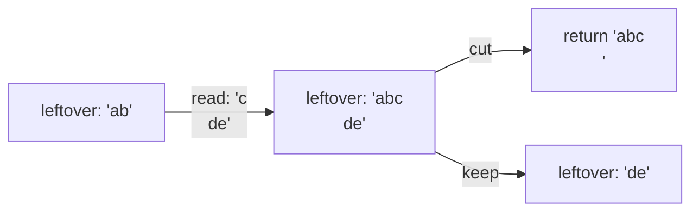

+++
title = "get_next_line: reading a file one line at a time"
description = "A static leftover buffer, read() in fixed-size chunks, and the bookkeeping needed to return exactly one line per call, for one file descriptor or many."
tags = ["42", "c"]
+++

**get_next_line** looks simple: each call returns the next line from a file descriptor, newline
included, and `NULL` at the end. The catch is that `read()` doesn't know about lines. It returns up
to `BUFFER_SIZE` bytes, and that size is chosen at compile time (`-D BUFFER_SIZE=42`) by whoever
grades you. It might be 1, it might be 10 million.

So a single `read()` can return half a line, or three lines and a bit. Whatever we read past the
newline must survive until the next call.

## A static leftover

That is what a `static` local variable is for: it lives for the whole program, but only this
function can see it ([source](https://github.com/PfClaKr/Ecole42Paris_GNL)).

```c
char *get_next_line(int fd)
{
    static char *final_line;   // what's left over from previous reads
    ...
    while (!ft_strchr(final_line, '\n') && len_read > 0)
    {
        len_read = read(fd, buffer, BUFFER_SIZE);
        buffer[len_read] = '\0';
        final_line = ft_strjoin(final_line, buffer);
    }
    result_line = ft_result_line(final_line); // copy up to and including '\n'
    ft_final_line(&final_line);               // keep only what comes after it
    return (result_line);
}
```

Each call does three things:

1. **Fill.** Keep reading and appending until the leftover contains a `\n` or `read()` returns 0.
2. **Cut.** Copy everything up to and including the first `\n` into a new string. That's the line
   we return.
3. **Keep.** Replace the leftover with what comes after the `\n`. At end of file there's nothing
   left, so free it and reset it to `NULL`.



## Many file descriptors at once

The bonus asks for interleaved calls on different fds (`gnl(3)`, `gnl(4)`, `gnl(3)`…) without
mixing them up. One leftover isn't enough anymore, so it becomes an array indexed by fd:

```c
static char *final_line[257];
if (fd < 0 || BUFFER_SIZE <= 0 || fd > 256)
    return (0);
```

Every function then works on `final_line[fd]` instead of a single pointer.

## Where it goes wrong

- **Memory.** Every `strjoin` allocates a new string and frees the old one. Miss one `free` and a
  long file leaks megabytes. Forget the reset to `NULL` and the next file starts with garbage.
- **Extreme buffer sizes.** With `BUFFER_SIZE=1` it's one syscall per byte: slow but correct. With
  a huge value, the buffer must be allocated on the heap, because it won't fit on the stack.
- **The last line.** A file that doesn't end with `\n` still has a last line, and it must be
  returned without one.

It's a small function, but it's the first time a 42 project makes you think about **state that
outlives a call** and who owns each allocation. The same pattern comes back in every parser
afterwards.
