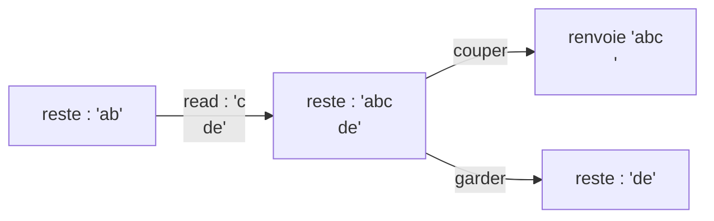

+++
title = "get_next_line : lire un fichier ligne par ligne"
description = "Un reste statique, des read() par blocs de taille fixe, et la comptabilité nécessaire pour renvoyer exactement une ligne par appel, sur un ou plusieurs descripteurs de fichier."
tags = ["42", "c"]
+++

**get_next_line** a l'air simple : chaque appel renvoie la ligne suivante d'un descripteur de
fichier, saut de ligne compris, et `NULL` à la fin. Le piège, c'est que `read()` ne connaît pas les
lignes. Il renvoie au plus `BUFFER_SIZE` octets, et cette taille est fixée à la compilation
(`-D BUFFER_SIZE=42`) par la personne qui vous évalue. Ça peut être 1, ça peut être 10 millions.

Un seul `read()` peut donc renvoyer une demi-ligne, ou trois lignes et un bout. Tout ce qu'on a lu
après le saut de ligne doit survivre jusqu'à l'appel suivant.

## Un reste statique

C'est exactement le rôle d'une variable locale `static` : elle vit pendant tout le programme, mais
seule cette fonction la voit ([source](https://github.com/PfClaKr/Ecole42Paris_GNL)).

```c
char *get_next_line(int fd)
{
    static char *final_line;   // ce qui reste des lectures précédentes
    ...
    while (!ft_strchr(final_line, '\n') && len_read > 0)
    {
        len_read = read(fd, buffer, BUFFER_SIZE);
        buffer[len_read] = '\0';
        final_line = ft_strjoin(final_line, buffer);
    }
    result_line = ft_result_line(final_line); // copie jusqu'au '\n' inclus
    ft_final_line(&final_line);               // ne garde que ce qui suit
    return (result_line);
}
```

Chaque appel fait trois choses :

1. **Remplir.** Lire et concaténer tant que le reste ne contient pas de `\n` et que `read()` ne
   renvoie pas 0.
2. **Couper.** Copier tout ce qui précède le premier `\n`, inclus, dans une nouvelle chaîne. C'est
   la ligne qu'on renvoie.
3. **Garder.** Remplacer le reste par ce qui suit le `\n`. En fin de fichier, il ne reste rien : on
   le libère et on le remet à `NULL`.



## Plusieurs descripteurs à la fois

Le bonus demande des appels entrelacés sur différents fd (`gnl(3)`, `gnl(4)`, `gnl(3)`…) sans les
mélanger. Un seul reste ne suffit plus, il devient donc un tableau indexé par le fd :

```c
static char *final_line[257];
if (fd < 0 || BUFFER_SIZE <= 0 || fd > 256)
    return (0);
```

Toutes les fonctions travaillent ensuite sur `final_line[fd]` au lieu d'un pointeur unique.

## Là où ça casse

- **La mémoire.** Chaque `strjoin` alloue une nouvelle chaîne et libère l'ancienne. Un `free`
  oublié, et un long fichier fuit des mégaoctets. Un oubli de remise à `NULL`, et le fichier
  suivant commence avec des déchets.
- **Les tailles de buffer extrêmes.** Avec `BUFFER_SIZE=1`, c'est un appel système par octet :
  lent mais correct. Avec une valeur énorme, le buffer doit être alloué sur le tas, parce qu'il ne
  tient pas sur la pile.
- **La dernière ligne.** Un fichier qui ne se termine pas par `\n` a quand même une dernière
  ligne, et il faut la renvoyer sans saut de ligne.

C'est une petite fonction, mais c'est la première fois qu'un projet de 42 oblige à penser à un
**état qui survit à l'appel** et à qui possède chaque allocation. Le même schéma revient ensuite
dans tous les parseurs.
