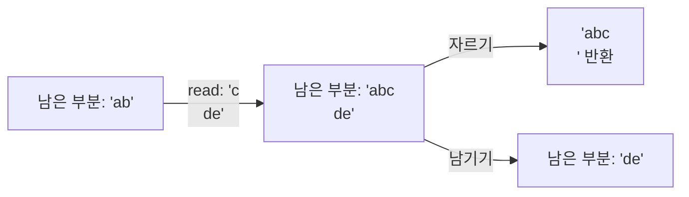

+++
title = "get_next_line: 파일을 한 줄씩 읽기"
description = "정적 변수에 남겨 둔 나머지, 고정 크기로 끊어 읽는 read(), 그리고 파일 디스크립터가 하나든 여럿이든 호출마다 정확히 한 줄을 돌려주기 위한 관리."
tags = ["42", "c"]
+++

**get_next_line**은 간단해 보입니다. 호출할 때마다 파일 디스크립터에서 다음 줄을 개행 문자까지 포함해
돌려주고, 끝나면 `NULL`을 돌려줍니다. 문제는 `read()`가 줄이라는 개념을 모른다는 점입니다. 최대
`BUFFER_SIZE`바이트를 돌려줄 뿐이고, 이 크기는 평가자가 컴파일할 때(`-D BUFFER_SIZE=42`) 정합니다.
1일 수도 있고 1000만일 수도 있습니다.

그래서 `read()` 한 번에 반 줄이 올 수도, 세 줄하고 조금이 올 수도 있습니다. 개행 뒤로 더 읽은 부분은
다음 호출까지 살아남아야 합니다.

## 정적 변수에 남겨 두기

`static` 지역 변수가 바로 이런 용도입니다. 프로그램이 끝날 때까지 살아 있지만, 이 함수 안에서만
보입니다([소스](https://github.com/PfClaKr/Ecole42Paris_GNL)).

```c
char *get_next_line(int fd)
{
    static char *final_line;   // 이전에 읽고 남은 부분
    ...
    while (!ft_strchr(final_line, '\n') && len_read > 0)
    {
        len_read = read(fd, buffer, BUFFER_SIZE);
        buffer[len_read] = '\0';
        final_line = ft_strjoin(final_line, buffer);
    }
    result_line = ft_result_line(final_line); // '\n'까지 포함해 복사
    ft_final_line(&final_line);               // 그 뒤만 남김
    return (result_line);
}
```

호출 한 번은 세 단계로 이루어집니다.

1. **채우기.** 남은 부분에 `\n`이 생기거나 `read()`가 0을 돌려줄 때까지 계속 읽어서 이어 붙입니다.
2. **자르기.** 첫 `\n`까지(포함) 새 문자열로 복사합니다. 이게 돌려줄 줄입니다.
3. **남기기.** 남은 부분을 `\n` 뒤의 내용으로 바꿉니다. 파일 끝이라 남은 게 없으면 해제하고 `NULL`로
   되돌립니다.



## 여러 파일 디스크립터 동시에

보너스는 서로 다른 fd에 번갈아 호출해도(`gnl(3)`, `gnl(4)`, `gnl(3)`…) 섞이지 않기를 요구합니다.
남은 부분 하나로는 부족하니, fd를 인덱스로 쓰는 배열로 바꿉니다.

```c
static char *final_line[257];
if (fd < 0 || BUFFER_SIZE <= 0 || fd > 256)
    return (0);
```

이후 모든 함수는 포인터 하나 대신 `final_line[fd]`를 다룹니다.

## 틀리기 쉬운 곳

- **메모리.** `strjoin`은 매번 새 문자열을 할당하고 이전 것을 해제합니다. `free` 하나만 빠져도 긴
  파일에서 메가바이트 단위로 샙니다. `NULL`로 되돌리는 걸 잊으면 다음 파일이 쓰레기 값으로 시작합니다.
- **극단적인 버퍼 크기.** `BUFFER_SIZE=1`이면 바이트마다 시스템 콜이 한 번씩 일어납니다. 느리지만
  맞습니다. 값이 아주 크면 스택에 들어가지 않으니 버퍼를 힙에 할당해야 합니다.
- **마지막 줄.** `\n`으로 끝나지 않는 파일에도 마지막 줄은 있고, 개행 없이 그대로 돌려줘야 합니다.

작은 함수지만, 42 과제 중 처음으로 **호출이 끝나도 살아남는 상태**와 각 할당의 주인이 누구인지를
고민하게 만드는 과제입니다. 같은 패턴이 이후의 모든 파서에서 다시 등장합니다.
