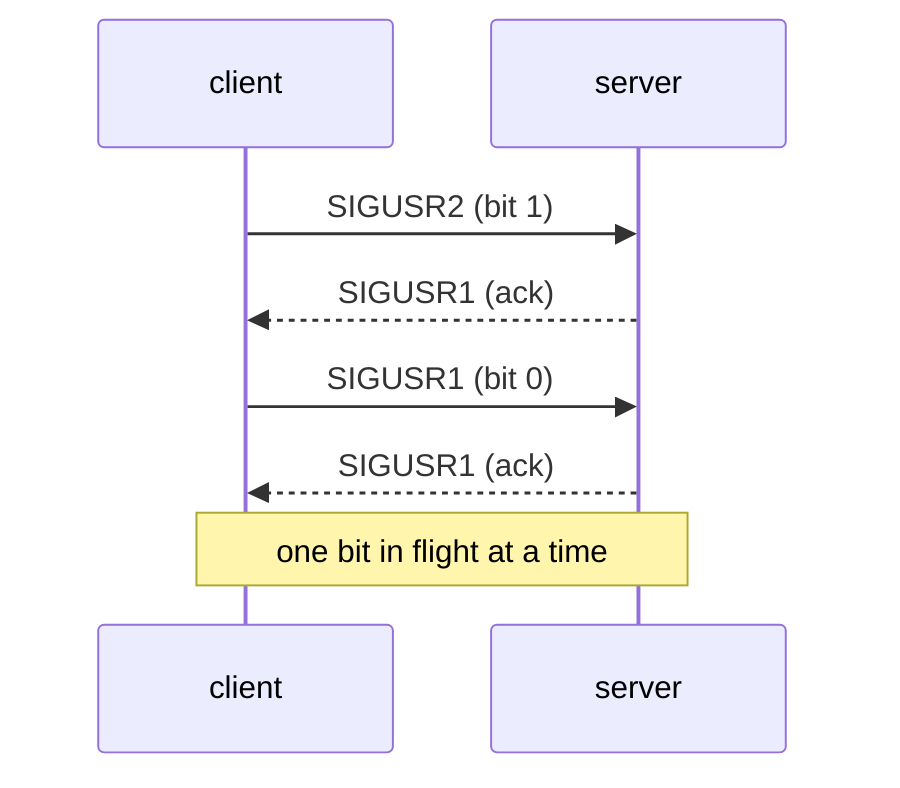

+++
title = "minitalk: sending text one signal at a time"
description = "A client and a server that talk using only SIGUSR1 and SIGUSR2: encoding bytes as bits, why signals get lost, and the acknowledgement that fixes it."
tags = ["42", "c", "unix"]
+++

**minitalk** is a tiny client/server pair with one constraint: the only way the client may talk to
the server is with two signals, `SIGUSR1` and `SIGUSR2`. No pipes, no sockets, no files. The server
prints its PID, and `./client <pid> "hello"` must make it print `hello`
([source](https://github.com/PfClaKr/Ecole42Paris_Minitalk)).

Two signals means two symbols, so the message goes out as bits: `SIGUSR1` for 0, `SIGUSR2` for 1,
eight signals per byte, most significant bit first.

## The server: rebuilding bytes

The handler shifts each incoming bit into an accumulator and writes a byte every eight signals. The
state has to be `static`, because a signal handler has no other place to keep it between calls.

```c
static void bit_to_str(int sig, siginfo_t *info, void *context)
{
    static int data;
    static int cnt;

    cnt++;
    data <<= 1;
    if (sig == SIGUSR2)
        data += 1;
    if (cnt == 8)
    {
        write(1, &data, 1);
        data = 0;
        cnt = 0;
    }
    kill(info->si_pid, SIGUSR1);   // acknowledge: "got it, send the next bit"
}
```

It's installed with `sigaction` and `SA_SIGINFO` instead of `signal()`, because that's the only way
to learn **who** sent the signal (`info->si_pid`), and the server needs it to answer.

## Why signals get lost

The naive client fires eight `kill()` calls per byte as fast as it can. It works for "hello" and
then garbles a long message. The reason: standard signals **don't queue**. While a signal is pending,
sending the same one again is merged into a single delivery. If the client sends `SIGUSR1` twice
before the server has run its handler once, the server sees one 0 instead of two, and every byte
after it is shifted.

`usleep(100)` between bits hides the problem on an idle machine and fails under load. The real fix
is to stop guessing:



## The client: wait for the ack

The client sends one bit, then waits until the server's acknowledgement flips a flag:

```c
while (cnt >= 0)
{
    if ((ch >> cnt & 1) == 0)
        kill(pid, SIGUSR1);
    else
        kill(pid, SIGUSR2);
    while (g_cnt == 0)      // set to 1 by the SIGUSR1 handler
        usleep(1);
    g_cnt = 0;
    cnt--;
}
```

With only one bit in flight, nothing can be merged. Before sending the message, the client also
sends eight zero bits as a handshake: if `kill()` fails or no ack comes back, the PID is wrong and it
stops right there.

## What I'd change today

- The flag shared with the handler should be `volatile sig_atomic_t`, not a plain `int`. Without
  `volatile` the compiler may hoist the read out of the loop and spin forever.
- `write()` is async-signal-safe; `printf` and `malloc` aren't. Keeping the handler to `write` and
  `kill` was the right call, even if I didn't know the word for it then.

minitalk is a toy, but it's a clean introduction to asynchronous events, and to the fact that "I
sent it" and "it was received" are two different things. That lesson comes back with every network
protocol.
