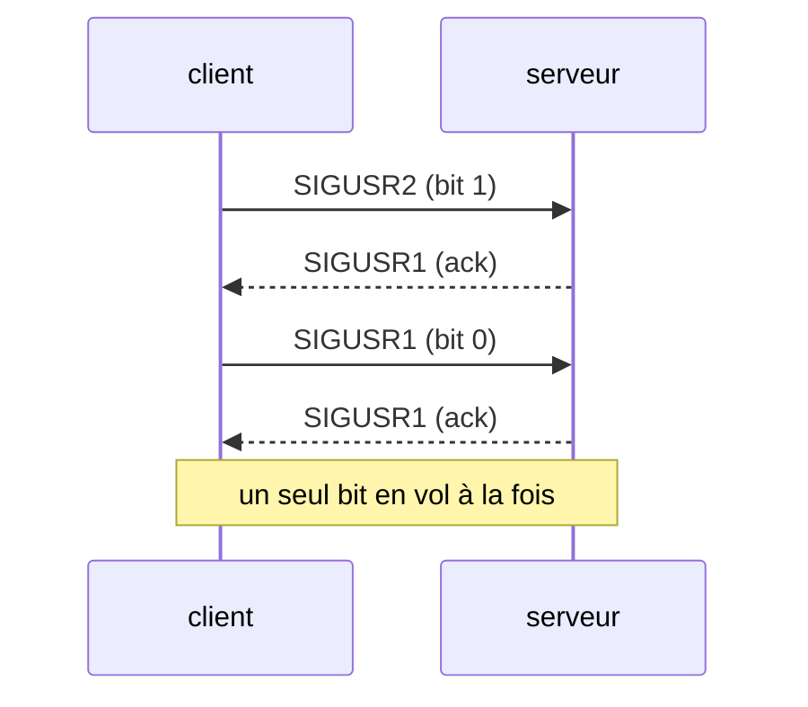

+++
title = "minitalk : envoyer du texte un signal à la fois"
description = "Un client et un serveur qui ne communiquent qu'avec SIGUSR1 et SIGUSR2 : coder les octets en bits, pourquoi des signaux se perdent, et l'accusé de réception qui règle le problème."
tags = ["42", "c", "unix"]
+++

**minitalk**, c'est un petit couple client/serveur avec une contrainte : le client ne peut parler au
serveur qu'avec deux signaux, `SIGUSR1` et `SIGUSR2`. Pas de pipe, pas de socket, pas de fichier. Le
serveur affiche son PID, et `./client <pid> "hello"` doit lui faire afficher `hello`
([source](https://github.com/PfClaKr/Ecole42Paris_Minitalk)).

Deux signaux, deux symboles : le message part donc en bits, `SIGUSR1` pour 0, `SIGUSR2` pour 1, huit
signaux par octet, bit de poids fort en premier.

## Le serveur : reconstruire les octets

Le handler pousse chaque bit reçu dans un accumulateur et écrit un octet tous les huit signaux. L'état
doit être `static`, parce qu'un handler de signal n'a pas d'autre endroit où le garder entre deux
appels.

```c
static void bit_to_str(int sig, siginfo_t *info, void *context)
{
    static int data;
    static int cnt;

    cnt++;
    data <<= 1;
    if (sig == SIGUSR2)
        data += 1;
    if (cnt == 8)
    {
        write(1, &data, 1);
        data = 0;
        cnt = 0;
    }
    kill(info->si_pid, SIGUSR1);   // accusé de réception : « reçu, envoie le bit suivant »
}
```

Il est installé avec `sigaction` et `SA_SIGINFO` plutôt qu'avec `signal()`, parce que c'est le seul
moyen de savoir **qui** a envoyé le signal (`info->si_pid`), et le serveur en a besoin pour répondre.

## Pourquoi des signaux se perdent

Le client naïf enchaîne huit `kill()` par octet le plus vite possible. Ça marche pour « hello », puis
ça brouille un long message. La raison : les signaux standards **ne sont pas mis en file**. Tant
qu'un signal est en attente, renvoyer le même est fusionné en une seule livraison. Si le client envoie
deux `SIGUSR1` avant que le serveur ait exécuté son handler une fois, le serveur voit un seul 0 au lieu
de deux, et tous les octets suivants sont décalés.

Un `usleep(100)` entre les bits masque le problème sur une machine au repos et échoue sous charge. La
vraie solution, c'est d'arrêter de deviner :



## Le client : attendre l'accusé de réception

Le client envoie un bit, puis attend que l'accusé de réception du serveur lève un drapeau :

```c
while (cnt >= 0)
{
    if ((ch >> cnt & 1) == 0)
        kill(pid, SIGUSR1);
    else
        kill(pid, SIGUSR2);
    while (g_cnt == 0)      // mis à 1 par le handler de SIGUSR1
        usleep(1);
    g_cnt = 0;
    cnt--;
}
```

Avec un seul bit en vol, rien ne peut être fusionné. Avant le message, le client envoie aussi huit
bits à zéro en guise de poignée de main : si `kill()` échoue ou qu'aucun accusé ne revient, le PID est
mauvais et il s'arrête là.

## Ce que je changerais aujourd'hui

- Le drapeau partagé avec le handler devrait être un `volatile sig_atomic_t`, pas un simple `int`.
  Sans `volatile`, le compilateur peut sortir la lecture de la boucle et tourner à l'infini.
- `write()` est async-signal-safe ; `printf` et `malloc` ne le sont pas. Se limiter à `write` et
  `kill` dans le handler était le bon choix, même si je ne connaissais pas encore le terme.

minitalk est un jouet, mais c'est une bonne introduction aux événements asynchrones, et au fait que
« je l'ai envoyé » et « il a été reçu » sont deux choses différentes. La leçon revient avec chaque
protocole réseau.
