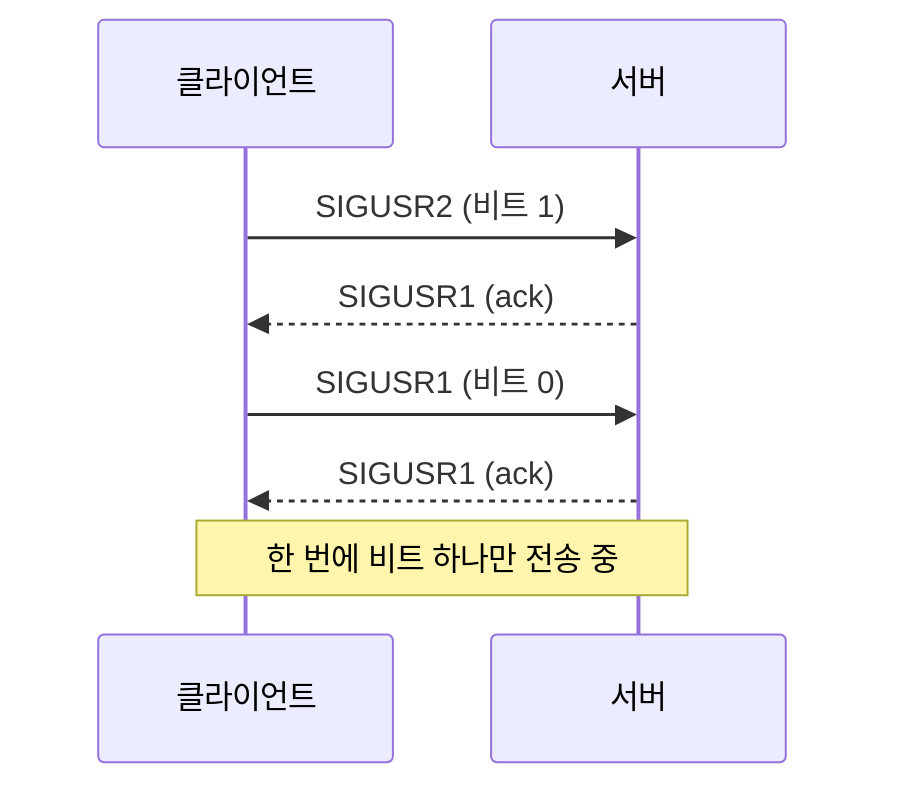

+++
title = "minitalk: 시그널 하나씩으로 문자열 보내기"
description = "SIGUSR1과 SIGUSR2만으로 대화하는 클라이언트와 서버: 바이트를 비트로 나누기, 시그널이 사라지는 이유, 그리고 이를 해결하는 확인 응답."
tags = ["42", "c", "unix"]
+++

**minitalk**는 제약이 하나 있는 작은 클라이언트/서버입니다. 클라이언트가 서버에 말을 거는 방법은
`SIGUSR1`과 `SIGUSR2` 두 시그널뿐입니다. 파이프도, 소켓도, 파일도 안 됩니다. 서버가 자기 PID를
출력하면, `./client <pid> "hello"`로 서버가 `hello`를 출력하게 만들어야 합니다
([소스](https://github.com/PfClaKr/Ecole42Paris_Minitalk)).

시그널이 두 개면 기호도 두 개이니, 메시지는 비트로 보냅니다. `SIGUSR1`은 0, `SIGUSR2`는 1, 바이트마다
시그널 8개, 최상위 비트부터.

## 서버: 바이트 다시 조립하기

핸들러는 들어오는 비트를 누산기에 밀어 넣고, 시그널 8개마다 한 바이트를 씁니다. 시그널 핸들러는 호출
사이에 상태를 둘 곳이 따로 없으니 `static`이어야 합니다.

```c
static void bit_to_str(int sig, siginfo_t *info, void *context)
{
    static int data;
    static int cnt;

    cnt++;
    data <<= 1;
    if (sig == SIGUSR2)
        data += 1;
    if (cnt == 8)
    {
        write(1, &data, 1);
        data = 0;
        cnt = 0;
    }
    kill(info->si_pid, SIGUSR1);   // 확인 응답: "받았으니 다음 비트 보내"
}
```

`signal()` 대신 `sigaction`과 `SA_SIGINFO`로 등록하는데, 그래야 **누가** 시그널을 보냈는지
(`info->si_pid`) 알 수 있고, 서버는 답장을 보내려면 이 값이 필요합니다.

## 시그널이 사라지는 이유

순진한 클라이언트는 바이트마다 `kill()`을 8번 최대한 빠르게 보냅니다. "hello"는 되는데 긴 메시지는
깨집니다. 이유는 표준 시그널이 **큐에 쌓이지 않기** 때문입니다. 시그널이 대기 중일 때 같은 시그널을
또 보내면 한 번으로 합쳐집니다. 서버가 핸들러를 한 번 실행하기 전에 클라이언트가 `SIGUSR1`을 두 번
보내면 서버는 0을 두 개가 아니라 하나만 보고, 그 뒤의 모든 바이트가 밀립니다.

비트 사이에 `usleep(100)`을 넣으면 한가한 머신에서는 문제가 가려지지만, 부하가 걸리면 실패합니다.
진짜 해결책은 추측을 그만두는 것입니다.



## 클라이언트: ack 기다리기

클라이언트는 비트 하나를 보내고, 서버의 확인 응답이 플래그를 바꿀 때까지 기다립니다.

```c
while (cnt >= 0)
{
    if ((ch >> cnt & 1) == 0)
        kill(pid, SIGUSR1);
    else
        kill(pid, SIGUSR2);
    while (g_cnt == 0)      // SIGUSR1 핸들러가 1로 바꿈
        usleep(1);
    g_cnt = 0;
    cnt--;
}
```

전송 중인 비트가 하나뿐이니 합쳐질 일이 없습니다. 메시지를 보내기 전에는 핸드셰이크로 0 비트 8개를
먼저 보냅니다. `kill()`이 실패하거나 ack가 돌아오지 않으면 PID가 틀린 것이니 거기서 멈춥니다.

## 지금이라면 바꿀 것

- 핸들러와 공유하는 플래그는 그냥 `int`가 아니라 `volatile sig_atomic_t`여야 합니다. `volatile`이
  없으면 컴파일러가 읽기를 반복문 밖으로 빼서 영원히 돌 수도 있습니다.
- `write()`는 async-signal-safe이지만 `printf`와 `malloc`은 아닙니다. 그때는 용어를 몰랐지만,
  핸들러에서 `write`와 `kill`만 쓴 건 옳은 선택이었습니다.

minitalk는 장난감 같은 과제지만, 비동기 이벤트를 깔끔하게 처음 접하게 해 주고, "보냈다"와 "받았다"는
다르다는 걸 알려 줍니다. 이 교훈은 모든 네트워크 프로토콜에서 다시 나옵니다.
