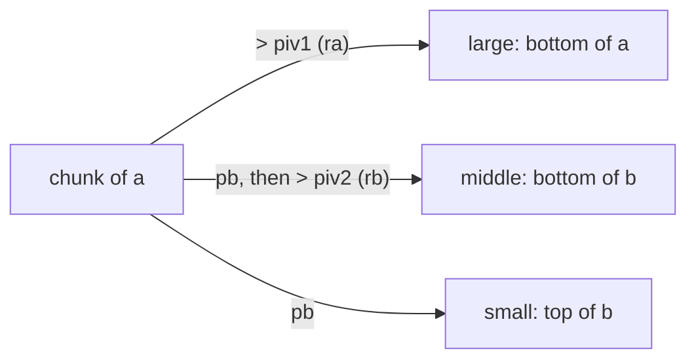

+++
title = "push_swap: sorting with two stacks and eleven moves"
description = "Sorting integers using only push, swap and rotate on two stacks: a recursive quicksort that splits around two pivots, and the tricks that save operations."
tags = ["42", "c", "algorithms"]
+++

**push_swap** gives you a list of integers on stack `a`, an empty stack `b`, and eleven operations.
The program must print a sequence of operations that leaves `a` sorted, and the grade depends on how
*short* that sequence is ([source](https://github.com/PfClaKr/Ecole42Paris_PushSwap)).

| Op | Effect |
|---|---|
| `sa` `sb` `ss` | swap the top two elements of `a`, `b`, or both |
| `pa` `pb` | move the top of `b` onto `a`, or the top of `a` onto `b` |
| `ra` `rb` `rr` | rotate up: the top element goes to the bottom |
| `rra` `rrb` `rrr` | rotate down: the bottom element goes to the top |

There is no "look at element *i*" and no random access. You can only touch the tops (and, through
rotation, the bottoms). The bonus is a `checker` that reads operations on stdin, applies them, and
prints `OK` or `KO`.

## Stacks as linked lists

Rotations need cheap access to both ends, so each stack is a doubly linked list with a header that
keeps `head`, `tail` and `size`. Every operation is then *O(1)*: `ra` just moves the head node to the
tail.

```c
typedef struct s_dummy
{
    int     size;
    t_node  *head;
    t_node  *tail;
}   t_dummy;
```

## Quicksort with two pivots

The idea is quicksort, but partitioning means physically moving elements between the two stacks.
To get more out of each pass, I split into **three** groups instead of two, using two pivots computed
from the range of the chunk being sorted:

```c
piv1 = (min + max) / 2;     // big ones stay in a
piv2 = (min + piv1) / 2;    // splits what goes to b in two
```

One pass over a chunk of `a` looks at each top element:

```c
if (a->head->value > piv1)
    ra(a);                  // large: rotate it out of the way, stays in a
else
{
    pb(a, b);               // small or middle: push to b
    if (b->head->value > piv2)
        rb(b);              // middle: send to the bottom of b
}                           // small: stays on top of b
```



After the pass, the rotated groups are brought back to the top with reverse rotations, and the
function recurses: `a_to_b` on the large group, `b_to_a` on the two groups now sitting in `b`.
`b_to_a` is the mirror image. It partitions a chunk of `b` and pushes the larger parts back to `a`.
Chunks of five or fewer elements are finished with hand-written sorting routines, because at that
size a fixed sequence beats any partitioning.

## Saving operations

The score is just the operation count, so small tricks matter:

- **Combine moves.** Undoing `ra` and `rb` rotations at the same time with `rrr` costs one operation
  instead of two. The code rewinds `min(ra, rb)` times with `rrr`, then finishes the remainder alone.
- **Skip useless rewinds.** On the very first partition, the "large" group is the only thing left in
  `a`, so rotating it back to the top changes nothing. A counter tracks whether we're still in that
  first call and skips the rewind.
- **Special cases.** 3 elements need at most 2 operations and 5 elements at most 12; both are hard-coded.

## What I'd do differently

The pivots come from `(min + max) / 2`, the middle of the **value range**, not the median. With
evenly spread inputs that's close enough, but a skewed input like `1 2 3 … 99 1000000` puts almost
everything in one group and the recursion degrades. Normalizing the input first (replace each value by
its rank, 0 to *n*−1) fixes this for free: the range midpoint becomes the true median.

push_swap is the first 42 project where "it works" isn't enough: the evaluation runs random inputs
of 100 and 500 numbers and counts the operations, so every idea has to be measured, not guessed.
