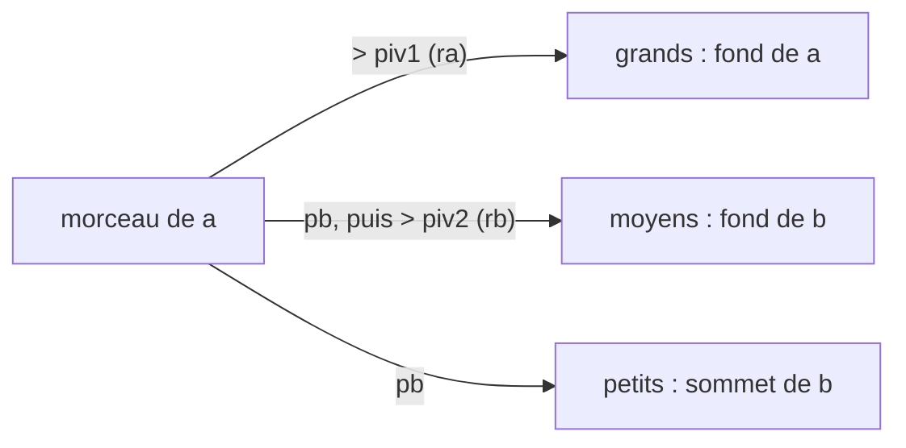

+++
title = "push_swap : trier avec deux piles et onze opérations"
description = "Trier des entiers uniquement avec push, swap et rotate sur deux piles : un quicksort récursif qui découpe autour de deux pivots, et les astuces qui économisent des opérations."
tags = ["42", "c", "algorithms"]
+++

**push_swap** fournit une liste d'entiers dans une pile `a`, une pile `b` vide et onze opérations. Le
programme doit afficher une suite d'opérations qui laisse `a` triée, et la note dépend de la
*brièveté* de cette suite ([source](https://github.com/PfClaKr/Ecole42Paris_PushSwap)).

| Op | Effet |
|---|---|
| `sa` `sb` `ss` | échange les deux éléments du sommet de `a`, de `b`, ou des deux |
| `pa` `pb` | déplace le sommet de `b` sur `a`, ou le sommet de `a` sur `b` |
| `ra` `rb` `rr` | rotation vers le haut : le sommet passe en bas |
| `rra` `rrb` `rrr` | rotation vers le bas : le dernier élément passe au sommet |

Pas de « regarder l'élément *i* », pas d'accès aléatoire. On ne touche que les sommets (et, par
rotation, les fonds). Le bonus est un `checker` qui lit les opérations sur l'entrée standard, les
applique et affiche `OK` ou `KO`.

## Des piles en listes chaînées

Les rotations ont besoin d'un accès bon marché aux deux bouts, donc chaque pile est une liste
doublement chaînée avec un en-tête qui garde `head`, `tail` et `size`. Chaque opération est alors en
*O(1)* : `ra` déplace simplement le nœud de tête en queue.

```c
typedef struct s_dummy
{
    int     size;
    t_node  *head;
    t_node  *tail;
}   t_dummy;
```

## Un quicksort à deux pivots

L'idée est un quicksort, mais partitionner veut dire déplacer physiquement des éléments d'une pile à
l'autre. Pour tirer plus de chaque passe, je découpe en **trois** groupes au lieu de deux, avec deux
pivots calculés à partir de l'intervalle du morceau à trier :

```c
piv1 = (min + max) / 2;     // les grands restent dans a
piv2 = (min + piv1) / 2;    // coupe en deux ce qui part dans b
```

Une passe sur un morceau de `a` examine chaque sommet :

```c
if (a->head->value > piv1)
    ra(a);                  // grand : on le fait tourner, il reste dans a
else
{
    pb(a, b);               // petit ou moyen : poussé dans b
    if (b->head->value > piv2)
        rb(b);              // moyen : envoyé au fond de b
}                           // petit : reste au sommet de b
```



Après la passe, les groupes tournés reviennent au sommet par des rotations inverses, et la fonction
s'appelle récursivement : `a_to_b` sur le groupe des grands, `b_to_a` sur les deux groupes désormais
dans `b`. `b_to_a` est le miroir : il partitionne un morceau de `b` et renvoie les plus grandes parts
dans `a`. Les morceaux de cinq éléments ou moins sont terminés par des tris écrits à la main, parce qu'à
cette taille une séquence fixe bat n'importe quel partitionnement.

## Économiser des opérations

Le score est juste le nombre d'opérations, donc les petites astuces comptent :

- **Combiner les mouvements.** Annuler en même temps des rotations `ra` et `rb` avec `rrr` coûte une
  opération au lieu de deux. Le code rembobine `min(ra, rb)` fois avec `rrr`, puis finit le reste seul.
- **Sauter les rembobinages inutiles.** Lors de la toute première partition, le groupe des grands est
  tout ce qui reste dans `a` : le ramener au sommet ne change rien. Un compteur indique si on est encore
  dans ce premier appel et saute le rembobinage.
- **Cas particuliers.** 3 éléments demandent au plus 2 opérations et 5 éléments au plus 12 ; les deux
  sont codés en dur.

## Ce que je ferais autrement

Les pivots viennent de `(min + max) / 2`, le milieu de **l'intervalle de valeurs**, pas la médiane.
Avec des entrées bien réparties, c'est assez proche, mais une entrée déséquilibrée comme
`1 2 3 … 99 1000000` met presque tout dans un seul groupe et la récursion se dégrade. Normaliser
l'entrée d'abord (remplacer chaque valeur par son rang, de 0 à *n*−1) règle le problème gratuitement :
le milieu de l'intervalle devient la vraie médiane.

push_swap est le premier projet de 42 où « ça marche » ne suffit pas et où il faut mesurer. Écrire un
script qui lançait des entrées aléatoires de 100 et 500 nombres et traçait le nombre d'opérations m'a
plus appris que n'importe quelle optimisation.
