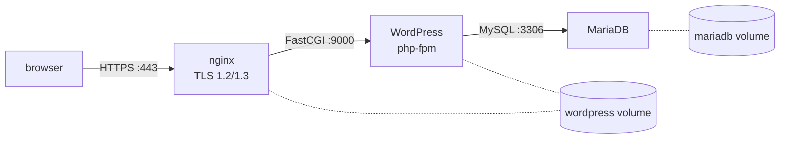

+++
title = "Inception: WordPress in three hand-written containers"
description = "nginx with TLS, WordPress on PHP-FPM, and MariaDB, each built from a bare Debian image with Docker Compose: PID 1, first-run init scripts, FastCGI between containers, and what I'd fix today."
tags = ["42", "docker", "devops"]
+++

**Inception** is 42's introduction to containers. The goal sounds ordinary, a WordPress site over
HTTPS, but the rules make it instructive: every service must run in its **own** container, built from
your own `Dockerfile` on top of a bare Debian or Alpine image. Pulling `wordpress:latest` or
`nginx:latest` from Docker Hub is forbidden. The project got **100/100**
([source](https://github.com/PfClaKr/Ecole42Paris_Inception)).

## The architecture



Only nginx publishes a port to the host, and only 443. WordPress and MariaDB are reachable from the
private `intra` bridge network only. Both volumes are bind-mounted under `/home/<login>/data` on the
host, so the site and the database survive `docker compose down`.

## One process, in the foreground

The first thing Docker teaches is that a container lives exactly as long as its **PID 1**. A
`Dockerfile` ending with `CMD service nginx start` exits immediately: the init script forks nginx into
the background and returns, PID 1 is gone, and the container stops. Every service must run in the
foreground:

```dockerfile
CMD ["nginx", "-g", "daemon off;"]   # nginx
CMD ["php-fpm7.3", "-F"]             # -F: don't daemonize
CMD ["mysqld"]
```

Hacks like `tail -f /dev/null` or `sleep infinity` to keep a container alive are explicitly banned, for
good reason: then Docker supervises `tail`, not your service. If nginx crashes, the container keeps
running and `restart: always` never kicks in.

## First-run initialization

MariaDB and WordPress both need setup the first time they start: create the database and user,
download WordPress, write `wp-config.php`, run the installer. Both containers use the same entrypoint
pattern: start the service temporarily, configure it, stop it, then `exec` the real command.

```bash
#!/bin/bash
service mysql start

echo "CREATE DATABASE IF NOT EXISTS $MARIADB_DATABASE;" | mysql -uroot
echo "CREATE USER IF NOT EXISTS '$MARIADB_USER'@'%' IDENTIFIED BY '$MARIADB_PWD';" | mysql -uroot
echo "GRANT ALL PRIVILEGES ON $MARIADB_DATABASE.* TO '$MARIADB_USER'@'%';" | mysql -uroot

service mysql stop
exec "$@"      # replace the shell with mysqld, which becomes PID 1
```

`exec` matters. Without it, bash stays PID 1, `mysqld` is its child, and `docker stop` sends `SIGTERM`
to bash, which ignores it. Docker waits ten seconds and then kills everything with `SIGKILL`, which
isn't a clean way to stop a database.

The WordPress side uses [WP-CLI](https://wp-cli.org) for a non-interactive install, guarded by
`if [ ! -f wp-config.php ]` so it runs only once. On the next start, the volume already holds an
installed site.

## nginx talks FastCGI

nginx doesn't run PHP. It forwards `.php` requests to php-fpm over FastCGI, across the container
network:

```nginx
server {
    listen 443 ssl;
    ssl_protocols TLSv1.2 TLSv1.3;
    root /var/www/html;

    location ~ \.php$ {
        include snippets/fastcgi-php.conf;
        fastcgi_param SCRIPT_FILENAME /var/www/html/$fastcgi_script_name;
        fastcgi_pass 172.31.0.12:9000;
    }
}
```

That's why the WordPress volume is mounted in **both** containers: nginx serves static files (images,
CSS) directly from it, and php-fpm executes the PHP files from the same path. The TLS certificate is
self-signed with `openssl req -x509` at build time, so the browser warns, which is expected.

## What I'd fix today

Inception passed, but reading it again, a few things stand out:

- **Fixed IPs.** I pinned each container to an address in `172.31.0.0/16`. Compose already gives
  every service a DNS name on its network, so `fastcgi_pass wordpress:9000` is simpler and doesn't
  break when the subnet changes.
- **Secrets in `.env`.** Database and admin passwords sat in a `.env` file committed to the repository.
  Compose `secrets:` mounts them as files under `/run/secrets/` instead, and they stay out of Git and
  out of `docker inspect`.
- **Startup order.** Nothing makes WordPress wait for MariaDB to accept connections. A `healthcheck`
  on MariaDB plus `depends_on: condition: service_healthy` would.
- **Non-idempotent config.** The WordPress entrypoint appends `listen = 0.0.0.0:9000` to the php-fpm
  pool config on **every** start. It works because the last line wins, but the file grows each restart.
  This belongs in the image, at build time.

The main takeaway isn't Docker syntax. A container is a process with a filesystem, and everything,
including signals, PID 1, and init scripts, follows from that.
