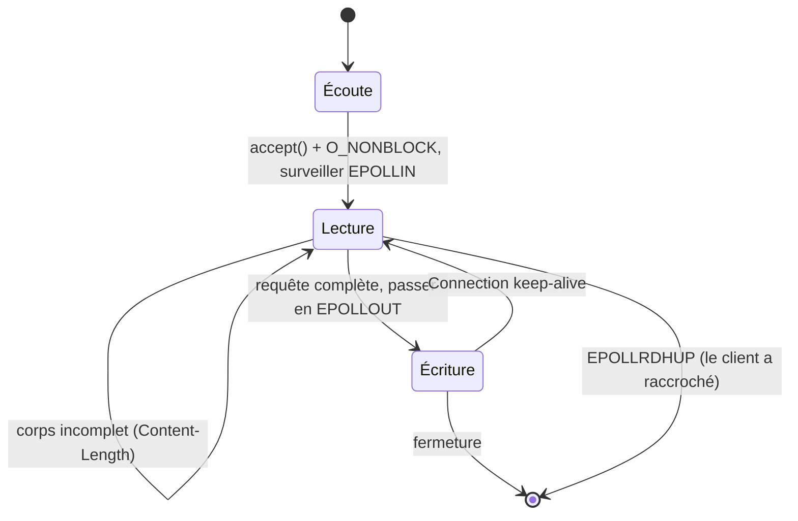

+++
title = "webserv : un serveur HTTP/1.1 sur une seule boucle epoll"
description = "Un serveur web non bloquant en C++98, réalisé en binôme : une configuration à la nginx, une seule boucle epoll pour toutes les sockets, des requêtes qui arrivent par morceaux, le keep-alive, les uploads, et le CGI avec fork et pipes."
tags = ["42", "cpp", "networking"]
+++

**webserv** demande d'écrire en C++98 un serveur HTTP utilisable par un vrai navigateur : fichiers
statiques, listing de répertoires, uploads, `DELETE`, redirections, pages d'erreur personnalisées, CGI
et plusieurs serveurs virtuels depuis un seul fichier de configuration. La contrainte qui façonne tout :
**un seul** appel de type `poll()` pour toutes les E/S, et aucune lecture ou écriture bloquante nulle
part. On l'a réalisé en binôme et obtenu **100/100**
([source](https://github.com/PfClaKr/Ecole42Paris_Webserv)).

## La configuration

Le format emprunte la syntaxe de nginx :

```nginx
http {
    root      www;
    autoindex on;

    server {
        listen               8080;
        host                 127.0.0.1;
        client_max_body_size 8000;
        allow_methods        GET POST DELETE;

        location /cgi-bin {
            cgi_path      www/cgi-bin/php-cgi;
            cgi_extention .php;
        }
        location /redirection/42-intra {
            return https://intra.42.fr/;
        }
    }
}
```

Les directives s'héritent vers le bas : un `root` défini dans `http` s'applique à chaque `server` et
`location` sauf redéfinition. Le parseur construit un arbre de contextes, et pour chaque requête le
serveur cherche le bloc `location` qui correspond au chemin demandé pour connaître sa racine, son
index, ses méthodes autorisées, sa redirection ou son gestionnaire CGI.

## Une boucle pour tout

On est sous Linux, donc le multiplexeur est `epoll`. Chaque socket d'écoute et chaque connexion client
est enregistrée dans une seule instance epoll, et tout le serveur tient en une boucle :

```cpp
while (is_up)
{
    n = epoll_wait(epoll_fd, events, MAX_EVENTS, -1);
    for (int i = 0; i < n; i++)
        handle_epoll_events(events[i].data.fd, &events[i]);
}
```

Chaque descripteur est dans l'un de quelques états, et l'événement dit quoi faire :



Le geste clé, c'est de basculer une connexion entre `EPOLLIN` et `EPOLLOUT` avec `EPOLL_CTL_MOD`. On ne
demande à être réveillé pour écrire qu'une fois une requête complète analysée et une réponse prête.
Sinon `EPOLLOUT` se déclenche en permanence, parce qu'une socket est presque toujours prête en
écriture, et la boucle tourne à 100 % de CPU.

## Les requêtes arrivent par morceaux

TCP est un flux d'octets, pas un flux de messages. Un `recv()` peut renvoyer la moitié des en-têtes, ou
les en-têtes plus une partie d'un upload de 5 Mo. Le serveur doit accumuler jusqu'à savoir que la
requête est complète : les en-têtes se terminent au premier `\r\n\r\n`, et le corps est complet quand
`Content-Length` octets sont arrivés (ou, avec `Transfer-Encoding: chunked`, quand le morceau de taille
zéro arrive).

Notre serveur analyse les en-têtes dès le premier `recv()`, puis garde la connexion en lecture et
ajoute les données de chaque `EPOLLIN` au corps jusqu'à atteindre `Content-Length`. Un corps plus grand
que `client_max_body_size` reçoit un `413 Payload Too Large`.

## CGI

Pour un fichier `.php` dans une location CGI, le serveur lance `php-cgi` comme processus enfant. Le CGI
est un vieux contrat simple : les métadonnées de la requête passent par des **variables
d'environnement** (`REQUEST_METHOD`, `CONTENT_LENGTH`, `QUERY_STRING`, `SCRIPT_FILENAME`…), le corps va
sur le **stdin** du script, et ce qu'il écrit sur **stdout** (en-têtes, ligne vide, puis corps) devient
la réponse.

```cpp
FILE *body = tmpfile();                 // corps → fichier temporaire → stdin de l'enfant
write(fileno(body), request.body.data(), request.body.size());
lseek(fileno(body), 0, SEEK_SET);

pipe(out);
if (fork() == 0)
{
    dup2(fileno(body), STDIN_FILENO);
    dup2(out[1], STDOUT_FILENO);        // stdout de l'enfant → pipe → réponse
    execve(cgi_path, argv, env);
}
```

Écrire le corps dans un fichier temporaire plutôt que dans un pipe évite un interblocage classique. Si
le parent écrivait un gros corps dans un pipe, il bloquerait dès que le tampon de 64 Kio serait plein,
en attendant un enfant qui pourrait lui-même être bloqué en écrivant sa sortie.

## Ce qu'on améliorerait

Le serveur a passé tous les tests d'évaluation, mais en le relisant avec plus d'expérience :

- **L'état par connexion.** Le tampon et le drapeau de « requête partielle » vivent dans l'objet
  `Server`, pas dans une structure par connexion. Deux clients qui uploadent de gros fichiers au même
  moment mélangeraient leurs corps. Tout ce qui concerne une requête en cours doit vivre dans une map
  indexée par descripteur.
- **Le CGI bloque la boucle.** Le parent appelle `waitpid()` puis lit le pipe. Un script lent bloque
  tous les autres clients, et un script qui affiche plus de 64 Kio bloque sur un pipe plein pendant que
  le parent attend qu'il se termine : interblocage. Le pipe devrait être enregistré dans epoll comme
  n'importe quel descripteur, avec un délai qui tue les scripts qui s'emballent.
- **Les en-têtes en une lecture.** On suppose que les en-têtes tiennent dans le premier `recv()` de
  2 Kio. Un client lent, ou une requête avec beaucoup de cookies, casse cette hypothèse.
- **Pas de délai d'inactivité.** Un client qui ouvre une connexion sans rien envoyer garde sa socket
  pour toujours.

webserv, c'est là où « ça marche dans le navigateur » et « c'est correct » se séparent visiblement. Les
navigateurs sont indulgents ; `curl`, `telnet` et un testeur de charge ne le sont pas. Quand ils ne
sont pas d'accord, ce sont les RFC (7230 à 7235 à l'époque, aujourd'hui 9110 et 9112) qui tranchent.
