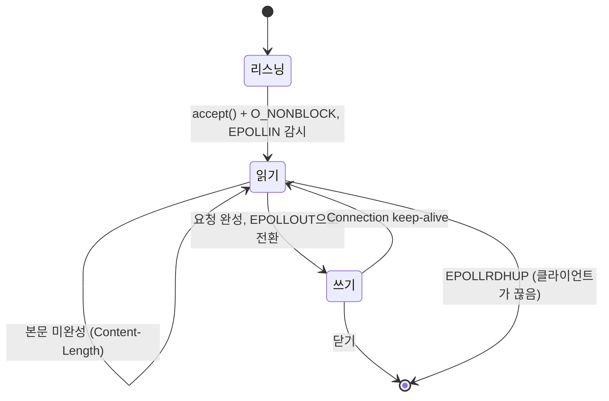

+++
title = "webserv: epoll 루프 하나로 돌아가는 HTTP/1.1 서버"
description = "2인 팀으로 C++98로 만든 논블로킹 웹 서버: nginx 스타일 설정, 모든 소켓을 위한 epoll 루프 하나, 조각나서 도착하는 요청, keep-alive, 업로드, 그리고 fork와 파이프로 구현한 CGI."
tags = ["42", "cpp", "networking"]
+++

**webserv**는 진짜 브라우저가 쓸 수 있는 HTTP 서버를 C++98로 만드는 과제입니다. 정적 파일, 디렉터리
목록, 업로드, `DELETE`, 리다이렉션, 사용자 정의 에러 페이지, CGI, 그리고 설정 파일 하나로 여러 가상
서버를 띄워야 합니다. 모든 걸 결정하는 제약은 이것입니다. 모든 I/O에 `poll()` 계열 호출을 **하나만**
쓰고, 어디에서도 블로킹 읽기나 쓰기를 하면 안 됩니다. 2인 팀으로 만들었고 **100/100**을 받았습니다
([소스](https://github.com/PfClaKr/Ecole42Paris_Webserv)).

## 설정 파일

설정 형식은 nginx 문법을 빌려 왔습니다.

```nginx
http {
    root      www;
    autoindex on;

    server {
        listen               8080;
        host                 127.0.0.1;
        client_max_body_size 8000;
        allow_methods        GET POST DELETE;

        location /cgi-bin {
            cgi_path      www/cgi-bin/php-cgi;
            cgi_extention .php;
        }
        location /redirection/42-intra {
            return https://intra.42.fr/;
        }
    }
}
```

지시어는 아래로 상속됩니다. `http`에서 정한 `root`는 덮어쓰지 않는 한 모든 `server`와 `location`에
적용됩니다. 파서는 컨텍스트 트리를 만들고, 서버는 요청마다 요청 경로에 맞는 `location` 블록을 찾아
루트, 인덱스, 허용 메서드, 리다이렉션, CGI 핸들러를 정합니다.

## 모든 걸 처리하는 루프 하나

리눅스이니 멀티플렉서는 `epoll`입니다. 모든 리스닝 소켓과 클라이언트 연결을 epoll 인스턴스 하나에
등록하고, 서버 전체가 루프 하나입니다.

```cpp
while (is_up)
{
    n = epoll_wait(epoll_fd, events, MAX_EVENTS, -1);
    for (int i = 0; i < n; i++)
        handle_epoll_events(events[i].data.fd, &events[i]);
}
```

파일 디스크립터마다 몇 가지 상태 중 하나에 있고, 이벤트가 할 일을 알려 줍니다.



핵심은 `EPOLL_CTL_MOD`로 연결을 `EPOLLIN`과 `EPOLLOUT` 사이에서 전환하는 것입니다. 요청을 다 파싱하고
응답이 준비된 뒤에야 쓰기 이벤트로 깨워 달라고 합니다. 그러지 않으면 소켓은 거의 항상 쓰기 가능하니
`EPOLLOUT`이 계속 발생하고, 루프가 CPU를 100% 씁니다.

## 요청은 조각나서 도착한다

TCP는 메시지 스트림이 아니라 바이트 스트림입니다. `recv()` 한 번에 헤더 절반이 올 수도 있고, 헤더와
5 MB 업로드의 일부가 같이 올 수도 있습니다. 서버는 요청이 끝났다는 걸 알 때까지 버퍼에 모아야 합니다.
헤더는 첫 `\r\n\r\n`에서 끝나고, 본문은 `Content-Length`만큼 바이트가 도착하면(`Transfer-Encoding:
chunked`라면 길이 0인 청크가 도착하면) 끝납니다.

저희 서버는 첫 `recv()`에서 헤더를 파싱한 뒤, 연결을 읽기 상태로 두고 `EPOLLIN`마다 받은 데이터를
본문에 이어 붙여 `Content-Length`에 도달할 때까지 기다립니다. `client_max_body_size`보다 큰 본문에는
`413 Payload Too Large`로 답합니다.

## CGI

CGI location 아래의 `.php` 파일이면 서버는 `php-cgi`를 자식 프로세스로 실행합니다. CGI는 오래되고 단순한
약속입니다. 요청 메타데이터는 **환경 변수**(`REQUEST_METHOD`, `CONTENT_LENGTH`, `QUERY_STRING`,
`SCRIPT_FILENAME`…)로, 본문은 스크립트의 **stdin**으로 넘기고, 스크립트가 **stdout**에 쓴 것(헤더, 빈
줄, 본문)이 응답이 됩니다.

```cpp
FILE *body = tmpfile();                 // 요청 본문 → 임시 파일 → 자식의 stdin
write(fileno(body), request.body.data(), request.body.size());
lseek(fileno(body), 0, SEEK_SET);

pipe(out);
if (fork() == 0)
{
    dup2(fileno(body), STDIN_FILENO);
    dup2(out[1], STDOUT_FILENO);        // 자식의 stdout → 파이프 → 응답
    execve(cgi_path, argv, env);
}
```

본문을 파이프 대신 임시 파일에 쓰면 고전적인 교착 상태를 피할 수 있습니다. 부모가 큰 본문을 파이프에
쓰면 64 KiB 파이프 버퍼가 차는 순간 막히고, 자식은 자기 출력을 쓰느라 막혀 있을 수 있습니다.

## 개선할 점

서버는 평가 테스트를 모두 통과했지만, 경험이 쌓인 지금 다시 읽어 보면:

- **연결별 상태.** "부분 요청" 버퍼와 플래그가 연결별 구조체가 아니라 `Server` 객체에 있습니다. 두
  클라이언트가 동시에 큰 파일을 올리면 본문이 섞입니다. 진행 중인 요청에 관한 모든 것은 파일 디스크립터를
  키로 하는 맵에 있어야 합니다.
- **CGI가 루프를 막는다.** 부모는 `waitpid()`를 부른 뒤 파이프를 읽습니다. 느린 스크립트는 다른 모든
  클라이언트를 멈추고, 64 KiB 넘게 출력하는 스크립트는 꽉 찬 파이프에서 막히는데 부모는 그 스크립트가
  끝나기만 기다립니다. 교착 상태입니다. 파이프도 다른 fd처럼 epoll에 등록하고, 폭주하는 스크립트를 죽이는
  타임아웃을 둬야 합니다.
- **헤더를 한 번에 읽는다는 가정.** 헤더가 첫 2 KiB `recv()`에 다 들어온다고 가정합니다. 느린
  클라이언트나 쿠키가 많은 요청이면 이 가정이 깨집니다.
- **유휴 타임아웃 없음.** 연결만 열고 아무것도 보내지 않는 클라이언트가 소켓을 영원히 붙잡고 있습니다.

webserv는 "브라우저에서 된다"와 "올바르다"가 눈에 보이게 갈라지는 과제입니다. 브라우저는 관대하지만
`curl`, `telnet`, 부하 테스터는 그렇지 않습니다. 둘이 엇갈리면 RFC(당시에는 7230~7235, 지금은 9110과
9112)가 심판입니다.
