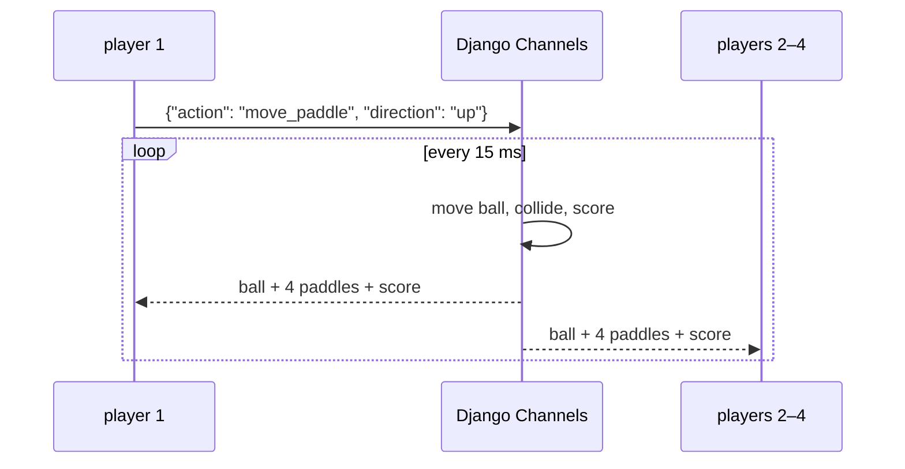

+++
title = "ft_transcendence: server-side Pong for four players"
description = "The last common-core project, built as a team of three: a 2-vs-2 Pong whose game loop runs on the server with Django Channels, row locks against races, reconnection, 42 OAuth with JWT, and ELK logging (125/100)."
tags = ["42", "python", "web"]
+++

**ft_transcendence** closes the 42 common core: a single-page web app around a game of Pong, with
modules to pick from (backend framework, OAuth, remote players, 3D, log management, and more). We were
a team of three, chose 9.5 modules, and finished at **125/100**
([source](https://github.com/sleepychloe/ft_transcendance)).

| Area | What we built |
|---|---|
| Backend | Django, with Channels for WebSockets, and PostgreSQL |
| Frontend | vanilla JS + Bootstrap, a 3D mode with Three.js, three languages |
| Game | local 1v1, local 3D, tournaments, and **remote 2v2 multiplayer on the server** |
| Auth | 42 OAuth, sessions as JWT in a cookie |
| DevOps | nginx in front, ELK stack (Elasticsearch, Logstash, Kibana) for logs |

My part was mostly the backend: the multiplayer game server, authentication, and the logging
pipeline. That's what this post is about.

## Why the server runs the game

In the first version of Pong, each browser simulates the ball itself. With remote players, that falls
apart: two clients drift out of sync after a few bounces, and anyone with the devtools open can move
the ball. The "Server-Side Pong" module fixes this by making the server **authoritative**. Clients
send only their inputs, the server runs the physics, and everyone draws the same state.



## A room is a channel group

Each WebSocket connection gets a Channels **consumer**. Every consumer in the same game joins a group
named after the room, so one `group_send` reaches all four players:

```python
await self.channel_layer.group_add(self.game_id, self.channel_name)
...
await self.channel_layer.group_send(self.game_id, {
    'type': 'game_status',      # calls game_status() on every consumer in the group
    'action': 'update',
    'data': state,
})
```

When the fourth player clicks "ready", that player's consumer starts the game loop as an `asyncio`
task. It moves the ball, checks collisions against the four paddles (two per side), handles scoring,
and broadcasts the new state roughly 66 times a second:

```python
async def ball_move_thread(self):
    while self.game_data.GameStatus:
        self.ball['x'] += self.vx
        self.ball['y'] += self.vy
        await self.paddle_ball_collision()
        ...
        await self.channel_layer.group_send(self.game_id, {...})
        await asyncio.sleep(0.015)
        await self.get_game_data()     # refresh paddles and status
```

## Races between four consumers

Four consumers update the same room at the same time: joining, toggling "ready", moving paddles,
disconnecting. Without locking, two players clicking "ready" at the same moment can both read
`QuantityPlayerReady = 2`, both write 3, and the game never starts. The fix was to make every update
a **read-modify-write inside a transaction with a row lock**:

```python
@database_sync_to_async
@transaction.atomic()
def player_ready(self, n_client):
    room = MultiRoomInfo.objects.select_for_update().get(Roomid=self.game_id)
    room.QuantityPlayerReady += 1          # nobody else can touch this row until commit
    getattr(room, n_client)['ready_status'] = 'ready'
    room.save()
```

`select_for_update()` becomes `SELECT … FOR UPDATE` in PostgreSQL, which makes the second transaction
wait until the first commits. `database_sync_to_async` runs the blocking ORM call in a thread so the
async consumer doesn't stall the event loop.

## Reconnecting

Refreshing the page closes the WebSocket. Without care, that ends the game for everyone. Each browser
gets a random `client_id` cookie on first visit, and the room records which `client_id` holds which
paddle. On disconnect during a game, the player is only marked `online: False`. When a socket
reconnects with the same cookie, the consumer finds its slot again, rejoins the group, and takes back
its paddle. The same check stops one browser from joining the same room twice.

## 42 OAuth and JWT

Login goes through the 42 intranet's OAuth2 authorization-code flow: redirect to
`api.intra.42.fr/oauth/authorize`, receive a `code` on the callback, exchange it server-side for an
access token, and fetch the profile from `/v2/me`. Then we issue our own session as a JWT signed with
HS256 and store it in a cookie. A Django middleware decodes it on every request and redirects to the
login page when it's missing or invalid.

## Logs with ELK

nginx access logs go to Logstash, which parses them and ships them to Elasticsearch, and Kibana shows
dashboards on top. The three services talk to each other over TLS with their own certificates, so the
log pipeline is a small piece of infrastructure in its own right, with its own configuration and
failure modes.

## What I'd change

- **Game state lives in the database.** The loop re-reads the room row every 15 ms, so each running
  game costs about 66 queries a second. Keeping the state in memory (or in Redis, which would also
  replace the in-memory channel layer and allow more than one server process) and writing only results
  to PostgreSQL would scale far better.
- **The loop belongs to one player's consumer.** It works, but the game's lifetime is tied to a
  connection. A dedicated worker per room would be cleaner.
- **Collision is checked at discrete steps.** As the ball speeds up, it can jump past a 10-pixel paddle
  in one tick. Sweeping the ball's path between ticks fixes that.

Three people, a dozen technologies, and a deadline: ft_transcendence was as much about splitting work
and agreeing on message formats as about code.
