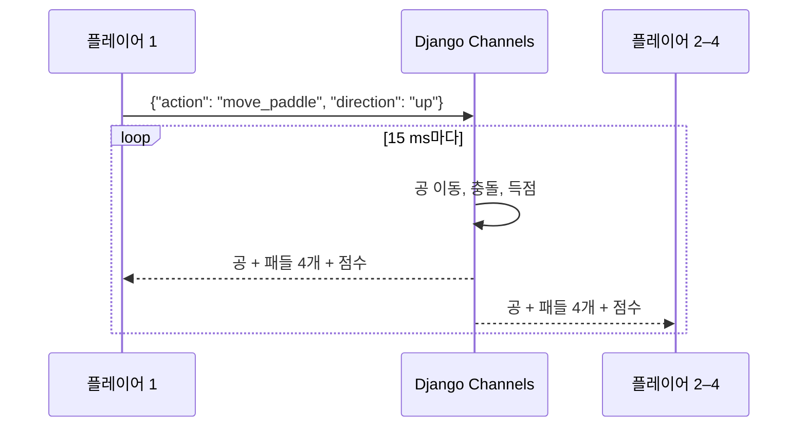

+++
title = "ft_transcendence: 4인용 서버 측 Pong"
description = "3인 팀으로 만든 공통 과정의 마지막 과제: Django Channels로 서버에서 게임 루프를 돌리는 2대2 Pong, 레이스를 막는 행 잠금, 재접속, JWT를 쓰는 42 OAuth, ELK 로깅 (125/100)."
tags = ["42", "python", "web"]
+++

**ft_transcendence**는 42 공통 과정을 마무리하는 과제입니다. Pong 게임을 중심으로 한 싱글 페이지 웹 앱을
만들고, 여러 모듈(백엔드 프레임워크, OAuth, 원격 플레이어, 3D, 로그 관리 등) 중에서 골라 구현합니다.
3인 팀으로 9.5개 모듈을 골랐고 **125/100**으로 마쳤습니다
([소스](https://github.com/sleepychloe/ft_transcendance)).

| 영역 | 만든 것 |
|---|---|
| 백엔드 | Django, WebSocket용 Channels, PostgreSQL |
| 프런트엔드 | 바닐라 JS + Bootstrap, Three.js 3D 모드, 3개 언어 |
| 게임 | 로컬 1대1, 로컬 3D, 토너먼트, 그리고 **서버에서 도는 원격 2대2 멀티플레이** |
| 인증 | 42 OAuth, 쿠키에 담은 JWT 세션 |
| DevOps | 앞단의 nginx, 로그용 ELK 스택 (Elasticsearch, Logstash, Kibana) |

제 몫은 주로 백엔드였습니다. 멀티플레이 게임 서버, 인증, 로그 파이프라인. 이 글은 그 이야기입니다.

## 왜 서버가 게임을 돌리나

Pong의 첫 버전에서는 브라우저마다 공을 직접 시뮬레이션합니다. 원격 플레이어가 생기면 무너집니다. 두
클라이언트는 몇 번 튕기고 나면 어긋나고, 개발자 도구를 연 사람은 누구나 공을 옮길 수 있습니다.
"Server-Side Pong" 모듈은 서버를 **권위자**로 만들어 이를 해결합니다. 클라이언트는 입력만 보내고, 서버가
물리를 계산하고, 모두가 같은 상태를 그립니다.



## 방 하나가 채널 그룹 하나

WebSocket 연결마다 Channels **컨슈머**가 하나씩 붙습니다. 같은 게임의 컨슈머는 모두 방 이름으로 된
그룹에 들어가니, `group_send` 한 번이면 네 명 모두에게 갑니다.

```python
await self.channel_layer.group_add(self.game_id, self.channel_name)
...
await self.channel_layer.group_send(self.game_id, {
    'type': 'game_status',      # 그룹 안 모든 컨슈머의 game_status() 호출
    'action': 'update',
    'data': state,
})
```

네 번째 플레이어가 "준비"를 누르면 그 플레이어의 컨슈머가 게임 루프를 `asyncio` 태스크로 시작합니다.
공을 움직이고, 패들 네 개(한쪽에 두 개씩)와 충돌을 검사하고, 득점을 처리하고, 새 상태를 1초에 약 66번
브로드캐스트합니다.

```python
async def ball_move_thread(self):
    while self.game_data.GameStatus:
        self.ball['x'] += self.vx
        self.ball['y'] += self.vy
        await self.paddle_ball_collision()
        ...
        await self.channel_layer.group_send(self.game_id, {...})
        await asyncio.sleep(0.015)
        await self.get_game_data()     # 패들과 상태 다시 읽기
```

## 컨슈머 네 개 사이의 레이스

컨슈머 네 개가 같은 방을 동시에 바꿉니다. 입장, "준비" 토글, 패들 이동, 연결 끊김. 잠금이 없으면 두
사람이 동시에 "준비"를 눌렀을 때 둘 다 `QuantityPlayerReady = 2`를 읽고 둘 다 3을 써서 게임이 영영
시작되지 않을 수 있습니다. 해결책은 모든 갱신을 **행 잠금을 건 트랜잭션 안의 읽기-수정-쓰기**로 만드는 것이었습니다.

```python
@database_sync_to_async
@transaction.atomic()
def player_ready(self, n_client):
    room = MultiRoomInfo.objects.select_for_update().get(Roomid=self.game_id)
    room.QuantityPlayerReady += 1          # 커밋 전까지 다른 누구도 이 행을 못 건드림
    getattr(room, n_client)['ready_status'] = 'ready'
    room.save()
```

`select_for_update()`는 PostgreSQL에서 `SELECT … FOR UPDATE`가 되고, 두 번째 트랜잭션은 첫 번째가 커밋할
때까지 기다립니다. `database_sync_to_async`는 블로킹 ORM 호출을 스레드에서 실행해서 비동기 컨슈머가
이벤트 루프를 막지 않게 합니다.

## 재접속

페이지를 새로 고치면 WebSocket이 닫힙니다. 신경 쓰지 않으면 모두의 게임이 끝납니다. 브라우저마다 첫
방문 때 무작위 `client_id` 쿠키를 주고, 방에는 어떤 `client_id`가 어떤 패들을 쥐었는지 기록합니다. 게임
중에 연결이 끊기면 그 플레이어를 `online: False`로만 표시합니다. 같은 쿠키로 소켓이 다시 연결되면
컨슈머가 자리를 다시 찾아 그룹에 들어가고 패들을 되찾습니다. 같은 검사로 한 브라우저가 같은 방에 두 번
들어오는 것도 막습니다.

## 42 OAuth와 JWT

로그인은 42 인트라넷의 OAuth2 인가 코드 흐름을 탑니다. `api.intra.42.fr/oauth/authorize`로
리다이렉트하고, 콜백에서 `code`를 받아 서버에서 액세스 토큰으로 바꾸고, `/v2/me`에서 프로필을 가져옵니다.
그다음 HS256으로 서명한 저희만의 JWT 세션을 발급해 쿠키에 넣습니다. Django 미들웨어가 요청마다 이를
디코딩하고, 없거나 유효하지 않으면 로그인 페이지로 보냅니다.

## ELK로 로그 모으기

nginx 접근 로그를 Logstash로 보내 파싱하고 Elasticsearch에 넣고, 그 위에서 Kibana로 대시보드를 봅니다.
세 서비스는 각자의 인증서로 TLS 통신을 하니, 로그 파이프라인은 그 자체로 설정과 장애 지점을 가진 작은
인프라입니다.

## 지금이라면 바꿀 것

- **게임 상태가 데이터베이스에 있다.** 루프가 15 ms마다 방 행을 다시 읽으니, 게임 하나에 초당 약 66번
  쿼리가 나갑니다. 상태는 메모리에(아니면 Redis에. 그러면 인메모리 채널 레이어도 대체해서 서버 프로세스를
  여러 개 띄울 수 있음) 두고 결과만 PostgreSQL에 쓰면 훨씬 잘 확장됩니다.
- **루프가 한 플레이어의 컨슈머에 속해 있다.** 동작은 하지만 게임 수명이 연결 하나에 묶여 있습니다.
  방마다 전용 워커를 두는 게 더 깔끔합니다.
- **충돌을 이산적인 단계마다 검사한다.** 공이 빨라지면 한 틱에 10픽셀 패들을 뛰어넘을 수 있습니다.
  틱 사이의 공 궤적을 쓸어서 검사하면 해결됩니다.

세 사람, 기술 십여 개, 마감. ft_transcendence는 코드만큼이나 일을 나누고 메시지 형식에 합의하는 과제였습니다.
