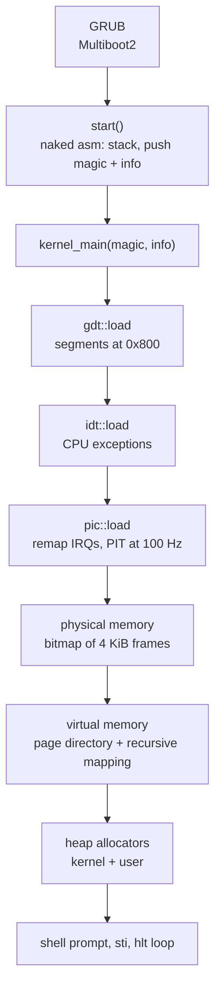

+++
title = "KFS: writing an x86 kernel from scratch in Rust"
description = "From GRUB to a shell prompt: how our 42 KFS kernel boots, sets up the GDT, interrupts and paging, and gets a heap allocator — in no_std Rust."
tags = ["42", "rust", "kernel", "osdev"]
+++

**KFS** (*Kernel From Scratch*) is a four-stage project at École 42. With my teammate
[schaehun](https://profile.intra.42.fr/users/schaehun) we wrote ours in **Rust**, for 32-bit x86,
without the standard library. It boots with GRUB, sets up segmentation and interrupts, manages
physical and virtual memory, provides a heap so `Box` and `Vec` work, and ends at a small shell.

This post follows the path from power-on to the prompt, using the code in the
[repository](https://github.com/PfClaKr/KFS).

## The big picture



We built it in four stages between September and November 2024, each one adding a layer of
this pipeline, starting from "boot and print something on the screen".

## Building a kernel with Cargo

There is no OS underneath, so the compiler needs a custom target. Ours is a JSON file,
`arch-i386/i386-unknown-none.json`:

```json
{
    "arch": "x86",
    "llvm-target": "i386-unknown-none",
    "features": "-mmx,-sse,+soft-float",
    "disable-redzone": true,
    "panic-strategy": "abort",
    "pre-link-args": { "gnu": ["-Tscripts/ld/x86.ld", "-melf_i386"] },
    "target-pointer-width": "32"
}
```

Two settings matter for kernel code:

- **No SSE/MMX, soft floats.** The kernel never saves the FPU/SSE registers when an interrupt
  arrives, so the compiler must not use them behind our back.
- **No red zone.** The System V ABI lets a function use 128 bytes below the stack pointer without
  moving it. An interrupt pushes its frame exactly there and would corrupt that data.

`core` and `alloc` are not shipped for a custom target, so Cargo rebuilds them (nightly only):

```makefile
cargo build -Zbuild-std=core,alloc --release --target=arch-i386/i386-unknown-none.json
```

The linker script loads the kernel at **2 MiB**, puts the `.multiboot` header first, and exports
`kernel_start`, `kernel_end` and `stack_top`. The memory manager reads those symbols later to know
which frames the kernel occupies. Finally, `grub-mkrescue` wraps everything into an ISO that runs
in QEMU (`make run`), or waits for GDB (`make debug-run`).

## Booting: Multiboot2 and a naked entry point

GRUB scans the binary for a Multiboot2 header (magic `0xE85250D6`) placed in the `.multiboot`
section. When it jumps to our entry point, the stack is undefined, so the first function cannot
be ordinary Rust. It is a **naked function**: pure assembly, no prologue.

```rust
#[naked]
#[no_mangle]
pub extern "C" fn start() -> ! {
    unsafe {
        naked_asm!(
            "lea esp, [STACK + 8192]", // our own 8 KiB stack
            "xor ebp, ebp",
            "push ebx",                // physical address of the Multiboot2 info
            "push eax",                // magic value: 0x36d76289
            "call {kernel_main}",
            "call {panic}",
            kernel_main = sym kernel_main,
            panic = sym panic,
        );
    }
}
```

`kernel_main(magic, multiboot_info)` then checks the magic value before doing anything else:

```rust
assert_eq!(magic, 0x36d76289, "System have to load by Multiboot2 boot loader.");
```

## Segmentation: the GDT

Even with a flat memory model, protected mode needs a Global Descriptor Table. Ours has seven
entries, all covering the full 4 GiB: null, kernel code/data/stack (ring 0, access bytes
`0x9A`/`0x93`) and user code/data/stack (ring 3, `0xFA`/`0xF2`). It lives at the fixed physical
address `0x800`.

Loading it takes a little assembly: `lgdt` installs the table, a **far jump** reloads `CS` with
the kernel code selector, and the data segment registers get the data selector:

```rust
asm!(
    "   lgdtl ({})
        ljmp $0x08, $1f
    1:
        movw $0x10, %ax
        movw %ax, %ds
        movw %ax, %es
        movw %ax, %fs
        movw %ax, %gs
        movw %ax, %ss",
    in(reg) &gdtr as *const GdtDescriptor,
    out("ax") _,
    options(att_syntax)
);
```

## Interrupts: IDT, PIC and the timer

The **IDT** maps the CPU exceptions (vectors `0x00`–`0x15`: divide by zero, page fault, general
protection fault…) to handlers that print the interrupt frame and halt. All entries are 32-bit
interrupt gates (`0x8E`) in the kernel code segment.

Hardware interrupts go through the two chained **8259 PICs**. By default they deliver IRQs on
vectors 8–15, which collide with CPU exceptions (8 is a double fault!). So the first job is to
remap them to `0x20`–`0x2F` (simplified from `pic.rs`):

```rust
outb(PIC1_CMD, CMD_INIT);  outb(PIC2_CMD, CMD_INIT);   // ICW1: start init
outb(PIC1_DATA, 0x20);     outb(PIC2_DATA, 0x28);      // ICW2: vector offsets
outb(PIC1_DATA, 4);        outb(PIC2_DATA, 2);         // ICW3: master/slave wiring
outb(PIC1_DATA, MODE_8086); outb(PIC2_DATA, MODE_8086); // ICW4
```

The **PIT** runs at 1,193,182 Hz. Dividing by 11,931 gives a 100 Hz tick, which increments a
counter used by the `uptime` command. IRQ 1 (the keyboard) feeds scancodes to the shell. Every
hardware handler ends by sending *End Of Interrupt* to the PIC.

We wrote the handler stubs ourselves with a `macro_rules!`: push the general-purpose registers,
call the Rust function, pop them, and `iretd`.

## Physical memory: one bit per frame

GRUB gives us a memory map (Multiboot2 tag type 6). We walk it and mark every region that is not
plain RAM as used. Then we reserve what is already taken: frame 0, the VGA buffer at `0xB8000`,
the kernel image between `kernel_start` and `kernel_end`, the page directory and the Multiboot info.

Bookkeeping is a **bitmap**: 4 GiB / 4 KiB = 1,048,576 frames, 32 per `u32`, so 32,768 words
(128 KiB) in a static array behind a `spin::Mutex`:

```rust
pub fn alloc_frame(&mut self) -> Result<usize, PhysicalMemoryError> {
    let next = self.next_available()?; // first word that is not 0xFFFFFFFF
    self.alloc_bitmap(next)?;          // set the bit
    Ok(next)                           // physical address of the frame
}
```

Errors are ordinary Rust values (`OutofMemory`, `FrameAlreadyUse`, …) rather than magic numbers.

## Virtual memory: two-level paging and a recursive trick

32-bit paging splits a virtual address into three parts:


Before switching paging on, we identity-map what must stay reachable: the first page, the VGA
buffer, the whole kernel and the Multiboot info. Then we load the directory into `CR3` and set
bit 31 of `CR0`.

Once paging is on, the page tables are only reachable through virtual addresses. The classic
solution is **recursive mapping**: the last directory entry (1023) points to the directory
itself. Through that loop, every page table appears at `0xFFC00000 + (index << 12)`, and the
directory at `0xFFFFF000`:

```rust
PAGE_DIRECTORY.lock().set_entry(1023, PDA, 0x3); // PD[1023] → PD
enable(PDA);                                     // CR3 = PD, CR0.PG = 1
*PAGE_DIRECTORY.lock() = PageDirectory(
    NonNull::new_unchecked((0x3FF << 22 | 0x3FF << 12) as *mut _), // 0xFFFFF000
    true, // recursive mode on
);
```

That is also why `map_page` refuses any address in the last 4 MiB: that range belongs to the
page tables.

## A heap for `alloc`: a buddy allocator

With frames and pages in place, we can implement `GlobalAlloc`. We set up two allocators over
separate virtual ranges: a **user** heap from `0x300000` to about 2 GiB, and a **kernel** heap from
there to about 3 GiB. The kernel one is the `#[global_allocator]`, so `Box`, `Vec` and friends work
inside the kernel.

Each allocator is a **buddy system** with free lists for orders 0 to 10 (4 KiB to 4 MiB). A
request takes the smallest block that fits. If that list is empty, a larger block is split in
half repeatedly, and each unused half (its *buddy*) goes down one order (simplified):

```rust
fn allocate_split(&mut self, higher_order: usize, target_order: usize) -> *mut u8 {
    let address = self.pop(higher_order);
    let mut order = higher_order;
    while order > target_order {
        order -= 1;
        let buddy = address + (1 << (order + 12)); // second half of the block
        self.push(order, buddy);
    }
    self.allocate_address(address, target_order) // map the pages, return the virtual address
}
```

There is a bootstrapping twist: the allocator cannot use the heap for its own bookkeeping, so the
free lists are fixed-size arrays (`[[usize; 1000]; 11]`). Requests above 4 MiB are built from
several blocks, which only works once paging is on.

## The shell

The screen is VGA text mode: 80×25 cells at `0xB8000`, each a character byte plus a color byte.
On top of it, a `println!` macro understands small `\x1b[n;m` sequences to switch colors. The
shell reads the keyboard buffer and supports `help`, `uptime`, `stack` (a hexdump of the kernel
stack), `bitmap` (the physical-memory map), `keymap`, `interrupt <n>` (trigger a vector by hand),
`panic`, `halt` and `reboot`.

When something does go wrong, the panic handler clears the screen, prints the location and
message from `PanicInfo`, disables interrupts, wipes the registers, resets the stack pointer and
halts.

## What Rust gave us, and what it didn't

- **`unsafe` stays at the edges.** Assembly, port I/O and fixed physical addresses (`0x800`,
  `0x1000`, `0xB8000`) need it. The bitmap logic, page-table index math and allocator bookkeeping
  are ordinary Rust with `Result`s.
- **Global state needs a lock.** There are no threads, but interrupts can fire at any point, so
  every global (`BITMAP`, `PAGE_DIRECTORY`, `PIC`, `SHELL`) sits behind a `spin::Mutex`.
- **`alloc` is worth the effort.** Once `GlobalAlloc` exists, the familiar collections come for
  free with `-Zbuild-std=core,alloc`.
- **Assembly doesn't disappear.** The entry point, `lgdt` with its far jump, `CR0`/`CR3` and
  `iretd` are still hand-written, just wrapped in typed Rust functions.

The code is on [GitHub](https://github.com/PfClaKr/KFS). With a Rust nightly toolchain, QEMU and
GRUB tools installed, `make && make run` boots it.
