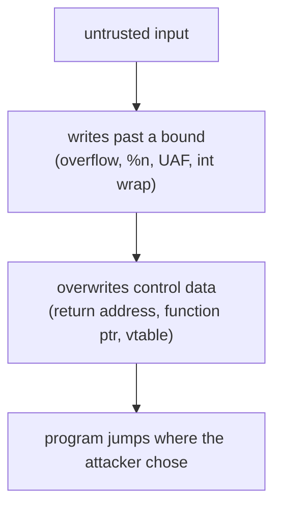

+++
title = "RainFall: a tour of memory-corruption bugs"
description = "Fourteen levels of binary exploitation at 42, read as a catalogue of vulnerability classes: stack overflows, format strings, use-after-free, integer overflow and C++ vtables, and the mitigations that make each one harder."
tags = ["42", "security", "reverse-engineering"]
+++

**RainFall** is 42's first security project. You get a VM with a chain of set-uid binaries, `level0`
through `level9` plus four bonus levels. Each one runs as the *next* user, and reading its password
lets you log in one step up. The only way forward is to make a program do something its author didn't
intend ([source](https://github.com/PfClaKr/Ecole42Paris_Rainfall)).

I'm writing this as a retrospective, not a copy-paste guide: no payloads, just the bug class behind each
level and the lesson it teaches. Every one of these is a mistake that still ships in real software, which
is exactly why 42 makes you meet them from the attacker's side first. The defence is in the last section.

## Reading a binary

Each level is a small ELF with no source. The loop is always the same: run it, watch how it reacts to
input, then open it in a disassembler (`gdb`, `objdump`, later Ghidra) and rebuild the C in your head.
The reconstructed sources in the repo are the *output* of that reverse engineering, not the input. The
VM is deliberately old, with **ASLR off** and **no stack canaries**, so the mechanisms are visible
before the mitigations hide them.

## The vulnerability classes

**A plain logic bug (level0).** The program spawns a shell only if your argument equals a magic number.
No corruption at all, just reading the disassembly and passing the right value. It exists to teach the
workflow.

**Stack buffer overflow (level1, bonus0, bonus2).** A fixed buffer filled by `gets()` or an unchecked
`strcpy`/`strcat`. `gets()` has no length limit, so input longer than the buffer runs off the end of the
stack frame and over the saved return address. Control where that return address points, and you control
where the CPU goes next. The fix has been known for decades: never use `gets`, and bound every copy.

**Format-string bug (level3, level4, level5).** The classic `printf(user_input)` instead of
`printf("%s", user_input)`. If the user's string contains `%` directives, `printf` reads arguments that
were never passed, walking up the stack. `%x` leaks memory; the `%n` directive, which *writes* the
number of bytes printed so far to a pointer argument, turns a log statement into an arbitrary write. It's
why compilers warn on non-literal format strings, and why `-Wformat-security` exists.

**Use-after-free and heap layout (level6, level8).** level6 keeps a function pointer and a string buffer
on the heap; overflowing the string overwrites the pointer. level8 frees a buffer but keeps using it
(`free(auth)` then `auth[32]`), so a later allocation can reuse that memory and change what the stale
pointer sees. These are the bugs that drive most modern browser exploits, and the reason for hardened
allocators and tools like ASan.

**Integer overflow (bonus1).** `memcpy(buffer, av[2], nb * 4)` with `nb` a user-controlled `int`. A
negative `nb` passes a `nb <= 9` check but becomes a huge **unsigned** size inside `memcpy`, and a large
`nb` makes `nb * 4` wrap around. The arithmetic bug becomes a memory bug. The lesson: validate sizes
*after* thinking about signedness and overflow, not before.

**Uninitialised / unterminated memory (level7, bonus3).** level7 relies on uninitialised heap contents;
bonus3 uses `atoi(av[1])` to place a NUL terminator inside a buffer, so a crafted index can make a
password string compare equal to your own argument. Small off-by-one assumptions about where a string
ends, turned into a login bypass.

**C++ objects and vtables (level9).** The last mandatory level is a C++ class with a buffer and a
member-function pointer laid out next to it in memory. Overflowing the buffer overwrites the pointer the
object will call through. The takeaway is that polymorphism is a function pointer in the object, and an
overflow into an object is an overflow into its dispatch.

Almost every level is the same shape: untrusted input reaches memory it shouldn't, and that memory
turns out to decide where the program goes next.

## Why none of this works on your laptop today

RainFall's VM has the protections switched off on purpose. On a current system, the same bugs run into
layers of defence, which is the real lesson of the project:

- **Stack canaries** (`-fstack-protector`) put a random value before the saved return address and check
  it before returning, so a straight overflow is caught.
- **NX / W^X** marks the stack non-executable, so you can't just jump into shellcode you wrote there.
- **ASLR** randomises where the stack, heap and libraries live, so hard-coded addresses miss.
- **PIE** randomises the executable itself.
- **FORTIFY_SOURCE** and compiler warnings reject `gets`, bound `memcpy`/`strcpy` where the size is
  known, and flag non-literal format strings.

Each mitigation raises the bar; none is sufficient alone, which is why they're layered. Having had to
defeat their *absence* by hand makes it obvious what each one is actually buying you.

RainFall is the project that changed how I read my own C. Now `gets`, a bare `printf(var)`, a `free`
followed by another use, and a size multiplication all look like what they are: the start of someone
else's exploit.
