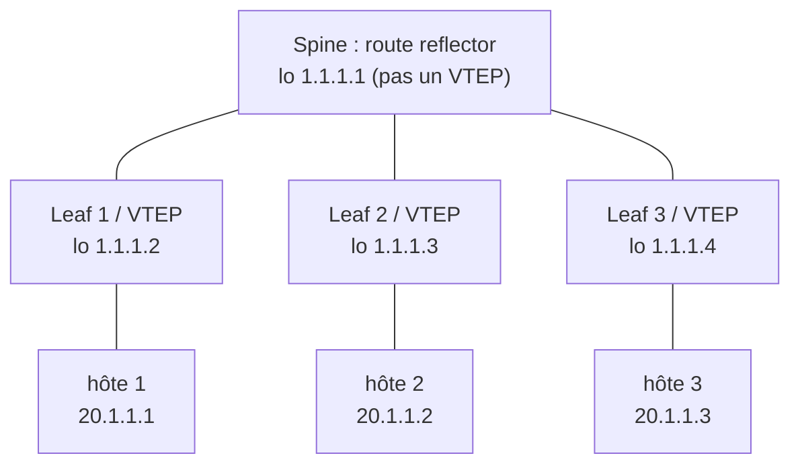
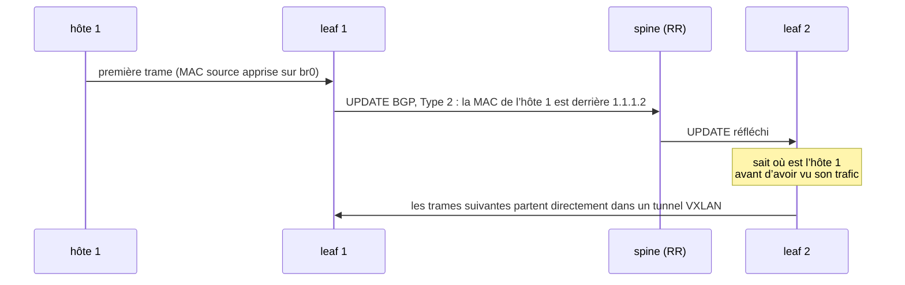

+++
title = "BADASS : du L2 au-dessus du L3 avec VXLAN et BGP-EVPN"
description = "Un labo GNS3 + FRRouting en trois étapes : des tunnels VXLAN faits main, puis du multicast, puis une fabric spine-leaf BGP-EVPN où un route reflector indique à chaque leaf où se trouve chaque adresse MAC."
tags = ["42", "network", "bgp", "vxlan"]
+++

**BADASS** (*BGP At Doors of Autonomous Systems is Simple*) est un projet réseau de 42 réalisé
dans [GNS3](https://www.gns3.com/). Chaque routeur est un conteneur Docker qui fait tourner
[FRRouting](https://frrouting.org/), et chaque hôte est un petit conteneur Alpine. L’objectif tient
en une phrase : des hôtes branchés sur des routeurs différents, de part et d’autre d’un réseau
routé, doivent se comporter comme s’ils étaient sur **le même switch**.

Le projet y arrive en trois parties. Cet article les suit à partir des configurations du
[dépôt](https://github.com/PfClaKr/Ecole42Paris_BADASS).

## Partie 1 : les briques de base

**GNS3** émule au lieu de simuler : l’interface graphique ne fait que dessiner la topologie, tandis
que `gns3-server` lance de vrais conteneurs et que `ubridge` les relie avec des paires veth. Ce
sont donc de vrais noyaux Linux qui acheminent les paquets, et un clic droit sur n’importe quel
lien permet de le capturer dans Wireshark.

**FRR** n’est pas un programme unique mais un ensemble de démons. Chaque protocole (`bgpd`,
`ospfd`, `isisd`) calcule ses propres routes et les transmet à **zebra**, qui choisit les gagnantes
selon la distance administrative et les installe dans la table de routage du noyau. Le noyau
achemine les paquets ; FRR décide où ils doivent aller.

L’image du routeur est simplement l’image officielle de FRR avec les bons démons activés :

```dockerfile
FROM frrouting/frr:latest
RUN apk update && apk add busybox-extras vim
ENV DAEMONS="zebra bgpd ospfd isisd"
COPY daemons /etc/frr/daemons
RUN chown frr:frr /etc/frr/daemons   # FRR refuse de lancer un démon dont il ne possède pas la config
CMD ["bash", "-c", "/usr/lib/frr/docker-start > /var/log/frr.log 2>&1 & exec bash"]
```

Les hôtes sont des `alpine` avec `tcpdump` et `iperf`. L’espace utilisateur d’Alpine est BusyBox :
l’image ne pèse que quelques mégaoctets.

## Partie 2 : VXLAN à la main

**VXLAN** encapsule une trame Ethernet complète dans de l’UDP (port 4789) et l’envoie à travers un
réseau IP. Un **VNI** de 24 bits identifie le segment :

| | VLAN | VXLAN |
|---|---|---|
| Identifiant | 12 bits, environ 4 094 segments | 24 bits, environ 16 millions de segments |
| Fonctionne en | L2 (tag 802.1Q) | L3 (encapsulation UDP) |
| Portée | un seul domaine L2 | à travers n’importe quel réseau routé |

Sur chaque routeur, un bridge Linux réunit le port côté hôte (`eth1`) et une interface VXLAN.
Pour l’hôte, le bridge est le switch, et l’interface VXLAN est un câble qui traverse le réseau.
Dans la version **statique**, chaque routeur désigne explicitement son pair :

```sh
ip link add br0 type bridge
ip link set dev br0 up
ip link add name vxlan10 type vxlan id 10 dev eth0 remote 10.1.1.2 local 10.1.1.1 dstport 4789
ip link set dev vxlan10 up
ip addr add 10.1.1.1/24 dev eth0
brctl addif br0 eth1
brctl addif br0 vxlan10
```

La version **multicast** remplace `remote … local …` par `group 239.1.1.1`. Tous les routeurs
rejoignent le même groupe, et le trafic de broadcast est envoyé une seule fois au groupe au lieu
d’une fois par pair :

| | Statique (unicast) | Groupe multicast |
|---|---|---|
| Pairs | listés dans chaque config | non listés, seulement le groupe |
| Trafic broadcast/inconnu | copié une fois par pair par l’émetteur | envoyé une fois, répliqué par le réseau |
| Ajout d’un routeur | modifier tous les routeurs existants | configurer seulement le nouveau |
| Prérequis | aucun | l’underlay doit router le multicast |

Les deux versions apprennent toujours les adresses MAC par **flood and learn** : si on ne sait pas
où se trouve une MAC, on envoie la trame partout et on observe les réponses. Et les réseaux publics
transportent rarement du multicast. La partie 3 règle ces deux problèmes avec un plan de contrôle.

## Partie 3 : BGP-EVPN sur une fabric spine-leaf

**EVPN** utilise BGP multiprotocole (la famille d’adresses `l2vpn evpn`) pour *annoncer* des
adresses MAC, comme BGP annonce habituellement des préfixes IP. Le plan de données reste VXLAN ;
seul l’apprentissage passe dans le plan de contrôle.



Cela fonctionne en deux couches.

- **Underlay (OSPF).** Chaque routeur a une loopback (`1.1.1.x/32`), et OSPF rend ces loopbacks
  joignables entre elles. Les sessions BGP et les tunnels VXLAN utilisent les loopbacks : ils
  survivent donc à la perte de n’importe quel lien physique.
- **Overlay (iBGP + route reflector).** iBGP ne transmet pas à un pair iBGP les routes apprises
  d’un autre, donc chaque paire de routeurs aurait normalement besoin de sa propre session. Un
  **route reflector** a le droit de les refléter : chaque leaf ne parle plus qu’au spine.

La config du spine utilise un peer group et une plage d’écoute : un nouveau leaf ne demande aucune
modification du spine :

```text
router bgp 1
    neighbor ibgp peer-group
    neighbor ibgp remote-as 1
    neighbor ibgp update-source lo
    bgp listen range 1.1.1.0/29 peer-group ibgp
    address-family l2vpn evpn
        neighbor ibgp activate
        neighbor ibgp route-reflector-client
```

Sur un leaf, l’interface VXLAN n’a **plus de pair ni de groupe**. EVPN s’en charge :

```text
ip link add vxlan10 type vxlan id 10 dstport 4789

router bgp 1
    neighbor 1.1.1.1 remote-as 1
    neighbor 1.1.1.1 update-source lo
    address-family l2vpn evpn
        neighbor 1.1.1.1 activate
        advertise-all-vni
```

### Deux types de routes font le travail

- **Type 3 (inclusive multicast).** « Je suis un VTEP pour le VNI 10, et mon adresse est 1.1.1.2. »
  Elle existe dès que le VNI est actif, même sans aucun hôte, et construit la liste des pairs qui
  reçoivent le trafic de broadcast. Pas besoin de multicast.
- **Type 2 (annonce MAC/IP).** « La MAC `aa:bb:…` (et l’IP 20.1.1.1) est derrière moi. » Elle
  apparaît dès qu’un hôte a émis du trafic et que sa MAC a été apprise, et gagne la partie IP quand
  l’hôte a une adresse.



Cette chaîne se démontre facilement. Avec tous les hôtes arrêtés, seules les routes de type 3
existent, et le bridge liste déjà les VTEP distants :

```sh
vtysh -c "show bgp l2vpn evpn route type multicast"   # [3]:[0]:[32]:[1.1.1.2] …
vtysh -c "show bgp l2vpn evpn route type macip"       # vide
bridge fdb show dev vxlan10 | grep 00:00:00:00:00:00  # dst 1.1.1.3, dst 1.1.1.4
```

Démarrez un hôte sans IP : une route de type 2 avec seulement la MAC (`[2]:[0]:[48]:[mac]`)
apparaît sur **tous** les leafs. Donnez des adresses aux hôtes et la route s’enrichit d’une IP
(`…:[32]:[20.1.1.1]`). Le `ping` traverse alors la fabric, et Wireshark montre de l’ICMP dans de
l’UDP 4789 entre les loopbacks.

## À retenir

- **Underlay et overlay sont deux métiers distincts.** OSPF rend seulement les loopbacks
  joignables ; BGP transporte seulement l’information d’accessibilité ; VXLAN déplace seulement des
  trames.
- **Les problèmes de la partie 2 sont des problèmes de plan de contrôle.** Le flood and learn et
  l’underlay multicast disparaissent dès que le réseau *indique* à chaque VTEP ce qu’il devrait
  sinon découvrir lui-même.
- **Un route reflector ne transporte que du trafic de contrôle.** Le spine n’est pas un VTEP ; les
  données circulent de leaf à leaf.

Les configurations des trois parties sont sur [GitHub](https://github.com/PfClaKr/Ecole42Paris_BADASS).
