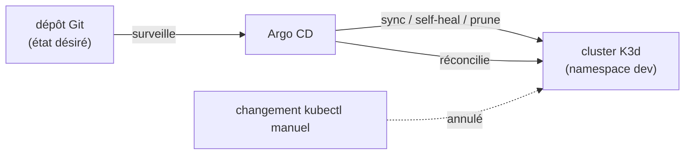

+++
title = "Inception-of-Things : de Kubernetes sur des VMs au GitOps"
description = "Un projet Kubernetes en trois parties, réalisé en binôme : un cluster K3s sur des VMs Vagrant, du routage Ingress par hôte vers trois applications, et du GitOps avec Argo CD sur K3d, synchronisé depuis un dépôt Git."
tags = ["42", "kubernetes", "devops"]
+++

**Inception-of-Things** (IoT) est le projet Kubernetes de 42, la suite dans l'esprit du travail Docker
d'[Inception](/fr/posts/inception/). Il se construit en trois parties : un cluster multi-nœuds sur des
VMs, du routage vers l'intérieur, et enfin le GitOps, où un dépôt Git est la source de vérité de ce qui
tourne. On l'a fait en binôme ([source](https://github.com/PfClaKr/Ecole42Paris_Inception_of_Things)).

Du début à la fin, la distribution est **K3s**, un Kubernetes en un seul binaire de Rancher, assez léger
pour tourner dans une VM de 1 Go, et c'est toute la raison pour laquelle le projet reste abordable sur un
portable.

## P1 — un cluster à deux nœuds avec Vagrant

La partie 1 provisionne deux VMs VirtualBox avec Vagrant : un **serveur** K3s (plan de contrôle) et un
**agent** K3s (worker), sur un réseau privé.

```text
┌─ ychunS 192.168.56.110 ─┐        ┌─ schaehunSW 192.168.56.111 ─┐
│  serveur K3s            │◀──────│  agent K3s (rejoint via token)│
│  publie le node-token   │ :6443 │                               │
└─────────────────────────┘        └───────────────────────────────┘
```

Le seul vrai problème, c'est le token de jonction. Un agent a besoin du node-token du serveur pour
rejoindre, mais les deux VMs démarrent ensemble. Mon serveur écrit le token dans un fichier et le sert via
un serveur HTTP jetable ; l'agent interroge jusqu'à ce qu'il soit là, puis installe K3s en pointant vers le
serveur :

```ruby
# serveur : publier le token une fois que K3s l'a écrit
NODE_TOKEN="/var/lib/rancher/k3s/server/node-token"
while [ ! -e ${NODE_TOKEN} ]; do sleep 2; done
cd /tmp/token-share && python3 -m http.server 8080 &

# agent : l'attendre, puis rejoindre
while [ -z "$NODE_TOKEN" ]; do
  NODE_TOKEN=$(curl -sf http://192.168.56.110:8080/node-token); sleep 2
done
curl -sfL https://get.k3s.io | K3S_URL=https://192.168.56.110:6443 K3S_TOKEN=${NODE_TOKEN} sh -
```

Les deux s'installent avec `--flannel-iface eth1` pour que le réseau du cluster passe par l'interface
privée, pas par l'interface NAT que Vagrant utilise pour le SSH. Se tromper là-dessus donne des nœuds qui
« rejoignent » mais ne peuvent pas se parler : la première de plusieurs leçons de réseau.

## P2 — trois applications derrière un Ingress

La partie 2, c'est un seul serveur K3s qui fait tourner trois petites applications web, routées par **nom
d'hôte**. K3s embarque Traefik comme contrôleur Ingress par défaut, donc le routage n'est qu'un objet
`Ingress` :

```yaml
rules:
- host: app1.com
  http: { paths: [{ path: /, backend: { service: { name: app1, port: { number: 80 }}}}]}
- host: app2.com
  http: { paths: [{ path: /, ... app2 ... }]}
- http:            # pas d'hôte → backend par défaut
    paths: [{ path: /, ... app3 ... }]
```

Un curl sur l'IP du serveur avec `Host: app1.com` atteint app1, `app2.com` atteint app2, et tout le reste
retombe sur app3 par défaut. C'est la même idée d'hôte virtuel que la configuration nginx d'Inception,
exprimée cette fois de façon déclarative et gérée par le cluster au lieu d'un bloc de serveur écrit à la
main. Une application tourne aussi en trois répliques, donc le Service répartit la charge entre les pods.

## P3 — le GitOps avec Argo CD

La partie 3, c'est le but de tout le projet. Au lieu de lancer `kubectl apply` à la main, un contrôleur
surveille un dépôt Git et fait correspondre le cluster à son contenu. C'est le **GitOps** : le dépôt est
l'état désiré, et le cluster se réconcilie en continu vers lui.

Le script de mise en place (idempotent, relançable) installe Docker, **K3d** (K3s dans des conteneurs
Docker, donc pas de VM cette fois) et `kubectl`, puis :

```bash
k3d cluster create iot --servers 1 --agents 2 --api-port 6550 -p "8080:80@loadbalancer"
kubectl create namespace argocd && kubectl create namespace dev
kubectl apply -n argocd -f https://raw.githubusercontent.com/argoproj/argo-cd/stable/manifests/install.yaml
kubectl apply -f argocd.yaml      # notre Application, qui pointe vers le dépôt Git
```

L'`Application` résume toute l'idée en un objet :

```yaml
spec:
  source:
    repoURL: https://github.com/.../ychun_iot_chaehun.git
    path: .
    targetRevision: HEAD
  destination: { namespace: dev }
  syncPolicy:
    automated: { selfHeal: true, prune: true }
```

Avec `selfHeal` et `prune`, Argo CD ne déploie pas qu'une fois. Changez le manifeste dans Git et le cluster
suit ; supprimez quelque chose de Git et Argo CD le retire du cluster ; changez quelque chose
**directement** dans le cluster et Argo CD le ramène à l'état de Git. La version déployée de l'application,
c'est ce que dit le dépôt, et rien d'autre.



## Ce que j'en retiens

- **Le déclaratif bat l'impératif.** Le passage de « lancer ces commandes dans l'ordre » (les entrypoints
  bash d'Inception) à « décrire l'état final et laisser un contrôleur converger » est le vrai contenu du
  projet. Un contrôleur de réconciliation gère la dérive, les redémarrages et les pannes partielles qu'un
  script ne gère pas.
- **Le réseau du cluster est un vrai réseau.** Choisir la mauvaise interface, oublier le réseau privé, ou
  faire entrer en collision des ports (K3d mappe des ports de l'hôte vers le load balancer) donnent des
  pannes qui ressemblent à des bugs Kubernetes mais ne sont que du réseau.
- **Tout est un objet lisible.** `Ingress`, `Service`, `Deployment`, `Application` — tout le système est du
  YAML qu'on `kubectl get` et `describe`. Intimidant au début, puis libérateur : pas d'état caché, juste
  l'API.

IoT, c'est le moment où Kubernetes a cessé d'être un mot à la mode pour devenir un ensemble d'objets
concrets et une boucle de contrôleur. Le GitOps en particulier a changé ma façon de penser le déploiement :
la question n'est plus « ai-je lancé la bonne commande ? » mais « le dépôt dit-il ce que je veux ? ».
