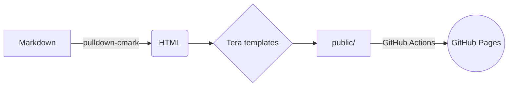

+++
title = "Hello, world — a Markdown showcase"
description = "The first post: everything this blog can render, from syntax-highlighted Rust to Mermaid diagrams."
tags = ["meta", "markdown"]
+++

Welcome to the blog! This first post doubles as a **test page** for everything the
renderer supports, so I can check the styling whenever I change something.

## Code

Highlighting happens at build time (no JavaScript needed):

```rust
use std::collections::HashMap;

fn word_count(text: &str) -> HashMap<&str, usize> {
    let mut counts = HashMap::new();
    for word in text.split_whitespace() {
        *counts.entry(word).or_insert(0) += 1;
    }
    counts
}
```

```toml
[dependencies]
pulldown-cmark = "0.13"
```

Inline code works too: `cargo run -- serve`.

## Diagrams



## Tables, lists and more

| Feature        | Supported |
|----------------|:---------:|
| Tables         | ✅        |
| Footnotes      | ✅        |
| Task lists     | ✅        |

- [x] Write the first post
- [ ] Write the second one

> [!TIP]
> GitHub-style alerts are supported: `NOTE`, `TIP`, `IMPORTANT`, `WARNING`, `CAUTION`.

Footnotes look like this.[^1]

[^1]: And they land at the bottom of the page.
