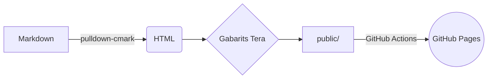

+++
title = "Bonjour le monde — démonstration Markdown"
description = "Le premier article : tout ce que ce blog sait afficher, du Rust coloré aux diagrammes Mermaid."
tags = ["meta", "markdown"]
+++

Bienvenue sur le blog ! Ce premier article sert aussi de **page de test** pour tout ce
que le moteur de rendu prend en charge.

## Code

La coloration syntaxique est faite à la compilation (aucun JavaScript nécessaire) :

```rust
use std::collections::HashMap;

fn word_count(text: &str) -> HashMap<&str, usize> {
    let mut counts = HashMap::new();
    for word in text.split_whitespace() {
        *counts.entry(word).or_insert(0) += 1;
    }
    counts
}
```

Le code en ligne fonctionne aussi : `cargo run -- serve`.

## Diagrammes



## Tableaux, listes et plus

| Fonctionnalité | Prise en charge |
|----------------|:---------------:|
| Tableaux       | ✅              |
| Notes          | ✅              |
| Listes de tâches | ✅            |

- [x] Écrire le premier article
- [ ] Écrire le deuxième

> [!NOTE]
> Les encadrés façon GitHub sont pris en charge.

Voici une note de bas de page.[^1]

[^1]: Elle apparaît en bas de la page.
