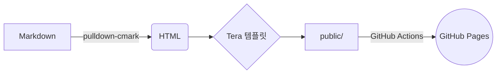

+++
title = "Hello, world — 마크다운 쇼케이스"
description = "첫 글: 문법 강조된 Rust 코드부터 Mermaid 다이어그램까지, 이 블로그가 렌더링할 수 있는 모든 것."
tags = ["meta", "markdown"]
+++

블로그에 오신 것을 환영합니다! 이 첫 글은 렌더러가 지원하는 기능을 한눈에 확인하는
**테스트 페이지** 역할도 합니다.

## 코드

문법 강조는 빌드 시점에 처리됩니다 (자바스크립트 불필요):

```rust
use std::collections::HashMap;

fn word_count(text: &str) -> HashMap<&str, usize> {
    let mut counts = HashMap::new();
    for word in text.split_whitespace() {
        *counts.entry(word).or_insert(0) += 1;
    }
    counts
}
```

인라인 코드도 됩니다: `cargo run -- serve`.

## 다이어그램



## 표, 리스트 등

| 기능      | 지원 |
|-----------|:----:|
| 표        | ✅   |
| 각주      | ✅   |
| 체크리스트 | ✅  |

- [x] 첫 글 쓰기
- [ ] 두 번째 글 쓰기

> [!IMPORTANT]
> GitHub 스타일 알림 블록을 지원합니다.

각주는 이렇게 씁니다.[^1]

[^1]: 페이지 하단에 표시됩니다.
