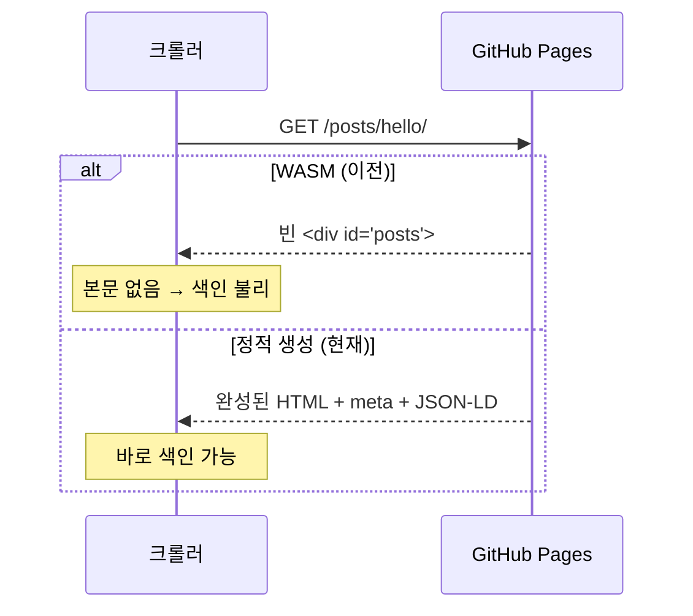

+++
title = "이 블로그를 Rust로 직접 만든 이유"
description = "기성 정적 사이트 생성기 대신, pulldown-cmark와 Tera로 다국어·SEO 친화적인 블로그 엔진을 직접 만든 과정."
tags = ["rust", "meta", "seo"]
+++

처음에는 Rust를 WebAssembly로 컴파일해서 **브라우저에서** 마크다운을 렌더링했습니다.
동작은 했지만, 검색 엔진 입장에서는 빈 HTML만 보이는 문제가 있었습니다.

## 클라이언트 렌더링 vs 빌드 타임 렌더링



그래서 같은 Rust 코드(`pulldown-cmark`)를 **빌드 시점**에 돌리는 작은 정적 사이트
생성기로 바꿨습니다.

## 구조

| 단계 | 담당 |
|------|------|
| 마크다운 파싱 | `pulldown-cmark` |
| 코드 하이라이팅 | `syntect` (CSS 클래스) |
| 템플릿 | `Tera` |
| 배포 | GitHub Actions → Pages |

```rust
pub fn render(markdown: &str) -> Rendered {
    let parser = Parser::new_ext(markdown, Options::all());
    // 코드 블록·헤딩·이미지 이벤트를 가로채서 변환
    // ...
}
```

이 글은 한국어로만 쓰였기 때문에, 영어·프랑스어 목록에서는 **원문 언어 배지**와 함께 표시됩니다.
