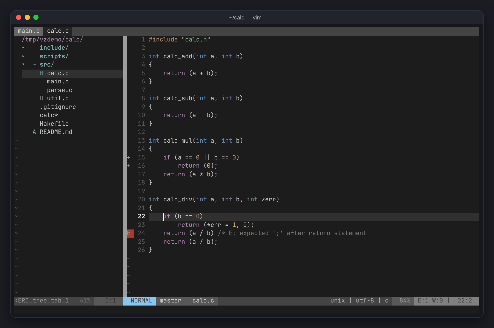
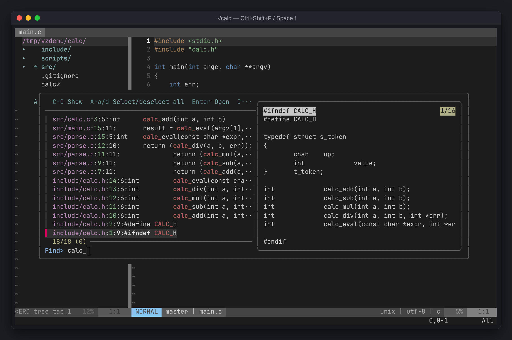
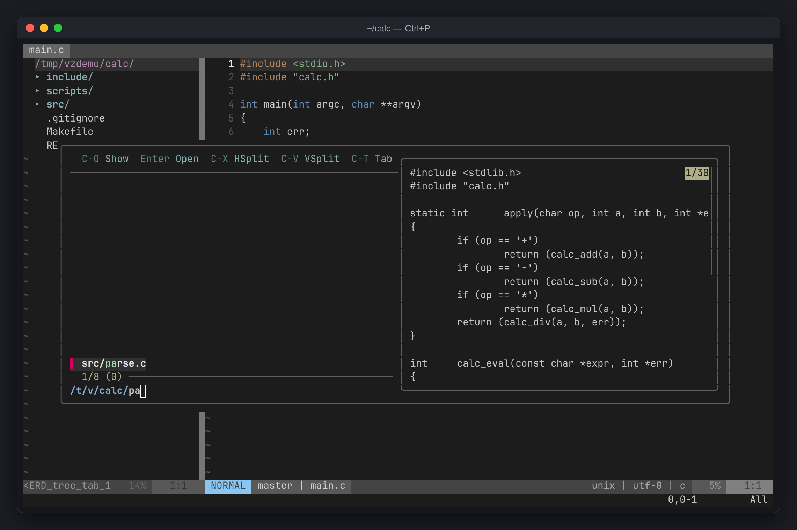
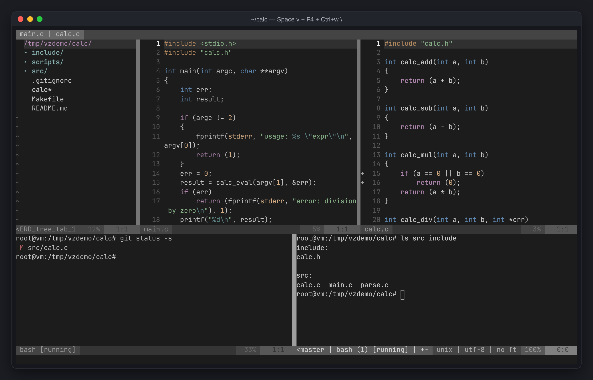
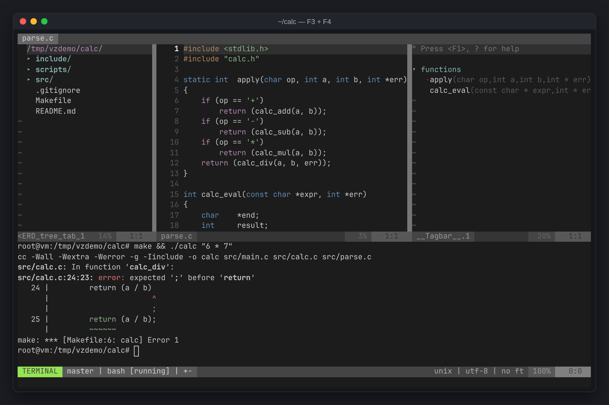
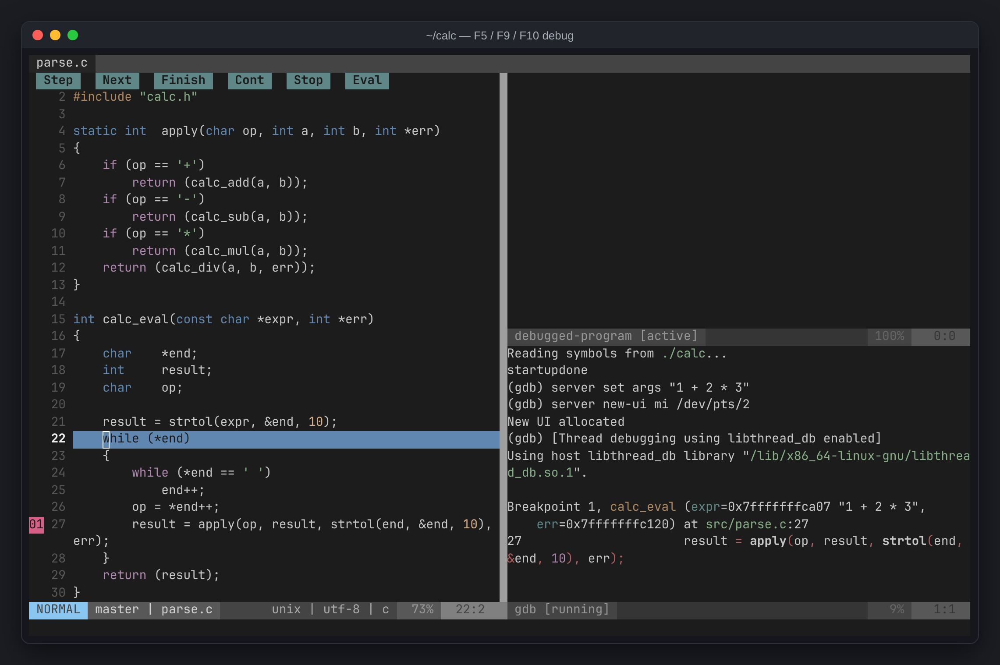

+++
title = "Tous les raccourcis de vimzip, en images"
description = "Tous les raccourcis de vimzip sur une page, groupés par tâche, avec des captures de la recherche, des splits, de la liste des symboles et du débogueur. Space est la touche leader ; les touches Ctrl+w marchent aussi dans le terminal."
tags = ["vim", "linux", "tools", "cheatsheet"]
+++

Voici tous les raccourcis de [vimzip](/fr/posts/vimzip/), mon environnement Vim qu'il suffit de décompresser, sur une seule page. Deux règles couvrent l'essentiel : **`Space` est la touche leader**, et **tout ce qui commence par `Ctrl+w` marche aussi depuis une fenêtre terminal**.



## Fichiers et recherche

| Touche | Action |
|---|---|
| `Ctrl+p` | chercher des fichiers par nom |
| `Ctrl+Shift+f` / `Space f` | chercher du texte dans tout le projet (seulement pendant la saisie) |
| `Space b` | chercher parmi les fichiers ouverts |
| `Space t` | chercher des symboles (fonctions, structs) |
| dans le sélecteur : `Enter` / `Ctrl+v` / `Ctrl+x` | ouvrir / split vertical / split horizontal |
| `/mot` → `n` / `N` | chercher dans ce fichier → suivant / précédent |
| `*` | chercher le mot sous le curseur |
| `:%s/old/new/g` | remplacer dans ce fichier |
| dans la recherche projet : `Alt+a` → `Enter` → `:cdo s/old/new/g` | remplacer dans tout le projet |

| Recherche de texte dans le projet | Recherche de fichiers |
|---|---|
|  |  |

## Buffers (fichiers ouverts)

| Touche | Action |
|---|---|
| `Tab` / `Shift+Tab` | fichier suivant / précédent |
| `Space q` | fermer le fichier courant |
| `Ctrl+s` | enregistrer (la sauvegarde auto est active aussi) |

## Splits de fenêtres

| Touche | Action |
|---|---|
| `Space v` / `Space s` | split vertical / horizontal |
| `Ctrl+h` `Ctrl+j` `Ctrl+k` `Ctrl+l` | aller à la fenêtre gauche / bas / haut / droite |
| `Ctrl+w h` `j` `k` `l` | se déplacer entre fenêtres (marche aussi dans le terminal) |
| `Ctrl+w =` | égaliser les tailles |
| `Ctrl+w _` / `Ctrl+w \|` | maximiser la hauteur / largeur |
| `Ctrl+w +` `-` `<` `>` | ajuster hauteur / largeur (ou tirer la bordure à la souris) |
| `Ctrl+w x` | échanger avec la fenêtre voisine |
| `Ctrl+w H` `J` `K` `L` | déplacer la fenêtre tout à gauche / en bas / en haut / à droite |
| `Ctrl+w q` | fermer la fenêtre |

## Terminal

| Touche | Action |
|---|---|
| `F4` | ouvrir / masquer le panneau terminal du bas (continue de tourner masqué) |
| `Space -` / `Space \` | nouveau terminal sous / à droite de la fenêtre courante |
| dans un terminal : `Ctrl+w n` / `Ctrl+w \` | un terminal de plus en bas / à droite |
| dans un terminal : `Ctrl+w N` → `i` | mode défilement/copie → revenir à la saisie (molette aussi) |
| dans un terminal : `Ctrl+w :` | lancer une commande Vim |
| `exit` | fermer le terminal |



## Navigation dans le code

| Touche | Action |
|---|---|
| `F12` / `gd` | aller à la définition (y compris des fonctions d'en-têtes système comme `malloc` ; choisir par numéro s'il y en a plusieurs) |
| `Ctrl+t` / `Ctrl+o` | revenir là où on était |
| `gr` / `K` | trouver les références / voir la doc (si clangd est présent) |
| `]e` / `[e` | erreur suivante / précédente |
| `Space e` | détail de l'erreur sur cette ligne |
| `%` | aller à la parenthèse correspondante |
| `F3` | liste des fonctions (`Enter` pour y aller) |



## Arbre de fichiers (`Ctrl+Shift+e` / `F2`)

`Ctrl+Shift+e` se comporte comme VS Code : ouvre l'arbre s'il est fermé, y saute si on est ailleurs, le ferme si on y est déjà.

| Touche | Action |
|---|---|
| `Enter` / `s` / `i` | ouvrir / split vertical / split horizontal |
| `m` | menu ajouter / renommer / supprimer |
| `I` / `R` | afficher les fichiers cachés / rafraîchir |
| `C` / `u` | prendre le dossier choisi comme racine / remonter d'un dossier |
| `M` `A` `U` `D` `R` `C` `~` | statut git : modifié / indexé / nouveau / supprimé / renommé / conflit / modifié à l'intérieur |

## Édition

| Touche | Action |
|---|---|
| `u` / `Ctrl+r` | annuler / refaire (conservé après redémarrage) |
| `gcc` / sélection puis `gc` | basculer le commentaire sur une ligne / sélection |
| `yy` / `dd` / `p` | copier / couper / coller une ligne |
| `y` / sélection puis `Ctrl+c` | copier (atteint le presse-papiers local par-dessus SSH sur les terminaux OSC 52) |
| `>>` / `<<` | indenter / désindenter |
| `=` | formater la sélection (`gg=G` pour tout le fichier) |
| `Ctrl+n` / `Ctrl+p` | complétion : fichiers ouverts, mots du projet, noms de fonctions, en-têtes inclus (pas de popup auto) |

## Agent IA

| Touche | Action |
|---|---|
| `Ctrl+Alt+i` / `Space a` | ouvrir / masquer un agent IA à droite (continue de tourner masqué) |

Il lance le premier trouvé parmi `claude`, `codex`, `gemini`, `aider`, `opencode`. Pour choisir :

```sh
export VIMZIP_AI=codex    # arguments possibles aussi : VIMZIP_AI="aider --model sonnet"
```

## Git

| Touche | Action |
|---|---|
| `]c` / `[c` | hunk de modification suivant / précédent |
| `Space hp` / `Space hs` / `Space hu` | prévisualiser / indexer / annuler un hunk |
| `:Git` | fenêtre de statut (`s` indexer, `u` désindexer, `=` diff, `cc` commit) |
| `:Git blame` / `:Gdiffsplit` | auteur par ligne / comparer les modifications |

## Débogage (nécessite gdb)

| Touche | Action |
|---|---|
| `F5` | démarrer (saisir `./a.out args`) / continuer |
| `F9` | basculer un point d'arrêt |
| `F10` / `F11` / `Shift+F11` | pas au-dessus / dans / hors de la fonction |



## Notes

- `Ctrl+Shift+f`, `Ctrl+Shift+e` et `Ctrl+Alt+i` échouent si le terminal les avale ou ne les distingue pas. Utilisez alors `Space f`, `F2`, `Space a`.
- Si le serveur a `clangd`, l'aller-à-la-définition et les diagnostics l'utilisent.
- Mettez vos réglages personnels dans `~/.config/vimzip/vimrc` ; il est lu en dernier.
