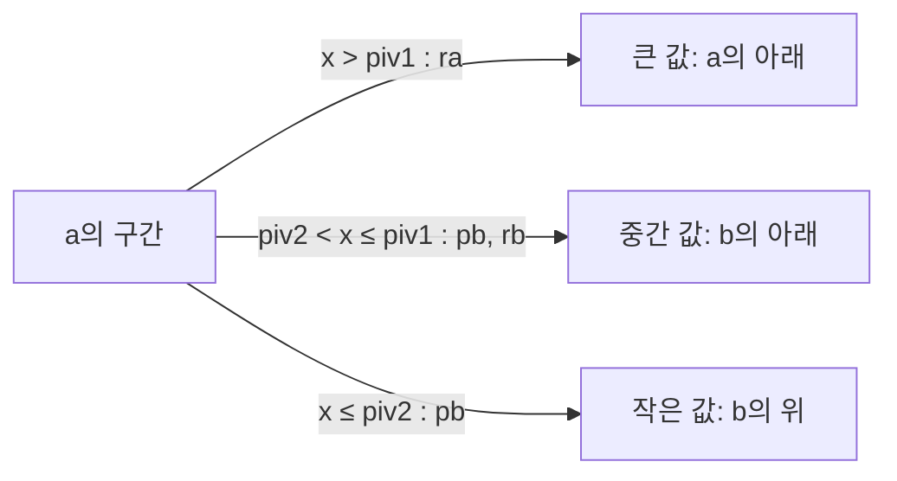

+++
title = "push_swap: 스택 두 개와 연산 11개로 정렬하기"
description = "두 스택에서 push, swap, rotate만으로 정수 정렬하기: 피벗 두 개로 나누는 재귀 퀵소트와 연산 수를 줄이는 요령."
tags = ["42", "c", "algorithms"]
+++

**push_swap**은 스택 `a`에 정수 목록을, 빈 스택 `b`와 연산 11개를 줍니다. 프로그램은 `a`를 정렬된
상태로 만드는 연산 순서를 출력해야 하고, 점수는 그 순서가 얼마나 *짧은지*로 매겨집니다
([소스](https://github.com/PfClaKr/Ecole42Paris_PushSwap)).

| 연산 | 효과 |
|---|---|
| `sa` `sb` `ss` | `a`, `b`, 또는 둘 다의 맨 위 두 원소 교환 |
| `pa` `pb` | `b`의 맨 위를 `a`로, 또는 `a`의 맨 위를 `b`로 옮김 |
| `ra` `rb` `rr` | 위로 회전: 맨 위 원소가 맨 아래로 |
| `rra` `rrb` `rrr` | 아래로 회전: 맨 아래 원소가 맨 위로 |

"*i*번째 원소 보기"도, 임의 접근도 없습니다. 맨 위(그리고 회전을 통해 맨 아래)만 건드릴 수 있습니다.
보너스는 표준 입력으로 연산을 읽어 적용하고 `OK`나 `KO`를 출력하는 `checker`입니다.

## 연결 리스트로 만든 스택

회전에는 양 끝에 싸게 접근해야 하니, 스택마다 `head`, `tail`, `size`를 들고 있는 헤더를 둔 이중
연결 리스트로 만들었습니다. 그러면 모든 연산이 *O(1)*입니다. `ra`는 머리 노드를 꼬리로 옮기기만 하면
됩니다.

```c
typedef struct s_dummy
{
    int     size;
    t_node  *head;
    t_node  *tail;
}   t_dummy;
```

## 피벗 두 개짜리 퀵소트

아이디어는 퀵소트인데, 분할한다는 건 원소를 두 스택 사이로 실제로 옮긴다는 뜻입니다. 한 번 훑을 때
더 많이 얻으려고, 정렬할 구간의 범위로 피벗 두 개를 구해 두 그룹이 아니라 **세** 그룹으로 나눴습니다.

```c
piv1 = (min + max) / 2;     // 큰 값은 a에 남음
piv2 = (min + piv1) / 2;    // b로 가는 값을 다시 둘로 나눔
```

`a`의 구간을 한 번 훑으면서 맨 위 원소를 하나씩 봅니다.

```c
if (a->head->value > piv1)
    ra(a);                  // 큰 값: 회전시켜 비켜 두고 a에 남김
else
{
    pb(a, b);               // 작거나 중간 값: b로 보냄
    if (b->head->value > piv2)
        rb(b);              // 중간 값: b의 맨 아래로
}                           // 작은 값: b의 맨 위에 그대로
```



한 번 훑고 나면 회전시켜 둔 그룹을 역회전으로 다시 위로 올리고 재귀합니다. 큰 값 그룹에는 `a_to_b`,
이제 `b`에 있는 두 그룹에는 `b_to_a`를 부릅니다. `b_to_a`는 거울상으로, `b`의 구간을 나눠 큰 부분을
다시 `a`로 보냅니다. 원소가 다섯 개 이하인 구간은 직접 짠 정렬 루틴으로 끝냅니다. 그 크기에서는 정해진
순서가 어떤 분할보다 낫기 때문입니다.

## 연산 아끼기

점수는 연산 수뿐이니 작은 요령이 중요합니다.

- **이동 합치기.** `ra`와 `rb` 회전을 `rrr`로 동시에 되돌리면 두 번이 아니라 한 번입니다. 코드는
  `min(ra, rb)`번은 `rrr`로 되감고, 나머지만 따로 처리합니다.
- **쓸모없는 되감기 건너뛰기.** 맨 첫 분할에서는 큰 값 그룹이 `a`에 남은 전부라서, 다시 위로 올려도
  아무것도 바뀌지 않습니다. 카운터로 아직 첫 호출인지 확인해서 되감기를 건너뜁니다.
- **특수한 경우.** 원소 3개는 최대 2번, 5개는 최대 12번이면 되니 둘 다 직접 코드로 짰습니다.

## 다르게 할 점

피벗은 `(min + max) / 2`, 즉 중앙값이 아니라 **값 범위의 가운데**입니다. 입력이 고르게 퍼져 있으면
충분히 비슷하지만, `1 2 3 … 99 1000000` 같은 치우친 입력은 거의 전부가 한 그룹에 몰려 재귀가
나빠집니다. 먼저 입력을 정규화하면(각 값을 0부터 *n*−1까지의 순위로 바꾸기) 공짜로 해결됩니다. 범위의
가운데가 진짜 중앙값이 되니까요.
