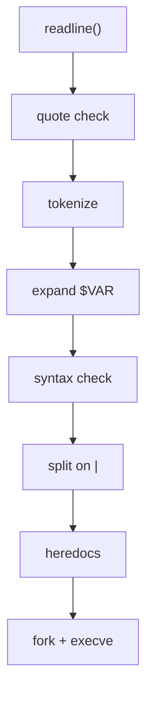

+++
title = "minishell: writing a small bash"
description = "A bash-like shell in C, built as a team of two: a tokenizer that understands quotes and $VARS, pipes and redirections with fork/dup2/execve, heredocs, builtins, and Ctrl-C."
tags = ["42", "c", "unix"]
+++

**minishell** is the big project of the 42 common core: write a shell that behaves like bash for a
well-defined subset. We built it as a team of two, and it finished at **101/100**
([source](https://github.com/PfClaKr/Ecole42Paris_MiniShell)).

What it has to support:

- a prompt with history (GNU readline is allowed);
- commands found through `$PATH`, or by relative or absolute path;
- single quotes (no interpretation) and double quotes (only `$` is expanded);
- `$VAR` and `$?` expansion;
- redirections `<`, `>`, `>>` and heredoc `<<`;
- pipes `|`;
- Ctrl-C, Ctrl-D and Ctrl-\ behaving as they do in bash;
- builtins: `echo -n`, `cd`, `pwd`, `export`, `unset`, `env`, `exit`.

## From a line to commands

The pipeline inside the shell looks like a tiny compiler:



**Tokenizing** turns `echo "hi $USER" > out | wc -c` into typed tokens. Each token gets a type
(`T_WORD`, `T_PIPE`, `INFILE_CHAR` for `<`, `HEREDOC_CHAR` for `<<`…), and the word right after a
redirection operator is re-typed as `INFILE`, `OUTFILE` or `LIMITOR`, so the executor never has to
guess what a filename is.

**Quotes** are the hard part. They change how characters around them are read, and they also mark
where words begin and end: `"a"'b'c` is a single argument, `abc`. The tokenizer tracks whether it's
inside single or double quotes. `$` is expanded inside double quotes but not inside single ones,
and a variable that expands to nothing must disappear entirely (`echo $NOPE x` prints `x`), unless it
was quoted (`echo "$NOPE" x` passes an empty argument).

**Syntax errors** are caught before anything runs: `| ls`, `ls >`, `cat << ` all print bash's
`syntax error near unexpected token` and set `$?` to 2.

## Pipes and redirections

For *N* commands, the shell opens *N − 1* pipes, forks once per command, and in each child wires the
right ends to stdin and stdout with `dup2` before calling `execve`:

```text
cmd0  stdout → pipe[0].write
cmd1  stdin  ← pipe[0].read     stdout → pipe[1].write
cmd2  stdin  ← pipe[1].read
```

Then every unused pipe end is closed. That last step is easy to forget and causes the classic bug:
`cat | ls` hangs forever, because some process still holds a write end, so `cat` never sees end of
file. A redirection takes precedence over the pipe, so `ls > out | wc` sends `ls` output to the file
and `wc` reads nothing, just like bash.

The parent waits for all children, and `$?` is the exit status of the **last** command in the
pipeline.

## Builtins that can't fork

`cd`, `export`, `unset` and `exit` change the shell's own state. Running them in a forked child would
change the child's directory or environment and then throw it away. So a single builtin without a
pipe runs in the parent. Inside a pipeline, bash runs it in a subshell anyway (`cd /tmp | ls` doesn't
move you), and so do we.

We keep the environment as a linked list of `key`/`value` pairs, so `export` and `unset` are list
operations, and rebuild a `char **envp` only when calling `execve`.

## Heredoc

`cat << EOF` reads lines until `EOF` and feeds them to `cat`. Our implementation forks a child that
reads with `readline("> ")` and writes into a temporary file, which becomes the command's stdin. The
file is unlinked after execution. If the delimiter is quoted (`<< 'EOF'`), variables inside the body
aren't expanded. All heredocs run **before** any command starts, just as in bash.

Forking for the heredoc makes Ctrl-C simple: the child installs a handler that exits with a special
status, the parent sees it, cancels the whole command line, and returns to the prompt.

## Signals

At the prompt, Ctrl-C must print a new prompt line without exiting. With readline, that means
clearing the current input from inside the handler:

```c
if (signo == SIGINT && g_global.child == 0)
{
    printf("\n");
    rl_on_new_line();
    rl_replace_line("", 1);
    rl_redisplay();
    g_global.ret = 130;     // $? after Ctrl-C
}
```

While a child is running, the shell instead lets the signal reach the child and prints nothing
itself. Ctrl-D is not a signal at all: `readline` returns `NULL` at end of input, and the shell
exits. The subject allows a single global variable, and ours holds just enough for this: the last
exit status, the number of running children, and a PID.

## Testing against bash

The repository includes a tester that runs hundreds of command lines in both bash and minishell and
compares stdout, stderr and exit codes, with separate suites for syntax, pipes, redirections, builtins
and signals. A shell is mostly a parser, and parsers are mostly edge cases.
