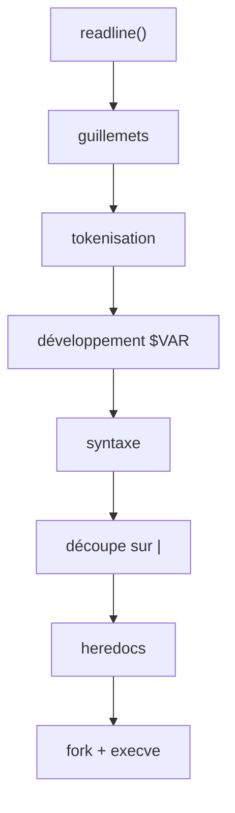

+++
title = "minishell : écrire un petit bash"
description = "Un shell à la bash en C, réalisé en binôme : un tokenizer qui comprend les guillemets et les $VARS, pipes et redirections avec fork/dup2/execve, heredocs, builtins et Ctrl-C."
tags = ["42", "c", "unix"]
+++

**minishell** est le gros projet du tronc commun de 42 : écrire un shell qui se comporte comme bash
sur un sous-ensemble bien défini. On l'a réalisé en binôme, avec une note finale de **101/100**
([source](https://github.com/PfClaKr/Ecole42Paris_MiniShell)).

Ce qu'il doit gérer :

- un prompt avec historique (GNU readline est autorisée) ;
- des commandes trouvées via `$PATH`, ou par chemin relatif ou absolu ;
- les guillemets simples (aucune interprétation) et doubles (seul `$` est développé) ;
- le développement de `$VAR` et `$?` ;
- les redirections `<`, `>`, `>>` et le heredoc `<<` ;
- les pipes `|` ;
- Ctrl-C, Ctrl-D et Ctrl-\ qui se comportent comme dans bash ;
- les builtins : `echo -n`, `cd`, `pwd`, `export`, `unset`, `env`, `exit`.

## D'une ligne à des commandes

Le traitement dans le shell ressemble à un tout petit compilateur :



**La tokenisation** transforme `echo "hi $USER" > out | wc -c` en tokens typés. Chaque token reçoit un
type (`T_WORD`, `T_PIPE`, `INFILE_CHAR` pour `<`, `HEREDOC_CHAR` pour `<<`…), et le mot qui suit un
opérateur de redirection est re-typé en `INFILE`, `OUTFILE` ou `LIMITOR`, pour que l'exécuteur n'ait
jamais à deviner ce qu'est un nom de fichier.

**Les guillemets** sont la partie difficile. Ils changent la lecture des caractères autour d'eux, et
ils marquent aussi où les mots commencent et finissent : `"a"'b'c` est un seul argument, `abc`. Le
tokenizer suit s'il est entre guillemets simples ou doubles. `$` est développé entre guillemets
doubles mais pas entre simples, et une variable qui se développe en rien doit disparaître
complètement (`echo $NOPE x` affiche `x`), sauf si elle était entre guillemets (`echo "$NOPE" x` passe
un argument vide).

**Les erreurs de syntaxe** sont détectées avant toute exécution : `| ls`, `ls >`, `cat << ` affichent
le `syntax error near unexpected token` de bash et mettent `$?` à 2.

## Pipes et redirections

Pour *N* commandes, le shell ouvre *N − 1* pipes, fait un fork par commande et, dans chaque enfant,
branche les bons bouts sur stdin et stdout avec `dup2` avant d'appeler `execve` :

```text
cmd0  stdout → pipe[0].write
cmd1  stdin  ← pipe[0].read     stdout → pipe[1].write
cmd2  stdin  ← pipe[1].read
```

Ensuite, chaque bout de pipe inutilisé est fermé. Cette dernière étape est facile à oublier et donne
le bug classique : `cat | ls` bloque pour toujours, parce qu'un processus garde un bout d'écriture et
que `cat` ne voit jamais la fin de fichier. Une redirection l'emporte sur le pipe, donc
`ls > out | wc` envoie la sortie de `ls` dans le fichier et `wc` ne lit rien, comme dans bash.

Le parent attend tous les enfants, et `$?` est le code de sortie de la **dernière** commande du pipeline.

## Les builtins qui ne peuvent pas forker

`cd`, `export`, `unset` et `exit` modifient l'état du shell lui-même. Les lancer dans un enfant
forké changerait le répertoire ou l'environnement de l'enfant, puis le jetterait. Donc un builtin seul,
sans pipe, s'exécute dans le parent. Dans un pipeline, bash le lance de toute façon dans un sous-shell
(`cd /tmp | ls` ne vous déplace pas), et nous aussi.

On garde l'environnement sous forme de liste chaînée de paires `key`/`value`, donc `export` et `unset`
sont des opérations de liste, et on ne reconstruit un `char **envp` qu'au moment d'appeler `execve`.

## Heredoc

`cat << EOF` lit des lignes jusqu'à `EOF` et les donne à `cat`. Notre implémentation forke un enfant
qui lit avec `readline("> ")` et écrit dans un fichier temporaire, qui devient le stdin de la commande.
Le fichier est supprimé après l'exécution. Si le délimiteur est entre guillemets (`<< 'EOF'`), les
variables du corps ne sont pas développées. Tous les heredocs s'exécutent **avant** la moindre
commande, comme dans bash.

Forker pour le heredoc simplifie Ctrl-C : l'enfant installe un handler qui quitte avec un code
spécial, le parent le voit, annule toute la ligne de commande et revient au prompt.

## Les signaux

Au prompt, Ctrl-C doit afficher une nouvelle ligne de prompt sans quitter. Avec readline, ça veut dire
vider la saisie en cours depuis le handler :

```c
if (signo == SIGINT && g_global.child == 0)
{
    printf("\n");
    rl_on_new_line();
    rl_replace_line("", 1);
    rl_redisplay();
    g_global.ret = 130;     // $? après Ctrl-C
}
```

Pendant qu'un enfant tourne, le shell laisse au contraire le signal atteindre l'enfant et n'affiche
rien lui-même. Ctrl-D n'est pas un signal du tout : `readline` renvoie `NULL` en fin d'entrée, et le
shell quitte. Le sujet autorise une seule variable globale, et la nôtre contient juste ce qu'il faut :
le dernier code de sortie, le nombre d'enfants en cours et un PID.

## Tester contre bash

Le dépôt contient un testeur qui lance des centaines de lignes de commande dans bash et dans
minishell et compare stdout, stderr et les codes de sortie, avec des suites séparées pour la syntaxe,
les pipes, les redirections, les builtins et les signaux. Un shell, c'est surtout un parseur, et un
parseur, c'est surtout des cas limites.
