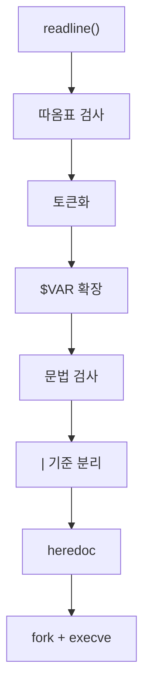

+++
title = "minishell: 작은 bash 만들기"
description = "2인 팀으로 만든 C로 된 bash 같은 셸: 따옴표와 $VAR를 이해하는 토크나이저, fork/dup2/execve로 구현한 파이프와 리다이렉션, heredoc, 빌트인, Ctrl-C."
tags = ["42", "c", "unix"]
+++

**minishell**은 42 공통 과정의 큰 과제입니다. 정해진 범위 안에서 bash처럼 동작하는 셸을 만듭니다.
2인 팀으로 만들었고 **101/100**으로 마쳤습니다([소스](https://github.com/PfClaKr/Ecole42Paris_MiniShell)).

지원해야 하는 것:

- 히스토리가 있는 프롬프트 (GNU readline 사용 가능)
- `$PATH`로 찾거나 상대·절대 경로로 지정한 명령 실행
- 작은따옴표(아무것도 해석하지 않음)와 큰따옴표(`$`만 확장)
- `$VAR`, `$?` 확장
- 리다이렉션 `<`, `>`, `>>`와 heredoc `<<`
- 파이프 `|`
- bash와 똑같이 동작하는 Ctrl-C, Ctrl-D, Ctrl-\
- 빌트인: `echo -n`, `cd`, `pwd`, `export`, `unset`, `env`, `exit`

## 한 줄에서 명령으로

셸 내부의 처리 과정은 작은 컴파일러처럼 생겼습니다.



**토큰화**는 `echo "hi $USER" > out | wc -c`를 타입이 붙은 토큰으로 바꿉니다. 토큰마다 타입이 붙고
(`T_WORD`, `T_PIPE`, `<`는 `INFILE_CHAR`, `<<`는 `HEREDOC_CHAR`…), 리다이렉션 연산자 바로 뒤의 단어는
`INFILE`, `OUTFILE`, `LIMITOR`로 다시 타입을 매깁니다. 그래서 실행부는 무엇이 파일 이름인지 추측할
필요가 없습니다.

**따옴표**가 가장 어렵습니다. 따옴표는 주변 문자를 읽는 방식을 바꾸고, 단어의 시작과 끝도 정합니다.
`"a"'b'c`는 인자 하나, `abc`입니다. 토크나이저는 지금 작은따옴표 안인지 큰따옴표 안인지 추적합니다.
`$`는 큰따옴표 안에서는 확장되고 작은따옴표 안에서는 안 되며, 빈 값으로 확장되는 변수는 완전히
사라져야 합니다(`echo $NOPE x`는 `x` 출력). 단, 따옴표로 감쌌다면 빈 인자로 넘어갑니다
(`echo "$NOPE" x`).

**문법 오류**는 실행 전에 잡습니다. `| ls`, `ls >`, `cat << `는 모두 bash의
`syntax error near unexpected token`을 출력하고 `$?`를 2로 설정합니다.

## 파이프와 리다이렉션

명령이 *N*개면 셸은 파이프를 *N − 1*개 열고, 명령마다 fork하고, 각 자식에서 `execve`를 부르기 전에
`dup2`로 알맞은 끝을 stdin과 stdout에 연결합니다.

```text
cmd0  stdout → pipe[0].write
cmd1  stdin  ← pipe[0].read     stdout → pipe[1].write
cmd2  stdin  ← pipe[1].read
```

그다음 쓰지 않는 파이프 끝을 전부 닫습니다. 이 마지막 단계를 잊기 쉽고, 그러면 고전적인 버그가
생깁니다. `cat | ls`가 영원히 멈추는데, 어떤 프로세스가 쓰기 끝을 아직 들고 있어서 `cat`이 파일 끝을
보지 못하기 때문입니다. 리다이렉션이 파이프보다 우선하므로, `ls > out | wc`는 bash처럼 `ls` 출력을
파일로 보내고 `wc`는 아무것도 읽지 않습니다.

부모는 모든 자식을 기다리고, `$?`는 파이프라인 **마지막** 명령의 종료 코드입니다.

## fork하면 안 되는 빌트인

`cd`, `export`, `unset`, `exit`는 셸 자신의 상태를 바꿉니다. fork한 자식에서 실행하면 자식의 디렉터리나
환경을 바꾸고 버리는 셈입니다. 그래서 파이프 없이 혼자 쓰인 빌트인은 부모에서 실행합니다. 파이프라인
안에서는 bash도 어차피 서브셸에서 실행하므로(`cd /tmp | ls`는 디렉터리를 바꾸지 않음) 저희도 그렇게
했습니다.

환경 변수는 `key`/`value` 쌍의 연결 리스트로 들고 있어서 `export`와 `unset`은 리스트 연산이고,
`char **envp`는 `execve`를 부를 때만 다시 만듭니다.

## heredoc

`cat << EOF`는 `EOF`가 나올 때까지 줄을 읽어 `cat`에 넘깁니다. 저희 구현은 자식을 fork해서
`readline("> ")`으로 읽은 내용을 임시 파일에 쓰고, 그 파일을 명령의 stdin으로 씁니다. 파일은 실행 후
삭제합니다. 구분자를 따옴표로 감싸면(`<< 'EOF'`) 본문의 변수를 확장하지 않습니다. bash처럼 모든
heredoc은 어떤 명령보다도 **먼저** 실행합니다.

heredoc을 fork해서 처리하면 Ctrl-C가 간단해집니다. 자식은 특별한 종료 코드로 끝나는 핸들러를 등록하고,
부모는 그 코드를 보고 명령 줄 전체를 취소한 뒤 프롬프트로 돌아갑니다.

## 시그널

프롬프트에서 Ctrl-C를 누르면 종료하지 않고 새 프롬프트 줄을 보여 줘야 합니다. readline을 쓸 때는
핸들러 안에서 현재 입력을 비워야 한다는 뜻입니다.

```c
if (signo == SIGINT && g_global.child == 0)
{
    printf("\n");
    rl_on_new_line();
    rl_replace_line("", 1);
    rl_redisplay();
    g_global.ret = 130;     // Ctrl-C 후의 $?
}
```

자식이 실행 중일 때는 반대로 시그널이 자식에게 가도록 두고 셸은 아무것도 출력하지 않습니다. Ctrl-D는
시그널이 아닙니다. 입력이 끝나면 `readline`이 `NULL`을 돌려주고 셸이 종료합니다. 과제는 전역 변수를
하나만 허용하는데, 저희 전역 변수에는 딱 필요한 것만 들어 있습니다. 마지막 종료 코드, 실행 중인 자식 수,
그리고 PID 하나.

## bash와 비교 테스트

저장소에는 수백 개의 명령 줄을 bash와 minishell에서 각각 실행해 stdout, stderr, 종료 코드를 비교하는
테스터가 들어 있고, 문법, 파이프, 리다이렉션, 빌트인, 시그널별로 테스트 묶음이 나뉘어 있습니다.
