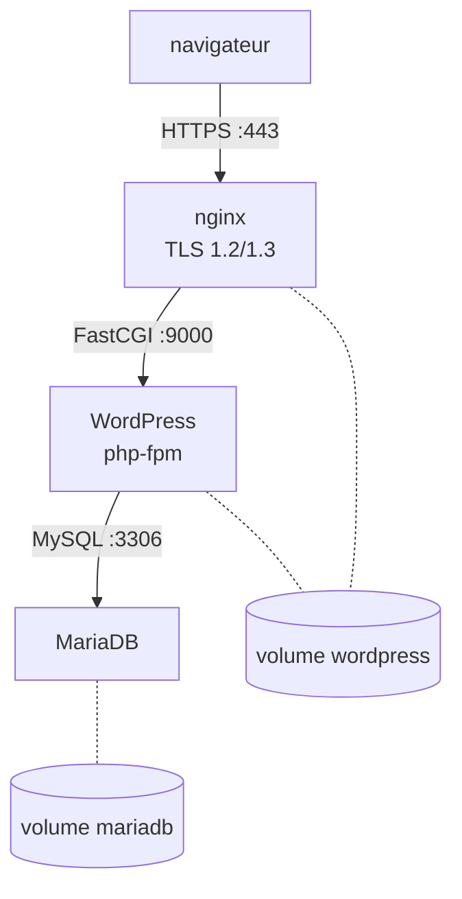

+++
title = "Inception : WordPress dans trois conteneurs écrits à la main"
description = "nginx avec TLS, WordPress sur PHP-FPM et MariaDB, chacun construit à partir d'une image Debian nue avec Docker Compose : PID 1, scripts d'initialisation au premier démarrage, FastCGI entre conteneurs, et ce que je corrigerais aujourd'hui."
tags = ["42", "docker", "devops"]
+++

**Inception** est l'introduction de 42 aux conteneurs. L'objectif paraît banal, un site WordPress en
HTTPS, mais les règles le rendent instructif : chaque service doit tourner dans son **propre**
conteneur, construit à partir de son propre `Dockerfile` sur une image Debian ou Alpine nue. Récupérer
`wordpress:latest` ou `nginx:latest` sur Docker Hub est interdit. Le projet a obtenu **100/100**
([source](https://github.com/PfClaKr/Ecole42Paris_Inception)).

## L'architecture



Seul nginx publie un port sur l'hôte, et seulement le 443. WordPress et MariaDB ne sont joignables que
depuis le réseau bridge privé `intra`. Les deux volumes sont montés depuis `/home/<login>/data` sur
l'hôte, donc le site et la base survivent à `docker compose down`.

## Un processus, au premier plan

La première chose que Docker enseigne, c'est qu'un conteneur vit exactement aussi longtemps que son
**PID 1**. Un `Dockerfile` qui finit par `CMD service nginx start` s'arrête aussitôt : le script
d'init lance nginx en arrière-plan et rend la main, le PID 1 disparaît, et le conteneur s'arrête.
Chaque service doit tourner au premier plan :

```dockerfile
CMD ["nginx", "-g", "daemon off;"]   # nginx
CMD ["php-fpm7.3", "-F"]             # -F : ne pas se démoniser
CMD ["mysqld"]
```

Les bidouilles comme `tail -f /dev/null` ou `sleep infinity` pour garder un conteneur en vie sont
explicitement interdites, et à raison : Docker surveille alors `tail`, pas votre service. Si nginx
plante, le conteneur continue de tourner et `restart: always` ne se déclenche jamais.

## L'initialisation au premier démarrage

MariaDB et WordPress ont besoin d'une mise en place au premier lancement : créer la base et
l'utilisateur, télécharger WordPress, écrire `wp-config.php`, lancer l'installation. Les deux
conteneurs suivent le même schéma d'entrypoint : démarrer le service temporairement, le configurer,
l'arrêter, puis faire un `exec` de la vraie commande.

```bash
#!/bin/bash
service mysql start

echo "CREATE DATABASE IF NOT EXISTS $MARIADB_DATABASE;" | mysql -uroot
echo "CREATE USER IF NOT EXISTS '$MARIADB_USER'@'%' IDENTIFIED BY '$MARIADB_PWD';" | mysql -uroot
echo "GRANT ALL PRIVILEGES ON $MARIADB_DATABASE.* TO '$MARIADB_USER'@'%';" | mysql -uroot

service mysql stop
exec "$@"      # remplace le shell par mysqld, qui devient PID 1
```

`exec` compte. Sans lui, bash reste PID 1, `mysqld` est son enfant, et `docker stop` envoie `SIGTERM`
à bash, qui l'ignore. Docker attend dix secondes puis tue tout avec `SIGKILL`, ce qui n'est pas une
façon propre d'arrêter une base de données.

Côté WordPress, [WP-CLI](https://wp-cli.org) permet une installation non interactive, protégée par
`if [ ! -f wp-config.php ]` pour ne tourner qu'une fois. Au démarrage suivant, le volume contient déjà
un site installé.

## nginx parle FastCGI

nginx n'exécute pas de PHP. Il transmet les requêtes `.php` à php-fpm en FastCGI, à travers le réseau
des conteneurs :

```nginx
server {
    listen 443 ssl;
    ssl_protocols TLSv1.2 TLSv1.3;
    root /var/www/html;

    location ~ \.php$ {
        include snippets/fastcgi-php.conf;
        fastcgi_param SCRIPT_FILENAME /var/www/html/$fastcgi_script_name;
        fastcgi_pass 172.31.0.12:9000;
    }
}
```

C'est pourquoi le volume WordPress est monté dans **les deux** conteneurs : nginx sert directement les
fichiers statiques (images, CSS), et php-fpm exécute les fichiers PHP depuis le même chemin. Le
certificat TLS est auto-signé avec `openssl req -x509` à la construction, donc le navigateur avertit,
ce qui est normal.

## Ce que je corrigerais aujourd'hui

Inception est passé, mais en le relisant, quelques points ressortent :

- **Des IP fixes.** J'ai attaché chaque conteneur à une adresse de `172.31.0.0/16`. Compose donne déjà
  un nom DNS à chaque service sur son réseau, donc `fastcgi_pass wordpress:9000` est plus simple et ne
  casse pas si le sous-réseau change.
- **Des secrets dans `.env`.** Les mots de passe de la base et de l'admin étaient dans un `.env`
  commité dans le dépôt. Les `secrets:` de Compose les montent plutôt comme fichiers sous
  `/run/secrets/`, hors de Git et hors de `docker inspect`.
- **L'ordre de démarrage.** Rien ne fait attendre WordPress que MariaDB accepte les connexions. Un
  `healthcheck` sur MariaDB plus `depends_on: condition: service_healthy` le ferait.
- **Une configuration non idempotente.** L'entrypoint WordPress ajoute `listen = 0.0.0.0:9000` à la
  configuration du pool php-fpm à **chaque** démarrage. Ça marche parce que la dernière ligne gagne,
  mais le fichier grossit à chaque redémarrage. Ça devrait être fait dans l'image, à la construction.
