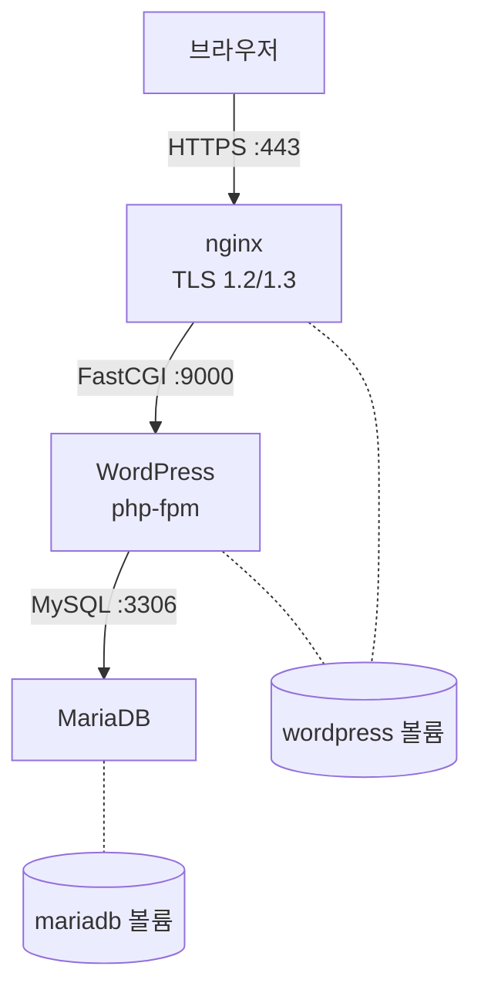

+++
title = "Inception: 직접 작성한 컨테이너 세 개로 WordPress 띄우기"
description = "TLS를 쓰는 nginx, PHP-FPM 위의 WordPress, MariaDB를 각각 빈 Debian 이미지에서 빌드해 Docker Compose로 묶기: PID 1, 첫 실행 초기화 스크립트, 컨테이너 사이의 FastCGI, 그리고 지금이라면 고칠 점."
tags = ["42", "docker", "devops"]
+++

**Inception**은 42의 컨테이너 입문 과제입니다. 목표는 평범해 보입니다. HTTPS로 WordPress 사이트를
띄우는 것. 하지만 규칙 덕분에 배울 게 많습니다. 서비스마다 **자기만의** 컨테이너에서 돌아야 하고, 빈
Debian이나 Alpine 이미지 위에 직접 쓴 `Dockerfile`로 빌드해야 합니다. Docker Hub의 `wordpress:latest`나
`nginx:latest`를 가져다 쓰는 건 금지입니다. **100/100**을 받았습니다
([소스](https://github.com/PfClaKr/Ecole42Paris_Inception)).

## 구조



호스트에 포트를 여는 건 nginx뿐이고, 그것도 443 하나입니다. WordPress와 MariaDB는 사설 브리지 네트워크
`intra`에서만 접근할 수 있습니다. 두 볼륨은 호스트의 `/home/<login>/data` 아래에 바인드 마운트되어서,
`docker compose down`을 해도 사이트와 데이터베이스가 남습니다.

## 프로세스 하나, 포그라운드로

Docker가 가장 먼저 가르쳐 주는 건, 컨테이너는 정확히 **PID 1**이 살아 있는 동안만 산다는 점입니다.
`CMD service nginx start`로 끝나는 `Dockerfile`은 바로 종료됩니다. init 스크립트가 nginx를
백그라운드로 띄우고 반환하면 PID 1이 사라지고 컨테이너가 멈춥니다. 모든 서비스는 포그라운드에서 돌아야
합니다.

```dockerfile
CMD ["nginx", "-g", "daemon off;"]   # nginx
CMD ["php-fpm7.3", "-F"]             # -F: 데몬화하지 않음
CMD ["mysqld"]
```

컨테이너를 살려 두려고 `tail -f /dev/null`이나 `sleep infinity`를 쓰는 꼼수는 명시적으로 금지되어
있고, 이유가 있습니다. 그러면 Docker는 서비스가 아니라 `tail`을 감시합니다. nginx가 죽어도 컨테이너는
계속 돌고 `restart: always`는 절대 동작하지 않습니다.

## 첫 실행 초기화

MariaDB와 WordPress는 처음 시작할 때 설정이 필요합니다. 데이터베이스와 사용자를 만들고, WordPress를
내려받고, `wp-config.php`를 쓰고, 설치를 실행해야 합니다. 두 컨테이너 모두 같은 엔트리포인트 패턴을
씁니다. 서비스를 잠깐 띄우고, 설정하고, 멈춘 다음, 진짜 명령을 `exec`합니다.

```bash
#!/bin/bash
service mysql start

echo "CREATE DATABASE IF NOT EXISTS $MARIADB_DATABASE;" | mysql -uroot
echo "CREATE USER IF NOT EXISTS '$MARIADB_USER'@'%' IDENTIFIED BY '$MARIADB_PWD';" | mysql -uroot
echo "GRANT ALL PRIVILEGES ON $MARIADB_DATABASE.* TO '$MARIADB_USER'@'%';" | mysql -uroot

service mysql stop
exec "$@"      # 셸을 mysqld로 교체해서 mysqld가 PID 1이 됨
```

`exec`가 중요합니다. 없으면 bash가 PID 1로 남고 `mysqld`는 그 자식이 됩니다. `docker stop`은 bash에
`SIGTERM`을 보내는데 bash는 이를 무시하고, Docker는 10초를 기다린 뒤 `SIGKILL`로 전부 죽입니다.
데이터베이스를 멈추는 깔끔한 방법이 아닙니다.

WordPress 쪽은 [WP-CLI](https://wp-cli.org)로 대화 없이 설치하고, `if [ ! -f wp-config.php ]`로 감싸서
한 번만 실행합니다. 다음에 시작할 때는 볼륨에 이미 설치된 사이트가 있습니다.

## nginx는 FastCGI로 말한다

nginx는 PHP를 실행하지 않습니다. `.php` 요청을 컨테이너 네트워크 너머의 php-fpm에 FastCGI로 넘깁니다.

```nginx
server {
    listen 443 ssl;
    ssl_protocols TLSv1.2 TLSv1.3;
    root /var/www/html;

    location ~ \.php$ {
        include snippets/fastcgi-php.conf;
        fastcgi_param SCRIPT_FILENAME /var/www/html/$fastcgi_script_name;
        fastcgi_pass 172.31.0.12:9000;
    }
}
```

그래서 WordPress 볼륨을 **두** 컨테이너 모두에 마운트합니다. nginx는 정적 파일(이미지, CSS)을 거기서
바로 서빙하고, php-fpm은 같은 경로의 PHP 파일을 실행합니다. TLS 인증서는 빌드할 때 `openssl req -x509`로
자체 서명하니 브라우저가 경고하는데, 예상된 일입니다.

## 지금이라면 고칠 것

Inception은 통과했지만 다시 읽어 보면 눈에 띄는 게 몇 가지 있습니다.

- **고정 IP.** 컨테이너마다 `172.31.0.0/16` 안의 주소를 박아 넣었습니다. Compose는 이미 네트워크 안에서
  서비스마다 DNS 이름을 주니, `fastcgi_pass wordpress:9000`이 더 간단하고 서브넷이 바뀌어도 깨지지
  않습니다.
- **`.env` 안의 비밀번호.** 데이터베이스와 관리자 비밀번호가 저장소에 커밋된 `.env` 파일에 있었습니다.
  Compose의 `secrets:`를 쓰면 `/run/secrets/` 아래 파일로 마운트되어 Git에도, `docker inspect`에도
  드러나지 않습니다.
- **시작 순서.** WordPress가 MariaDB가 연결을 받을 때까지 기다리게 하는 장치가 없습니다. MariaDB에
  `healthcheck`를 두고 `depends_on: condition: service_healthy`를 쓰면 됩니다.
- **멱등하지 않은 설정.** WordPress 엔트리포인트가 시작할 **때마다** php-fpm 풀 설정에
  `listen = 0.0.0.0:9000`을 덧붙입니다. 마지막 줄이 이기니 동작은 하지만, 재시작할 때마다 파일이
  길어집니다. 이건 빌드할 때 이미지 안에서 해야 합니다.
