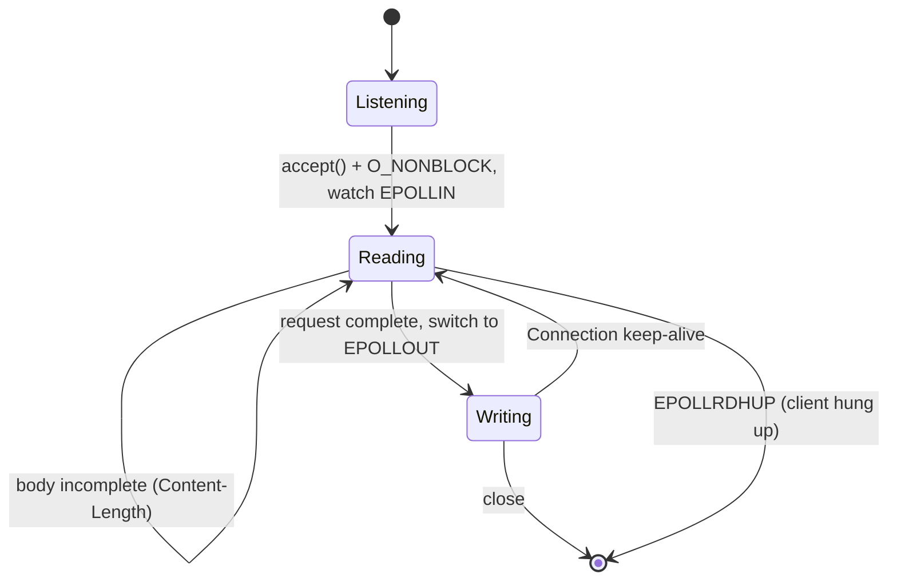

+++
title = "webserv: an HTTP/1.1 server on a single epoll loop"
description = "A non-blocking web server in C++98, built as a team of two: an nginx-style config, one epoll loop for every socket, requests that arrive in pieces, keep-alive, uploads, and CGI with fork and pipes."
tags = ["42", "cpp", "networking"]
+++

**webserv** asks you to write an HTTP server in C++98 that a real browser can use: static files,
directory listings, uploads, `DELETE`, redirections, custom error pages, CGI, and several virtual
servers from one config file. The constraint that shapes everything: **one** `poll()`-like call for
all I/O, and no blocking read or write anywhere. We built it as a team of two and got **100/100**
([source](https://github.com/PfClaKr/Ecole42Paris_Webserv)).

## The configuration

The config format borrows nginx's syntax:

```nginx
http {
    root      www;
    autoindex on;

    server {
        listen               8080;
        host                 127.0.0.1;
        client_max_body_size 8000;
        allow_methods        GET POST DELETE;

        location /cgi-bin {
            cgi_path      www/cgi-bin/php-cgi;
            cgi_extention .php;
        }
        location /redirection/42-intra {
            return https://intra.42.fr/;
        }
    }
}
```

Directives inherit downward: `root` set in `http` applies to every `server` and `location` unless
overridden. The parser builds a tree of contexts, and for each request the server looks up the
`location` block that matches the request path to find its root, index, allowed methods, redirection
or CGI handler.

## One loop for everything

We're on Linux, so the multiplexer is `epoll`. Every listening socket and every client connection is
registered in one epoll instance, and the whole server is a single loop:

```cpp
while (is_up)
{
    n = epoll_wait(epoll_fd, events, MAX_EVENTS, -1);
    for (int i = 0; i < n; i++)
        handle_epoll_events(events[i].data.fd, &events[i]);
}
```

Each file descriptor is in one of a few states, and the event tells us what to do:



The key move is switching a connection between `EPOLLIN` and `EPOLLOUT` with `EPOLL_CTL_MOD`. We only
ask to be woken for writing once a full request is parsed and a response is ready. Otherwise
`EPOLLOUT` fires constantly, because a socket is almost always writable, and the loop spins at 100%
CPU.

## Requests arrive in pieces

TCP is a byte stream, not a message stream. One `recv()` might return half the headers, or the
headers plus part of a 5 MB upload. The server has to buffer until it knows the request is complete:
the headers end at the first `\r\n\r\n`, and the body is complete once `Content-Length` bytes have
arrived (or, with `Transfer-Encoding: chunked`, once the zero-length chunk arrives).

Our server parses the headers from the first `recv()` and then keeps the connection in the reading
state, appending each `EPOLLIN`'s data to the body until it reaches `Content-Length`. A body larger
than `client_max_body_size` is answered with `413 Payload Too Large`.

## CGI

For a `.php` file under a CGI location, the server runs `php-cgi` as a child process. CGI is an old,
simple contract: request metadata goes in **environment variables** (`REQUEST_METHOD`,
`CONTENT_LENGTH`, `QUERY_STRING`, `SCRIPT_FILENAME`…), the body goes to the script's **stdin**, and
whatever it writes to **stdout** (headers, a blank line, then the body) becomes the response.

```cpp
FILE *body = tmpfile();                 // request body → temp file → child's stdin
write(fileno(body), request.body.data(), request.body.size());
lseek(fileno(body), 0, SEEK_SET);

pipe(out);
if (fork() == 0)
{
    dup2(fileno(body), STDIN_FILENO);
    dup2(out[1], STDOUT_FILENO);        // child's stdout → pipe → response
    execve(cgi_path, argv, env);
}
```

Writing the body to a temporary file instead of a pipe avoids a classic deadlock. If the parent wrote
a large body into a pipe, it would block once the 64 KiB pipe buffer was full, waiting for a child that
might itself be blocked writing its output.

## What we'd improve

The server passed every evaluation test, but reading it again with more experience:

- **Per-connection state.** The "partial request" buffer and flag live in the `Server` object, not
  in a per-connection structure. Two clients uploading large files at the same moment would interleave
  their bodies. Everything about a request in progress belongs in a map keyed by file descriptor.
- **CGI blocks the loop.** The parent calls `waitpid()` and then reads the pipe. A slow script stalls
  every other client, and a script that prints more than 64 KiB blocks on a full pipe while the parent
  waits for it to exit: a deadlock. The pipe should be registered in epoll like any other fd, with a
  timeout that kills runaway scripts.
- **Headers in one read.** Headers are assumed to fit in the first 2 KiB `recv()`. A slow client, or a
  request with many cookies, breaks that assumption.
- **No idle timeout.** A client that opens a connection and sends nothing keeps its socket forever.
