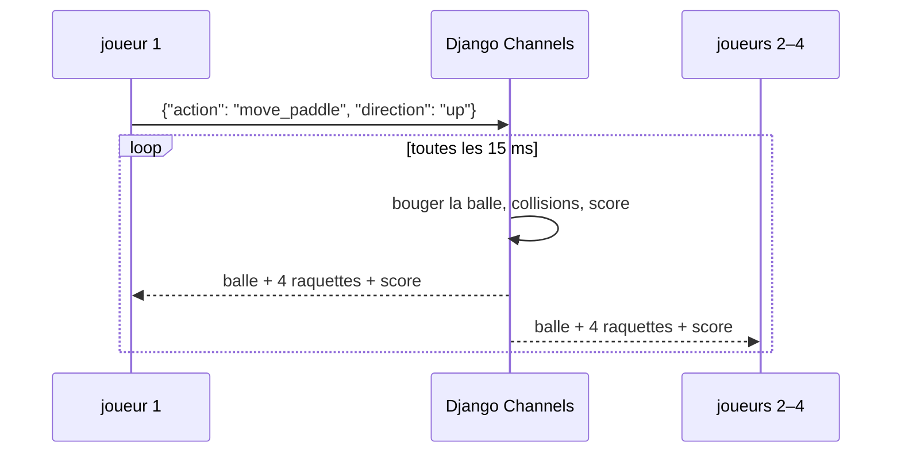

+++
title = "ft_transcendence : un Pong côté serveur pour quatre joueurs"
description = "Le dernier projet du tronc commun, réalisé à trois : un Pong en 2 contre 2 dont la boucle de jeu tourne sur le serveur avec Django Channels, des verrous de ligne contre les races, la reconnexion, l'OAuth 42 avec JWT, et des logs avec ELK (125/100)."
tags = ["42", "python", "web"]
+++

**ft_transcendence** clôt le tronc commun de 42 : une application web monopage autour d'un Pong, avec
des modules au choix (framework backend, OAuth, joueurs distants, 3D, gestion des logs, et d'autres).
On était trois, on a choisi 9,5 modules, et terminé à **125/100**
([source](https://github.com/sleepychloe/ft_transcendance)).

| Domaine | Ce qu'on a construit |
|---|---|
| Backend | Django, avec Channels pour les WebSockets, et PostgreSQL |
| Frontend | JS natif + Bootstrap, un mode 3D avec Three.js, trois langues |
| Jeu | 1v1 local, 3D local, tournois, et **multijoueur 2v2 à distance côté serveur** |
| Auth | OAuth 42, sessions en JWT dans un cookie |
| DevOps | nginx en frontal, pile ELK (Elasticsearch, Logstash, Kibana) pour les logs |

Ma part était surtout le backend : le serveur de jeu multijoueur, l'authentification et la chaîne de
logs. C'est le sujet de cet article.

## Pourquoi le serveur fait tourner le jeu

Dans la première version du Pong, chaque navigateur simule la balle lui-même. Avec des joueurs à
distance, ça ne tient plus : deux clients se désynchronisent après quelques rebonds, et n'importe qui
avec les devtools ouverts peut déplacer la balle. Le module « Server-Side Pong » règle ça en rendant le
serveur **autoritaire**. Les clients n'envoient que leurs actions, le serveur fait la physique, et tout
le monde dessine le même état.



## Une salle est un groupe de canaux

Chaque connexion WebSocket a son **consumer** Channels. Tous les consumers d'une même partie rejoignent
un groupe nommé d'après la salle, donc un seul `group_send` atteint les quatre joueurs :

```python
await self.channel_layer.group_add(self.game_id, self.channel_name)
...
await self.channel_layer.group_send(self.game_id, {
    'type': 'game_status',      # appelle game_status() sur chaque consumer du groupe
    'action': 'update',
    'data': state,
})
```

Quand le quatrième joueur clique sur « prêt », son consumer lance la boucle de jeu comme tâche
`asyncio`. Elle déplace la balle, teste les collisions avec les quatre raquettes (deux par côté), gère le
score, et diffuse le nouvel état environ 66 fois par seconde :

```python
async def ball_move_thread(self):
    while self.game_data.GameStatus:
        self.ball['x'] += self.vx
        self.ball['y'] += self.vy
        await self.paddle_ball_collision()
        ...
        await self.channel_layer.group_send(self.game_id, {...})
        await asyncio.sleep(0.015)
        await self.get_game_data()     # relire raquettes et statut
```

## Des races entre quatre consumers

Quatre consumers modifient la même salle en même temps : arrivée, bascule « prêt », raquettes,
déconnexion. Sans verrou, deux joueurs cliquant « prêt » au même moment peuvent lire tous les deux
`QuantityPlayerReady = 2`, écrire tous les deux 3, et la partie ne démarre jamais. La solution : faire
de chaque mise à jour une **lecture-modification-écriture dans une transaction avec un verrou de ligne** :

```python
@database_sync_to_async
@transaction.atomic()
def player_ready(self, n_client):
    room = MultiRoomInfo.objects.select_for_update().get(Roomid=self.game_id)
    room.QuantityPlayerReady += 1          # personne d'autre ne touche la ligne avant le commit
    getattr(room, n_client)['ready_status'] = 'ready'
    room.save()
```

`select_for_update()` devient `SELECT … FOR UPDATE` dans PostgreSQL, ce qui fait attendre la seconde
transaction jusqu'au commit de la première. `database_sync_to_async` exécute l'appel ORM bloquant dans
un thread pour que le consumer asynchrone ne bloque pas la boucle d'événements.

## La reconnexion

Rafraîchir la page ferme la WebSocket. Sans précaution, ça termine la partie pour tout le monde. Chaque
navigateur reçoit un cookie `client_id` aléatoire à la première visite, et la salle note quel
`client_id` tient quelle raquette. Une déconnexion en cours de partie marque seulement le joueur
`online: False`. Quand une socket revient avec le même cookie, le consumer retrouve sa place, rejoint le
groupe et reprend sa raquette. La même vérification empêche un navigateur de rejoindre deux fois la même
salle.

## OAuth 42 et JWT

La connexion passe par le flux OAuth2 « authorization code » de l'intranet 42 : redirection vers
`api.intra.42.fr/oauth/authorize`, réception d'un `code` au retour, échange côté serveur contre un jeton
d'accès, et récupération du profil via `/v2/me`. Ensuite on émet notre propre session sous forme de JWT
signé en HS256, stocké dans un cookie. Un middleware Django le décode à chaque requête et redirige vers
la page de connexion s'il manque ou n'est pas valide.

## Les logs avec ELK

Les logs d'accès de nginx partent vers Logstash, qui les analyse et les envoie à Elasticsearch, et
Kibana affiche des tableaux de bord par-dessus. Les trois services se parlent en TLS avec leurs propres
certificats : la chaîne de logs est une petite infrastructure à part entière, avec sa configuration et
ses pannes à elle.

## Ce que je changerais

- **L'état du jeu vit dans la base.** La boucle relit la ligne de la salle toutes les 15 ms, donc chaque
  partie coûte environ 66 requêtes par seconde. Garder l'état en mémoire (ou dans Redis, qui
  remplacerait aussi la couche de canaux en mémoire et permettrait plusieurs processus serveur) et
  n'écrire que les résultats dans PostgreSQL passerait bien mieux à l'échelle.
- **La boucle appartient au consumer d'un joueur.** Ça marche, mais la durée de vie de la partie est
  liée à une connexion. Un worker dédié par salle serait plus propre.
- **Les collisions sont testées par pas discrets.** Quand la balle accélère, elle peut sauter une
  raquette de 10 pixels en un seul pas. Balayer la trajectoire entre deux pas règle ça.
