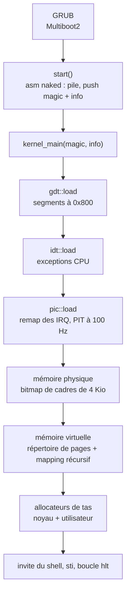
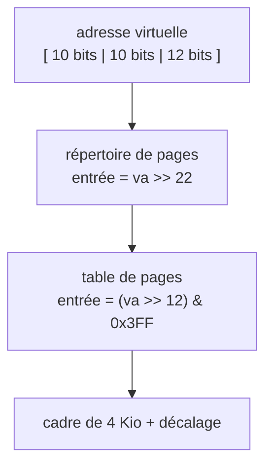

+++
title = "KFS : écrire un noyau x86 de zéro en Rust"
description = "De GRUB à l’invite de commande : comment notre noyau KFS de 42 démarre, configure la GDT, les interruptions et la pagination, puis obtient un allocateur de tas, en Rust no_std."
tags = ["42", "rust", "kernel", "osdev"]
+++

**KFS** (*Kernel From Scratch*) est un projet en quatre étapes de l’École 42. Avec mon binôme
[schaehun](https://profile.intra.42.fr/users/schaehun), nous l’avons écrit en **Rust**, pour le x86
32 bits, sans bibliothèque standard. Le noyau démarre avec GRUB, configure la segmentation et les
interruptions, gère la mémoire physique et virtuelle, fournit un tas pour que `Box` et `Vec`
fonctionnent, et se termine par un petit shell.

Cet article suit le chemin de la mise sous tension jusqu’à l’invite de commande, à partir du code
du [dépôt](https://github.com/PfClaKr/KFS).

## Vue d’ensemble



Nous l’avons construit en quatre étapes entre septembre et novembre 2024, chacune ajoutant une
couche de ce pipeline, en partant de « démarrer et afficher quelque chose à l’écran ».

## Compiler un noyau avec Cargo

Il n’y a pas d’OS en dessous : le compilateur a besoin d’une cible sur mesure. La nôtre est un
fichier JSON, `arch-i386/i386-unknown-none.json` :

```json
{
    "arch": "x86",
    "llvm-target": "i386-unknown-none",
    "features": "-mmx,-sse,+soft-float",
    "disable-redzone": true,
    "panic-strategy": "abort",
    "pre-link-args": { "gnu": ["-Tscripts/ld/x86.ld", "-melf_i386"] },
    "target-pointer-width": "32"
}
```

Deux réglages comptent pour du code noyau :

- **Pas de SSE/MMX, flottants logiciels.** Le noyau ne sauvegarde jamais les registres FPU/SSE à
  l’arrivée d’une interruption : le compilateur ne doit donc pas les utiliser dans notre dos.
- **Pas de red zone.** L’ABI System V autorise une fonction à utiliser 128 octets sous le pointeur
  de pile sans le déplacer. Une interruption empile sa trame exactement à cet endroit et
  corromprait ces données.

`core` et `alloc` ne sont pas fournis pour une cible personnalisée : Cargo les recompile
(nightly uniquement) :

```makefile
cargo build -Zbuild-std=core,alloc --release --target=arch-i386/i386-unknown-none.json
```

Le script de l’éditeur de liens charge le noyau à **2 Mio**, place l’en-tête `.multiboot` en
premier et exporte `kernel_start`, `kernel_end` et `stack_top`. Le gestionnaire de mémoire lit
ces symboles plus tard pour savoir quels cadres le noyau occupe. Enfin, `grub-mkrescue` emballe le
tout dans une ISO qui tourne dans QEMU (`make run`) ou attend GDB (`make debug-run`).

## Démarrage : Multiboot2 et un point d’entrée naked

GRUB cherche dans le binaire un en-tête Multiboot2 (magic `0xE85250D6`) placé dans la section
`.multiboot`. Quand il saute vers notre point d’entrée, la pile n’est pas définie : la première
fonction ne peut pas être du Rust ordinaire. C’est une **fonction naked** : de l’assembleur pur,
sans prologue.

```rust
#[naked]
#[no_mangle]
pub extern "C" fn start() -> ! {
    unsafe {
        naked_asm!(
            "lea esp, [STACK + 8192]", // notre propre pile de 8 Kio
            "xor ebp, ebp",
            "push ebx",                // adresse physique des infos Multiboot2
            "push eax",                // valeur magique : 0x36d76289
            "call {kernel_main}",
            "call {panic}",
            kernel_main = sym kernel_main,
            panic = sym panic,
        );
    }
}
```

`kernel_main(magic, multiboot_info)` vérifie la valeur magique avant toute chose :

```rust
assert_eq!(magic, 0x36d76289, "System have to load by Multiboot2 boot loader.");
```

## Segmentation : la GDT

Même avec un modèle mémoire plat, le mode protégé exige une Global Descriptor Table. La nôtre
contient sept entrées couvrant chacune les 4 Gio : null, code/données/pile du noyau (ring 0, octets
d’accès `0x9A`/`0x93`) et code/données/pile utilisateur (ring 3, `0xFA`/`0xF2`). Elle se trouve à
l’adresse physique fixe `0x800`.

Son chargement demande un peu d’assembleur : `lgdt` installe la table, un **far jump** recharge
`CS` avec le sélecteur de code noyau, et les registres de segment de données reçoivent le
sélecteur de données :

```rust
asm!(
    "   lgdtl ({})
        ljmp $0x08, $1f
    1:
        movw $0x10, %ax
        movw %ax, %ds
        movw %ax, %es
        movw %ax, %fs
        movw %ax, %gs
        movw %ax, %ss",
    in(reg) &gdtr as *const GdtDescriptor,
    out("ax") _,
    options(att_syntax)
);
```

## Interruptions : IDT, PIC et horloge

L’**IDT** associe les exceptions du CPU (vecteurs `0x00`–`0x15` : division par zéro, défaut de
page, faute de protection générale…) à des gestionnaires qui affichent la trame d’interruption
puis s’arrêtent. Toutes les entrées sont des interrupt gates 32 bits (`0x8E`) dans le segment de
code du noyau.

Les interruptions matérielles passent par les deux **PIC 8259** chaînés. Par défaut, ils émettent
les IRQ sur les vecteurs 8 à 15, qui entrent en collision avec les exceptions du CPU (8 est une
double faute !). La première tâche est donc de les déplacer vers `0x20`–`0x2F` (version
simplifiée de `pic.rs`) :

```rust
outb(PIC1_CMD, CMD_INIT);  outb(PIC2_CMD, CMD_INIT);   // ICW1 : début de l’init
outb(PIC1_DATA, 0x20);     outb(PIC2_DATA, 0x28);      // ICW2 : décalage des vecteurs
outb(PIC1_DATA, 4);        outb(PIC2_DATA, 2);         // ICW3 : câblage maître/esclave
outb(PIC1_DATA, MODE_8086); outb(PIC2_DATA, MODE_8086); // ICW4
```

Le **PIT** tourne à 1 193 182 Hz. En divisant par 11 931, on obtient un tick à 100 Hz, qui
incrémente un compteur utilisé par la commande `uptime`. L’IRQ 1 (le clavier) transmet les
scancodes au shell. Chaque gestionnaire matériel se termine en envoyant un *End Of Interrupt* au
PIC.

Nous avons écrit nous-mêmes les stubs des gestionnaires avec une `macro_rules!` : empiler les
registres généraux, appeler la fonction Rust, les dépiler, puis `iretd`.

## Mémoire physique : un bit par cadre

GRUB nous fournit une carte mémoire (tag Multiboot2 de type 6). Nous la parcourons et marquons
comme occupée toute région qui n’est pas de la RAM utilisable. Puis nous réservons ce qui est déjà
pris : le cadre 0, le buffer VGA à `0xB8000`, l’image du noyau entre `kernel_start` et
`kernel_end`, le répertoire de pages et les infos Multiboot.

La comptabilité est un **bitmap** : 4 Gio / 4 Kio = 1 048 576 cadres, 32 par `u32`, soit
32 768 mots (128 Kio) dans un tableau statique protégé par un `spin::Mutex` :

```rust
pub fn alloc_frame(&mut self) -> Result<usize, PhysicalMemoryError> {
    let next = self.next_available()?; // premier mot différent de 0xFFFFFFFF
    self.alloc_bitmap(next)?;          // positionne le bit
    Ok(next)                           // adresse physique du cadre
}
```

Les erreurs sont des valeurs Rust ordinaires (`OutofMemory`, `FrameAlreadyUse`, …) plutôt que des
nombres magiques.

## Mémoire virtuelle : pagination à deux niveaux et astuce récursive

La pagination 32 bits découpe une adresse virtuelle en trois parties :



Avant d’activer la pagination, nous mappons à l’identique ce qui doit rester accessible : la
première page, le buffer VGA, tout le noyau et les infos Multiboot. Ensuite, nous chargeons le
répertoire dans `CR3` et activons le bit 31 de `CR0`.

Une fois la pagination active, les tables de pages ne sont accessibles que via des adresses
virtuelles. La solution classique est le **mapping récursif** : la dernière entrée du répertoire
(1023) pointe vers le répertoire lui-même. Grâce à cette boucle, chaque table de pages apparaît à
`0xFFC00000 + (index << 12)`, et le répertoire à `0xFFFFF000` :

```rust
PAGE_DIRECTORY.lock().set_entry(1023, PDA, 0x3); // PD[1023] → PD
enable(PDA);                                     // CR3 = PD, CR0.PG = 1
*PAGE_DIRECTORY.lock() = PageDirectory(
    NonNull::new_unchecked((0x3FF << 22 | 0x3FF << 12) as *mut _), // 0xFFFFF000
    true, // mode récursif activé
);
```

C’est aussi pour cela que `map_page` refuse toute adresse dans les 4 derniers Mio : cette plage
appartient aux tables de pages.

## Un tas pour `alloc` : un allocateur buddy

Une fois les cadres et les pages en place, nous pouvons implémenter `GlobalAlloc`. Nous créons
deux allocateurs sur des plages virtuelles distinctes : un tas **utilisateur** de `0x300000` à
environ 2 Gio, et un tas **noyau** de là jusqu’à environ 3 Gio. Celui du noyau est le
`#[global_allocator]` : `Box`, `Vec` et compagnie fonctionnent donc dans le noyau.

Chaque allocateur est un **système buddy** avec des listes libres pour les ordres 0 à 10
(de 4 Kio à 4 Mio). Une demande prend le plus petit bloc qui convient. Si cette liste est vide, un
bloc plus grand est coupé en deux plusieurs fois, et chaque moitié inutilisée (son *buddy*)
descend d’un ordre (version simplifiée) :

```rust
fn allocate_split(&mut self, higher_order: usize, target_order: usize) -> *mut u8 {
    let address = self.pop(higher_order);
    let mut order = higher_order;
    while order > target_order {
        order -= 1;
        let buddy = address + (1 << (order + 12)); // seconde moitié du bloc
        self.push(order, buddy);
    }
    self.allocate_address(address, target_order) // mappe les pages, renvoie l’adresse virtuelle
}
```

Il y a un problème d’amorçage : l’allocateur ne peut pas utiliser le tas pour sa propre
comptabilité, donc les listes libres sont des tableaux de taille fixe (`[[usize; 1000]; 11]`).
Les demandes au-delà de 4 Mio sont composées de plusieurs blocs, ce qui ne fonctionne qu’une fois
la pagination activée.

## Le shell

L’écran est en mode texte VGA : 80×25 cellules à `0xB8000`, chacune composée d’un octet de
caractère et d’un octet de couleur. Par-dessus, une macro `println!` comprend de courtes séquences
`\x1b[n;m` pour changer de couleur. Le shell lit le buffer clavier et propose `help`, `uptime`,
`stack` (un hexdump de la pile du noyau), `bitmap` (la carte de la mémoire physique), `keymap`,
`interrupt <n>` (déclencher un vecteur à la main), `panic`, `halt` et `reboot`.

Quand quelque chose tourne mal, le gestionnaire de panique efface l’écran, affiche l’emplacement
et le message de `PanicInfo`, désactive les interruptions, remet les registres à zéro,
réinitialise le pointeur de pile et s’arrête.

## Ce que Rust nous a apporté, et ce qu’il n’a pas apporté

- **`unsafe` reste en bordure.** L’assembleur, les E/S sur ports et les adresses physiques fixes
  (`0x800`, `0x1000`, `0xB8000`) en ont besoin. La logique du bitmap, le calcul des index de tables
  de pages et la comptabilité de l’allocateur sont du Rust ordinaire avec des `Result`.
- **L’état global a besoin d’un verrou.** Il n’y a pas de threads, mais une interruption peut
  survenir à tout moment : chaque variable globale (`BITMAP`, `PAGE_DIRECTORY`, `PIC`, `SHELL`)
  est derrière un `spin::Mutex`.
- **`alloc` vaut l’effort.** Une fois `GlobalAlloc` en place, les collections habituelles viennent
  gratuitement avec `-Zbuild-std=core,alloc`.
- **L’assembleur ne disparaît pas.** Le point d’entrée, `lgdt` et son far jump, `CR0`/`CR3` et
  `iretd` restent écrits à la main, simplement enveloppés dans des fonctions Rust typées.

Le code est sur [GitHub](https://github.com/PfClaKr/KFS). Avec une toolchain Rust nightly, QEMU
et les outils GRUB installés, `make && make run` le démarre.
