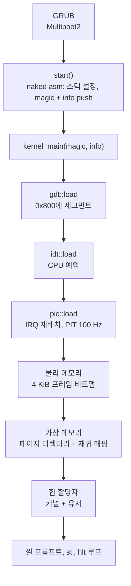
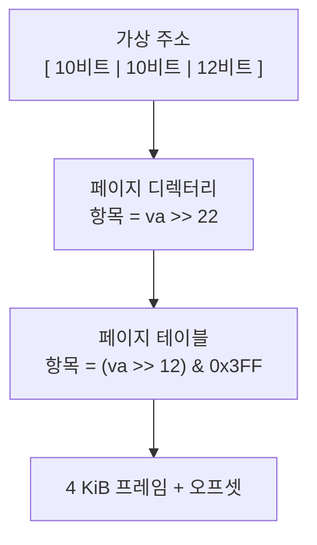

+++
title = "KFS: Rust로 x86 커널을 처음부터 만들기"
description = "GRUB부터 셸 프롬프트까지: 42 KFS 커널이 어떻게 부팅하고, GDT·인터럽트·페이징을 설정하고, 힙 할당자를 갖추는지 no_std Rust 코드로 따라가 봅니다."
tags = ["42", "rust", "kernel", "osdev"]
+++

**KFS**(*Kernel From Scratch*)는 École 42의 4단계짜리 프로젝트입니다. 팀원
[schaehun](https://profile.intra.42.fr/users/schaehun)과 함께 32비트 x86용 커널을 표준 라이브러리 없이
**Rust**로 작성했습니다. GRUB으로 부팅하고, 세그먼테이션과 인터럽트를 설정하고, 물리·가상 메모리를
관리하고, `Box`와 `Vec`을 쓸 수 있도록 힙을 제공한 뒤, 작은 셸에서 끝납니다.

이 글에서는 [저장소](https://github.com/PfClaKr/KFS)의 코드를 따라 전원이 들어온 순간부터 프롬프트가
뜰 때까지의 과정을 살펴봅니다.

## 전체 흐름



2024년 9월부터 11월까지 네 단계에 걸쳐, "부팅해서 화면에 뭔가 출력하기"에서 시작해 이 흐름을 한 층씩
쌓아 올렸습니다.

## Cargo로 커널 빌드하기

아래에 OS가 없으니 컴파일러에게 전용 타깃을 알려 줘야 합니다. 저희 타깃은
`arch-i386/i386-unknown-none.json` 파일입니다.

```json
{
    "arch": "x86",
    "llvm-target": "i386-unknown-none",
    "features": "-mmx,-sse,+soft-float",
    "disable-redzone": true,
    "panic-strategy": "abort",
    "pre-link-args": { "gnu": ["-Tscripts/ld/x86.ld", "-melf_i386"] },
    "target-pointer-width": "32"
}
```

커널 코드에서 중요한 설정은 두 가지입니다.

- **SSE/MMX 금지, 소프트웨어 부동소수점.** 커널은 인터럽트가 걸릴 때 FPU/SSE 레지스터를 저장하지
  않으므로, 컴파일러가 몰래 그 레지스터를 쓰면 안 됩니다.
- **레드 존 비활성화.** System V ABI는 함수가 스택 포인터를 옮기지 않고 그 아래 128바이트를 쓸 수 있게
  허용합니다. 그런데 인터럽트는 바로 그 위치에 프레임을 push하므로 데이터가 망가집니다.

커스텀 타깃용 `core`와 `alloc`은 미리 빌드되어 있지 않아서 Cargo가 직접 다시 빌드합니다(nightly 전용).

```makefile
cargo build -Zbuild-std=core,alloc --release --target=arch-i386/i386-unknown-none.json
```

링커 스크립트는 커널을 **2 MiB** 지점에 올리고, `.multiboot` 헤더를 맨 앞에 두고,
`kernel_start`, `kernel_end`, `stack_top` 심볼을 내보냅니다. 메모리 관리자는 나중에 이 심볼로 커널이
차지한 프레임을 알아냅니다. 마지막으로 `grub-mkrescue`가 ISO로 묶어 주면 QEMU에서 실행하거나
(`make run`) GDB 접속을 기다리게 할 수 있습니다(`make debug-run`).

## 부팅: Multiboot2와 naked 진입점

GRUB은 바이너리의 `.multiboot` 섹션에서 Multiboot2 헤더(magic `0xE85250D6`)를 찾습니다. GRUB이 진입점으로
점프한 시점에는 스택이 정해져 있지 않기 때문에, 첫 함수는 평범한 Rust일 수 없습니다. 프롤로그 없이
순수 어셈블리로만 된 **naked 함수**입니다.

```rust
#[naked]
#[no_mangle]
pub extern "C" fn start() -> ! {
    unsafe {
        naked_asm!(
            "lea esp, [STACK + 8192]", // 직접 잡은 8 KiB 스택
            "xor ebp, ebp",
            "push ebx",                // Multiboot2 정보의 물리 주소
            "push eax",                // 매직 값: 0x36d76289
            "call {kernel_main}",
            "call {panic}",
            kernel_main = sym kernel_main,
            panic = sym panic,
        );
    }
}
```

`kernel_main(magic, multiboot_info)`는 가장 먼저 매직 값을 확인합니다.

```rust
assert_eq!(magic, 0x36d76289, "System have to load by Multiboot2 boot loader.");
```

## 세그먼테이션: GDT

평면(flat) 메모리 모델을 쓰더라도 보호 모드에는 Global Descriptor Table이 꼭 필요합니다. 저희 GDT에는
4 GiB 전체를 덮는 항목이 일곱 개 있습니다. null, 커널 코드/데이터/스택(ring 0, 접근 바이트
`0x9A`/`0x93`), 유저 코드/데이터/스택(ring 3, `0xFA`/`0xF2`)입니다. 위치는 고정 물리 주소 `0x800`입니다.

불러오는 데는 약간의 어셈블리가 필요합니다. `lgdt`로 테이블을 등록하고, **far jump**로 `CS`에 커널
코드 셀렉터를 다시 싣고, 데이터 세그먼트 레지스터에는 데이터 셀렉터를 넣습니다.

```rust
asm!(
    "   lgdtl ({})
        ljmp $0x08, $1f
    1:
        movw $0x10, %ax
        movw %ax, %ds
        movw %ax, %es
        movw %ax, %fs
        movw %ax, %gs
        movw %ax, %ss",
    in(reg) &gdtr as *const GdtDescriptor,
    out("ax") _,
    options(att_syntax)
);
```

## 인터럽트: IDT, PIC, 타이머

**IDT**는 CPU 예외(벡터 `0x00`–`0x15`: 0으로 나누기, 페이지 폴트, 일반 보호 오류…)를 핸들러에
연결합니다. 핸들러는 인터럽트 프레임을 출력하고 멈춥니다. 모든 항목은 커널 코드 세그먼트의 32비트
인터럽트 게이트(`0x8E`)입니다.

하드웨어 인터럽트는 연결된 두 개의 **8259 PIC**를 거칩니다. 기본 설정에서는 IRQ가 벡터 8–15로 들어오는데,
이게 CPU 예외와 겹칩니다(8번은 더블 폴트입니다!). 그래서 가장 먼저 `0x20`–`0x2F`로 옮깁니다
(`pic.rs`를 단순화한 코드).

```rust
outb(PIC1_CMD, CMD_INIT);  outb(PIC2_CMD, CMD_INIT);   // ICW1: 초기화 시작
outb(PIC1_DATA, 0x20);     outb(PIC2_DATA, 0x28);      // ICW2: 벡터 오프셋
outb(PIC1_DATA, 4);        outb(PIC2_DATA, 2);         // ICW3: 마스터/슬레이브 연결
outb(PIC1_DATA, MODE_8086); outb(PIC2_DATA, MODE_8086); // ICW4
```

**PIT**는 1,193,182 Hz로 동작합니다. 11,931로 나누면 100 Hz 틱이 나오고, 이 틱이 `uptime` 명령에서 쓰는
카운터를 올립니다. IRQ 1(키보드)은 스캔코드를 셸로 넘깁니다. 모든 하드웨어 핸들러는 마지막에 PIC에
*End Of Interrupt*를 보냅니다.

핸들러 스텁은 `macro_rules!`로 직접 작성했습니다. 범용 레지스터를 push하고, Rust 함수를 호출하고,
레지스터를 pop한 뒤 `iretd`합니다.

## 물리 메모리: 프레임 하나에 비트 하나

GRUB은 메모리 맵(Multiboot2 태그 타입 6)을 넘겨줍니다. 이를 순회하면서 일반 RAM이 아닌 영역은 모두 사용
중으로 표시합니다. 그다음 이미 쓰이고 있는 곳을 예약합니다. 0번 프레임, `0xB8000`의 VGA 버퍼,
`kernel_start`부터 `kernel_end`까지의 커널 이미지, 페이지 디렉터리, Multiboot 정보입니다.

관리 방식은 **비트맵**입니다. 4 GiB / 4 KiB = 1,048,576개 프레임을 `u32` 하나에 32개씩 담아
32,768워드(128 KiB) 정적 배열로 만들고, `spin::Mutex`로 감쌌습니다.

```rust
pub fn alloc_frame(&mut self) -> Result<usize, PhysicalMemoryError> {
    let next = self.next_available()?; // 0xFFFFFFFF가 아닌 첫 워드
    self.alloc_bitmap(next)?;          // 비트 세팅
    Ok(next)                           // 프레임의 물리 주소
}
```

에러는 매직 넘버가 아니라 평범한 Rust 값(`OutofMemory`, `FrameAlreadyUse`, …)입니다.

## 가상 메모리: 2단계 페이징과 재귀 매핑

32비트 페이징은 가상 주소를 세 부분으로 나눕니다.



페이징을 켜기 전에, 계속 접근할 수 있어야 하는 영역을 아이덴티티 매핑합니다. 첫 페이지, VGA 버퍼, 커널
전체, Multiboot 정보입니다. 그런 다음 디렉터리 주소를 `CR3`에 넣고 `CR0`의 31번 비트를 켭니다.

페이징이 켜지고 나면 페이지 테이블에도 가상 주소로만 접근할 수 있습니다. 고전적인 해법이
**재귀 매핑**입니다. 디렉터리의 마지막 항목(1023)이 디렉터리 자기 자신을 가리키게 합니다. 이 고리
덕분에 모든 페이지 테이블은 `0xFFC00000 + (index << 12)`에, 디렉터리는 `0xFFFFF000`에 나타납니다.

```rust
PAGE_DIRECTORY.lock().set_entry(1023, PDA, 0x3); // PD[1023] → PD
enable(PDA);                                     // CR3 = PD, CR0.PG = 1
*PAGE_DIRECTORY.lock() = PageDirectory(
    NonNull::new_unchecked((0x3FF << 22 | 0x3FF << 12) as *mut _), // 0xFFFFF000
    true, // 재귀 모드 켜짐
);
```

`map_page`가 마지막 4 MiB 범위의 주소를 거부하는 것도 이 때문입니다. 그 영역은 페이지 테이블의
자리입니다.

## `alloc`을 위한 힙: 버디 할당자

프레임과 페이지가 준비되면 `GlobalAlloc`을 구현할 수 있습니다. 서로 다른 가상 주소 범위에 할당자를 두 개
둡니다. `0x300000`부터 약 2 GiB까지의 **유저** 힙, 그리고 거기서부터 약 3 GiB까지의 **커널** 힙입니다.
커널 힙이 `#[global_allocator]`이므로 커널 안에서 `Box`, `Vec` 등을 그대로 쓸 수 있습니다.

각 할당자는 order 0부터 10까지(4 KiB–4 MiB) free list를 갖는 **버디 시스템**입니다. 요청이 오면 들어갈
수 있는 가장 작은 블록을 꺼냅니다. 그 리스트가 비어 있으면 더 큰 블록을 반으로 계속 쪼개고, 쓰지 않는
나머지 반쪽(*버디*)은 한 단계 아래 리스트로 내려보냅니다(단순화한 코드).

```rust
fn allocate_split(&mut self, higher_order: usize, target_order: usize) -> *mut u8 {
    let address = self.pop(higher_order);
    let mut order = higher_order;
    while order > target_order {
        order -= 1;
        let buddy = address + (1 << (order + 12)); // 블록의 뒤쪽 절반
        self.push(order, buddy);
    }
    self.allocate_address(address, target_order) // 페이지를 매핑하고 가상 주소 반환
}
```

여기에는 닭과 달걀 문제가 있습니다. 할당자는 자기 장부를 힙에 둘 수 없으니, free list는 고정 크기
배열(`[[usize; 1000]; 11]`)입니다. 4 MiB를 넘는 요청은 블록 여러 개를 이어 붙여 처리하는데, 이건 페이징이
켜진 뒤에만 가능합니다.

## 셸

화면은 VGA 텍스트 모드입니다. `0xB8000`에 80×25칸이 있고, 각 칸은 문자 1바이트와 색상 1바이트로
이뤄집니다. 그 위에 올린 `println!` 매크로는 색을 바꾸는 짧은 `\x1b[n;m` 시퀀스를 이해합니다. 셸은 키보드
버퍼를 읽어 `help`, `uptime`, `stack`(커널 스택 hexdump), `bitmap`(물리 메모리 맵), `keymap`,
`interrupt <n>`(벡터를 직접 발생), `panic`, `halt`, `reboot` 명령을 처리합니다.

문제가 생기면 패닉 핸들러가 화면을 지우고, `PanicInfo`의 위치와 메시지를 출력하고, 인터럽트를 끄고,
레지스터를 비우고, 스택 포인터를 되돌린 뒤 멈춥니다.

## Rust가 준 것과 주지 않은 것

- **`unsafe`는 가장자리에만 남습니다.** 어셈블리, 포트 I/O, 고정 물리 주소(`0x800`, `0x1000`,
  `0xB8000`)에는 필요합니다. 비트맵 로직, 페이지 테이블 인덱스 계산, 할당자 장부 관리는 `Result`를 쓰는
  평범한 Rust 코드입니다.
- **전역 상태에는 락이 필요합니다.** 스레드는 없지만 인터럽트는 언제든 끼어들 수 있으니, 모든 전역
  (`BITMAP`, `PAGE_DIRECTORY`, `PIC`, `SHELL`)을 `spin::Mutex`로 감쌌습니다.
- **`alloc`은 고생할 가치가 있습니다.** `GlobalAlloc`만 있으면 `-Zbuild-std=core,alloc`으로 익숙한
  컬렉션을 그대로 쓸 수 있습니다.
- **어셈블리는 사라지지 않습니다.** 진입점, `lgdt`와 far jump, `CR0`/`CR3`, `iretd`는 여전히 손으로
  작성하고, 타입이 있는 Rust 함수로 감쌀 뿐입니다.

코드는 [GitHub](https://github.com/PfClaKr/KFS)에 있습니다. Rust nightly 툴체인, QEMU, GRUB 도구를
설치하고 `make && make run`을 실행하면 부팅됩니다.
