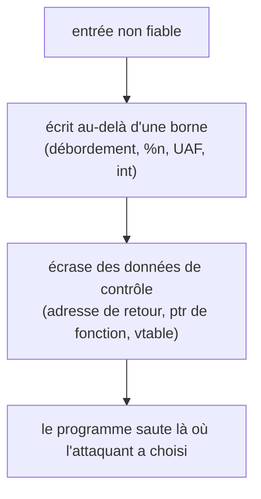

+++
title = "RainFall : une visite guidée des bugs de corruption mémoire"
description = "Quatorze niveaux d'exploitation de binaires à 42, lus comme un catalogue de classes de vulnérabilités : débordements de pile, chaînes de format, use-after-free, débordement d'entier et vtables C++, et les protections qui compliquent chacune."
tags = ["42", "security", "reverse-engineering"]
+++

**RainFall** est le premier projet de sécurité de 42. On reçoit une VM avec une chaîne de binaires
set-uid, `level0` à `level9` plus quatre bonus. Chacun s'exécute sous l'utilisateur *suivant*, et lire
son mot de passe permet de monter d'un cran. Le seul moyen d'avancer : faire faire au programme quelque
chose que son auteur n'avait pas prévu ([source](https://github.com/PfClaKr/Ecole42Paris_Rainfall)).

J'écris ça comme une rétrospective, pas comme un guide à copier-coller : pas de payloads, juste la classe
de bug derrière chaque niveau et la leçon qu'elle enseigne. Chacun de ces bugs part encore en production
dans de vrais logiciels, et c'est exactement pour ça que 42 vous les fait rencontrer d'abord du côté de
l'attaquant. La défense est dans la dernière partie.

## Lire un binaire

Chaque niveau est un petit ELF sans source. La boucle est toujours la même : le lancer, observer sa
réaction aux entrées, puis l'ouvrir dans un désassembleur (`gdb`, `objdump`, puis Ghidra) et reconstruire
le C dans sa tête. Les sources reconstruites du dépôt sont le *résultat* de ce reverse engineering, pas
le point de départ. La VM est volontairement ancienne, avec l'**ASLR désactivé** et **sans canary de
pile**, pour que les mécanismes soient visibles avant que les protections ne les cachent.

## Les classes de vulnérabilités

**Un simple bug de logique (level0).** Le programme lance un shell seulement si l'argument vaut un nombre
magique. Aucune corruption, juste lire le désassemblage et passer la bonne valeur. Il sert à apprendre la
démarche.

**Débordement de tampon sur la pile (level1, bonus0, bonus2).** Un tampon fixe rempli par `gets()` ou un
`strcpy`/`strcat` non borné. `gets()` n'a aucune limite de taille, donc une entrée plus longue que le
tampon déborde du cadre de pile et écrase l'adresse de retour sauvegardée. Contrôlez où pointe cette
adresse, et vous contrôlez où le CPU va ensuite. La correction est connue depuis des décennies : ne jamais
utiliser `gets`, et borner chaque copie.

**Chaîne de format (level3, level4, level5).** Le classique `printf(saisie)` au lieu de
`printf("%s", saisie)`. Si la chaîne de l'utilisateur contient des directives `%`, `printf` lit des
arguments jamais passés en remontant la pile. `%x` fuit la mémoire ; la directive `%n`, qui *écrit* le
nombre d'octets déjà affichés dans un argument pointeur, transforme un affichage en écriture arbitraire.
C'est pourquoi les compilateurs avertissent sur les chaînes de format non littérales, et pourquoi
`-Wformat-security` existe.

**Use-after-free et disposition du tas (level6, level8).** level6 garde un pointeur de fonction et un
tampon de chaîne sur le tas ; déborder la chaîne écrase le pointeur. level8 libère un tampon mais continue
de l'utiliser (`free(auth)` puis `auth[32]`), donc une allocation ultérieure peut réutiliser cette
mémoire et changer ce que voit le pointeur périmé. Ce sont les bugs qui motivent la plupart des exploits
de navigateurs modernes, et la raison des allocateurs durcis et d'outils comme ASan.

**Débordement d'entier (bonus1).** `memcpy(buffer, av[2], nb * 4)` avec `nb` un `int` contrôlé par
l'utilisateur. Un `nb` négatif passe un test `nb <= 9` mais devient une énorme taille **non signée** dans
`memcpy`, et un grand `nb` fait déborder `nb * 4`. Le bug arithmétique devient un bug mémoire. La leçon :
valider les tailles *après* avoir pensé au signe et au débordement, pas avant.

**Mémoire non initialisée / non terminée (level7, bonus3).** level7 s'appuie sur un contenu de tas non
initialisé ; bonus3 utilise `atoi(av[1])` pour placer un terminateur NUL dans un tampon, donc un indice
bien choisi peut rendre une chaîne de mot de passe égale à votre propre argument. De petites hypothèses
d'un cran sur la fin d'une chaîne, transformées en contournement d'authentification.

**Objets C++ et vtables (level9).** Le dernier niveau obligatoire est une classe C++ avec un tampon et un
pointeur de fonction membre posés côte à côte en mémoire. Déborder le tampon écrase le pointeur que
l'objet va appeler. À retenir : le polymorphisme, c'est un pointeur de fonction dans l'objet, et un
débordement dans un objet est un débordement dans son aiguillage.

Presque tous les niveaux ont la même forme : une entrée non fiable atteint une mémoire interdite, et cette
mémoire décide où le programme ira ensuite.

## Pourquoi rien de tout ça ne marche sur votre portable aujourd'hui

La VM de RainFall a les protections coupées exprès. Sur un système actuel, les mêmes bugs se heurtent à
des couches de défense, et c'est la vraie leçon du projet :

- **Les canaries de pile** (`-fstack-protector`) placent une valeur aléatoire avant l'adresse de retour et
  la vérifient avant de revenir, donc un débordement direct est attrapé.
- **NX / W^X** marque la pile non exécutable, donc on ne peut pas sauter dans du shellcode qu'on y a écrit.
- **L'ASLR** randomise où vivent la pile, le tas et les bibliothèques, donc les adresses en dur ratent.
- **PIE** randomise l'exécutable lui-même.
- **FORTIFY_SOURCE** et les avertissements du compilateur rejettent `gets`, bornent `memcpy`/`strcpy`
  quand la taille est connue, et signalent les chaînes de format non littérales.

Chaque protection relève la barre ; aucune ne suffit seule, d'où leur empilement. Avoir dû vaincre leur
*absence* à la main rend évident ce que chacune apporte vraiment.
