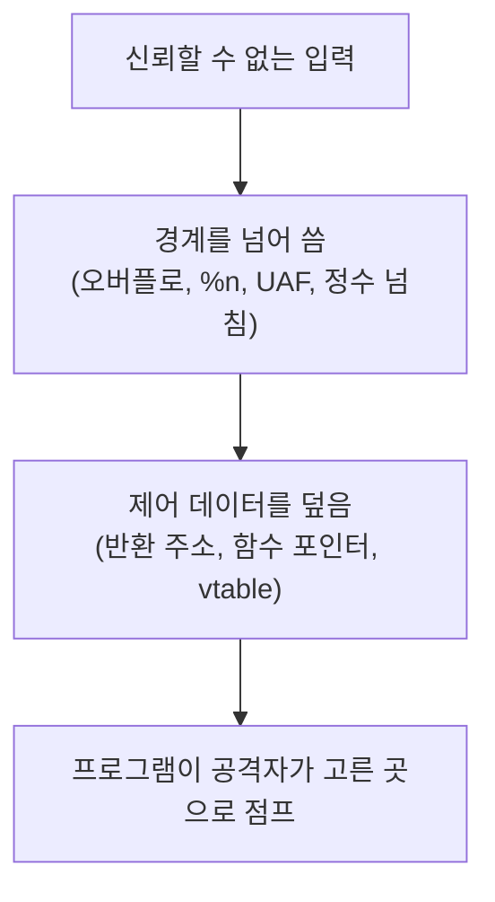

+++
title = "RainFall: 메모리 손상 버그 둘러보기"
description = "42의 바이너리 익스플로잇 14단계를 취약점 분류 목록으로 읽기: 스택 오버플로, 포맷 스트링, use-after-free, 정수 오버플로, C++ vtable, 그리고 각각을 어렵게 만드는 완화 기법."
tags = ["42", "security", "reverse-engineering"]
+++

**RainFall**은 42의 첫 보안 과제입니다. set-uid 바이너리가 사슬처럼 이어진 VM을 받습니다. `level0`부터
`level9`에 보너스 네 개까지. 각 바이너리는 *다음* 사용자 권한으로 실행되고, 그 비밀번호를 읽으면 한 단계
위로 로그인할 수 있습니다. 앞으로 나아가는 유일한 방법은 프로그램이 작성자가 의도하지 않은 일을 하게
만드는 것입니다([소스](https://github.com/PfClaKr/Ecole42Paris_Rainfall)).

이 글은 복붙 가이드가 아니라 회고로 씁니다. 페이로드는 없고, 각 단계 뒤에 있는 버그 종류와 그것이
가르치는 교훈만 다룹니다. 여기 나오는 버그는 모두 지금도 실제 소프트웨어에 그대로 실려 나가고, 42가 이걸
먼저 공격자 쪽에서 만나게 하는 이유가 바로 그것입니다. 방어는 마지막 절에 있습니다.

## 바이너리 읽기

각 단계는 소스가 없는 작은 ELF입니다. 과정은 늘 같습니다. 실행해 보고, 입력에 어떻게 반응하는지 살피고,
디스어셈블러(`gdb`, `objdump`, 나중엔 Ghidra)로 열어 머릿속에서 C를 다시 세웁니다. 저장소의 복원된
소스는 그 리버스 엔지니어링의 *결과*이지 출발점이 아닙니다. VM은 일부러 오래된 것이라 **ASLR이 꺼져**
있고 **스택 카나리가 없어서**, 완화 기법이 가리기 전의 동작 원리가 그대로 보입니다.

## 취약점 분류

**단순 로직 버그 (level0).** 인자가 매직 넘버와 같을 때만 셸을 띄웁니다. 손상은 전혀 없고, 디스어셈블리를
읽고 맞는 값을 넘기기만 하면 됩니다. 작업 흐름을 익히라고 있는 단계입니다.

**스택 버퍼 오버플로 (level1, bonus0, bonus2).** `gets()`나 길이를 확인하지 않는 `strcpy`/`strcat`으로
채우는 고정 버퍼. `gets()`는 길이 제한이 없어서 버퍼보다 긴 입력이 스택 프레임 끝을 넘어 저장된 반환
주소를 덮습니다. 그 반환 주소가 어디를 가리킬지 제어하면 CPU가 다음에 어디로 갈지 제어하게 됩니다.
해결책은 수십 년 전부터 알려져 있습니다. `gets`는 절대 쓰지 말 것, 모든 복사에 경계를 둘 것.

**포맷 스트링 (level3, level4, level5).** `printf("%s", 입력)` 대신 `printf(입력)`을 쓰는 고전적인 실수.
사용자 문자열에 `%` 지시자가 들어 있으면 `printf`는 넘긴 적 없는 인자를 스택을 거슬러 올라가며 읽습니다.
`%x`는 메모리를 흘리고, 지금까지 출력한 바이트 수를 포인터 인자에 *쓰는* `%n` 지시자는 출력문을 임의 쓰기로
바꿉니다. 컴파일러가 리터럴이 아닌 포맷 문자열을 경고하는 이유이고, `-Wformat-security`가 있는 이유입니다.

**use-after-free와 힙 배치 (level6, level8).** level6은 함수 포인터와 문자열 버퍼를 힙에 두는데, 문자열을
넘치게 하면 포인터를 덮습니다. level8은 버퍼를 해제하고도 계속 씁니다(`free(auth)` 뒤에 `auth[32]`).
그래서 나중의 할당이 그 메모리를 재사용해 낡은 포인터가 보는 값을 바꿀 수 있습니다. 요즘 브라우저 익스플로잇
대부분을 이끄는 버그이고, 강화된 할당자와 ASan 같은 도구가 있는 이유입니다.

**정수 오버플로 (bonus1).** `memcpy(buffer, av[2], nb * 4)`에서 `nb`가 사용자가 정하는 `int`입니다. 음수
`nb`는 `nb <= 9` 검사를 통과하지만 `memcpy` 안에서는 거대한 **부호 없는** 크기가 되고, 큰 `nb`는 `nb * 4`가
넘쳐 돕니다. 산술 버그가 메모리 버그가 됩니다. 교훈은, 크기는 부호와 오버플로를 생각한 *뒤에* 검증하라는
것입니다. 그 전이 아니라.

**초기화되지 않은 / 종료되지 않은 메모리 (level7, bonus3).** level7은 초기화되지 않은 힙 내용에 기댑니다.
bonus3은 `atoi(av[1])`로 버퍼 안에 NUL 종료 문자를 놓아서, 잘 고른 인덱스로 비밀번호 문자열이 내가 넘긴
인자와 같아지게 만들 수 있습니다. 문자열이 어디서 끝나는지에 대한 한 칸짜리 작은 가정이 인증 우회가 됩니다.

**C++ 객체와 vtable (level9).** 마지막 필수 단계는 버퍼와 멤버 함수 포인터가 메모리에 나란히 놓인 C++
클래스입니다. 버퍼를 넘치게 하면 객체가 호출할 포인터를 덮습니다. 요점은, 다형성이란 객체 안의 함수
포인터이고, 객체로의 오버플로는 그 디스패치로의 오버플로라는 것입니다.

거의 모든 단계가 같은 모양입니다. 신뢰할 수 없는 입력이 닿으면 안 되는 메모리에 닿고, 그 메모리가 결국
프로그램이 다음에 갈 곳을 정합니다.

## 왜 오늘 여러분 노트북에서는 이게 안 통하나

RainFall의 VM은 보호 기능을 일부러 꺼 뒀습니다. 요즘 시스템에서는 같은 버그가 여러 겹의 방어에 부딪히고,
그것이 이 과제의 진짜 교훈입니다.

- **스택 카나리**(`-fstack-protector`)는 저장된 반환 주소 앞에 무작위 값을 놓고 반환 전에 확인하니, 곧바로
  넘치는 공격은 걸립니다.
- **NX / W^X**는 스택을 실행 불가로 표시해서, 거기에 써 둔 셸코드로 바로 점프할 수 없게 합니다.
- **ASLR**은 스택·힙·라이브러리의 위치를 무작위화해서, 하드코딩한 주소가 빗나가게 합니다.
- **PIE**는 실행 파일 자체를 무작위화합니다.
- **FORTIFY_SOURCE**와 컴파일러 경고는 `gets`를 거부하고, 크기를 아는 `memcpy`/`strcpy`에 경계를 넣고,
  리터럴이 아닌 포맷 문자열을 표시합니다.

완화 기법마다 문턱을 높이지만, 하나만으로는 충분하지 않아서 겹겹이 쌓습니다. 이것들의 *부재*를 손으로 뚫어
봐야 각각이 실제로 무엇을 막아 주는지 분명해집니다.
