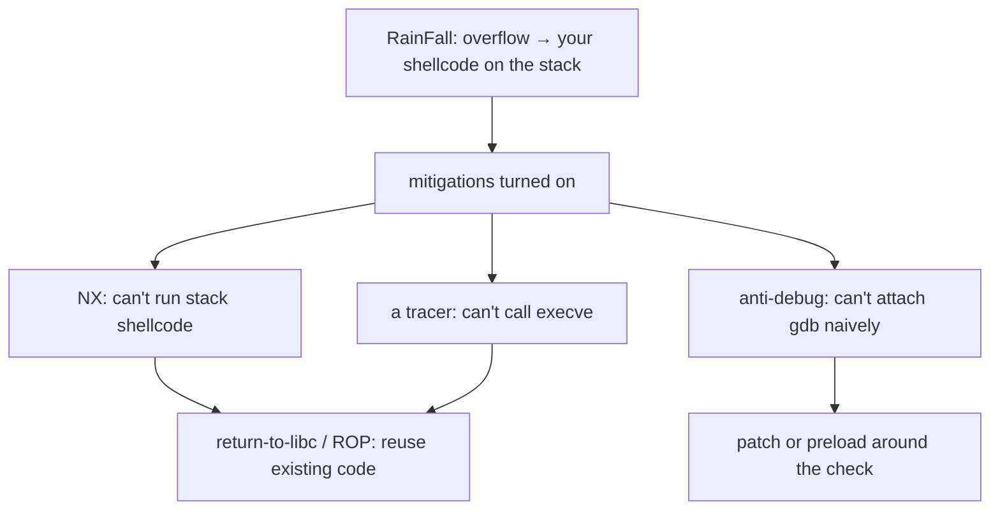

+++
title = "OverRide: exploitation past the easy mitigations"
description = "The sequel to RainFall: ten more levels where the shortcuts are closed. Anti-debugging with ptrace, defeating a non-executable stack with return-to-libc and ROP, GOT overwrites, and shellcode under a tracer."
tags = ["42", "security", "reverse-engineering"]
+++

**OverRide** is the follow-up to [RainFall](/posts/42/rainfall/): the same set-uid ladder, `level00` to
`level09`, but the binaries fight back. Where RainFall let you overwrite a return address and jump
straight into shellcode, OverRide turns on the defences and forces the techniques you actually need on a
modern target ([source](https://github.com/PfClaKr/Ecole42Paris_Override)).

Same disclaimer as before: this is a retrospective about vulnerability *classes*, not a payload cookbook.
The point is what each level teaches about attack and, by mirror image, defence.

## What's new compared to RainFall

RainFall was mostly "overflow a buffer, land on your shellcode". OverRide takes that away piece by piece.

**Reading, not just overflowing (level00–level02).** Several levels are about *information*: a hardcoded
check, a username compare, or a buffer the program itself fills with the next password and then lets you
read back through an overflow. The first skill of exploitation is recon, and these levels drill it.

**Anti-debugging with ptrace (level04, level06).** A process can call `ptrace(PTRACE_TRACEME)` or
`ptrace(PTRACE_PINE..., 0, 1, 0)` to detect or prevent a debugger, because a process can only be traced
once. level06 prints "TAMPERING DETECTED" and bails if it's already traced. You learn that
anti-debugging is a speed bump, not a wall: `LD_PRELOAD` a stub `ptrace`, patch the call, or set the
breakpoint after the check. It's exactly how malware hides and how analysts get around it.

**Return-to-libc (defeating NX).** With a non-executable stack, you can't run shellcode you wrote onto
the stack. So instead of pointing the overwritten return address at your own code, you point it at a
function that already exists, `system()` in libc, and arrange its argument (`"/bin/sh"`) on the stack.
The program's own library becomes the weapon. This is the headline technique the project is built
around.

**ROP, the generalisation.** Once you can chain one library call, you can chain many: find short
instruction sequences ending in `ret` ("gadgets") already present in the binary, and lay their addresses
on the stack so each one runs and returns into the next. Return-oriented programming lets you compute with
code you never wrote, which is why a non-executable stack alone isn't enough.

**GOT overwrite (format strings, again).** level05 and level08 come back to format strings and controlled
writes, but now the interesting target is the **Global Offset Table**, the table of resolved library
addresses a dynamically linked program jumps through. Overwrite the GOT entry for, say, `fprintf` with the
address of `system`, and the next "log" call runs a shell. It ties together the format-string write from
RainFall with how dynamic linking actually works.

**Shellcode under a tracer (level04).** One level forks, has the child trace itself, reads your input with
`gets`, and the parent watches via `ptrace` to block any `execve`. You still get to inject shellcode, but
it has to do its work *without* the one syscall the parent is screening for. It's a neat lesson that a
sandbox that blocks one syscall is not a sandbox.

**Struct overflow into a hidden path (level09).** A `struct` holds a message buffer, a username, and a
length field next to each other. Overflowing one field corrupts the length used for the next copy, and the
program contains a `secret_backdoor()` that runs `system()` on your input, waiting to be reached. Field
adjacency in a struct is as exploitable as adjacency on the stack.

## The defender's reading

Every technique here exists because one defence was deployed without the others. That's the real syllabus:

- NX stops stack shellcode, so attackers moved to **ret2libc and ROP** → the answer is **ASLR + PIE**, so
  the addresses they need aren't predictable.
- ASLR can be undone by an **info leak** (a format string, an uninitialised read) → so you also need to
  *close the leaks*, with `-Wformat-security`, initialised memory, and bounds checks.
- GOT overwrites motivated **RELRO** (`-Wl,-z,relro,-z,now`), which maps the GOT read-only after startup.
- Anti-debugging and syscall screening are **obfuscation**, useful to slow analysis but never a security
  boundary; real isolation is seccomp, namespaces, and least privilege.

The lesson that stuck from OverRide is that mitigations are a *system*. Any single one has a known bypass;
their value is in forcing an attacker to chain several, each of which needs something (an address, a leak,
a writable table) that another mitigation is meant to deny. Having built the chains by hand, I read a
hardening flag list very differently now.
