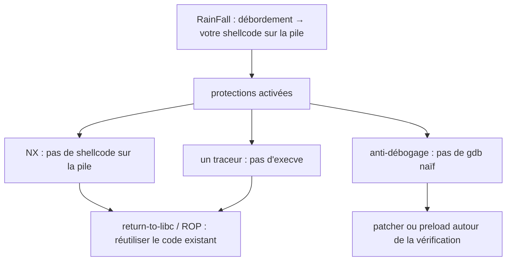

+++
title = "OverRide : l'exploitation au-delà des protections faciles"
description = "La suite de RainFall : dix niveaux de plus où les raccourcis sont fermés. Anti-débogage avec ptrace, contourner une pile non exécutable avec return-to-libc et ROP, écrasements de GOT, et du shellcode sous un traceur."
tags = ["42", "security", "reverse-engineering"]
+++

**OverRide** est la suite de [RainFall](/fr/posts/42/rainfall/) : la même échelle de binaires set-uid,
`level00` à `level09`, mais cette fois ils se défendent. Là où RainFall laissait écraser une adresse de
retour et sauter directement dans du shellcode, OverRide active les protections et impose les techniques
dont on a réellement besoin sur une cible moderne
([source](https://github.com/PfClaKr/Ecole42Paris_Override)).

Même avertissement qu'avant : c'est une rétrospective sur des *classes* de vulnérabilités, pas un livre de
recettes de payloads. L'intérêt, c'est ce que chaque niveau apprend sur l'attaque et, en miroir, sur la
défense.

## Ce qui change par rapport à RainFall

RainFall, c'était surtout « déborder un tampon, atterrir sur son shellcode ». OverRide retire ça morceau
par morceau.

**Lire, pas seulement déborder (level00–level02).** Plusieurs niveaux portent sur l'*information* : une
vérification en dur, une comparaison de nom d'utilisateur, ou un tampon que le programme remplit lui-même
avec le mot de passe suivant avant de laisser le relire par un débordement. La première compétence de
l'exploitation, c'est la reconnaissance, et ces niveaux l'entraînent.

**Anti-débogage avec ptrace (level04, level06).** Un processus peut appeler `ptrace(PTRACE_TRACEME)` ou
une variante pour détecter ou empêcher un débogueur, puisqu'un processus ne peut être tracé qu'une fois.
level06 affiche « TAMPERING DETECTED » et abandonne s'il est déjà tracé. On apprend que l'anti-débogage est
un ralentisseur, pas un mur : faire un `LD_PRELOAD` d'un `ptrace` factice, patcher l'appel, ou poser le
point d'arrêt après la vérification. C'est exactement comme ça que les malwares se cachent et que les
analystes les contournent.

**Return-to-libc (vaincre NX).** Avec une pile non exécutable, impossible d'exécuter du shellcode écrit
sur la pile. Alors, au lieu de pointer l'adresse de retour écrasée vers son propre code, on la pointe vers
une fonction qui existe déjà, `system()` dans la libc, et on dispose son argument (`"/bin/sh"`) sur la
pile. La bibliothèque du programme devient l'arme. C'est la technique phare autour de laquelle le projet
est construit.

**ROP, la généralisation.** Une fois qu'on sait enchaîner un appel de bibliothèque, on peut en enchaîner
plusieurs : trouver de courtes séquences d'instructions finissant par `ret` (« gadgets ») déjà présentes
dans le binaire, et poser leurs adresses sur la pile pour que chacune s'exécute et revienne dans la
suivante. La programmation orientée retour permet de calculer avec du code qu'on n'a jamais écrit, et c'est
pourquoi une pile non exécutable ne suffit pas seule.

**Écrasement de GOT (encore les chaînes de format).** level05 et level08 reviennent aux chaînes de format
et aux écritures contrôlées, mais la cible intéressante est maintenant la **Global Offset Table**, la table
des adresses de bibliothèque résolues par où saute un programme lié dynamiquement. Écrasez l'entrée GOT de,
disons, `fprintf` avec l'adresse de `system`, et le prochain appel de « log » lance un shell. Ça relie
l'écriture par chaîne de format de RainFall au fonctionnement réel de l'édition de liens dynamique.

**Shellcode sous un traceur (level04).** Un niveau fait un fork, l'enfant se trace lui-même, lit l'entrée
avec `gets`, et le parent surveille via `ptrace` pour bloquer tout `execve`. On peut toujours injecter du
shellcode, mais il doit faire son travail *sans* le seul appel système que le parent filtre. Belle leçon :
un bac à sable qui bloque un seul appel système n'est pas un bac à sable.

**Débordement de struct vers un chemin caché (level09).** Une `struct` contient un tampon de message, un
nom d'utilisateur et un champ de longueur côte à côte. Déborder un champ corrompt la longueur utilisée pour
la copie suivante, et le programme contient un `secret_backdoor()` qui exécute `system()` sur votre entrée,
en attente d'être atteint. L'adjacence des champs dans une struct est aussi exploitable que l'adjacence sur
la pile.

## La lecture du défenseur

Chaque technique ici existe parce qu'une défense a été déployée sans les autres. C'est ça, le vrai
programme :

- NX arrête le shellcode sur la pile, donc les attaquants sont passés au **ret2libc et au ROP** → la
  réponse, c'est **ASLR + PIE**, pour que les adresses nécessaires soient imprévisibles.
- L'ASLR peut être défait par une **fuite d'info** (une chaîne de format, une lecture non initialisée) →
  il faut donc aussi *fermer les fuites*, avec `-Wformat-security`, de la mémoire initialisée et des
  vérifications de bornes.
- Les écrasements de GOT ont motivé **RELRO** (`-Wl,-z,relro,-z,now`), qui rend la GOT en lecture seule
  après le démarrage.
- L'anti-débogage et le filtrage de syscalls sont de l'**obfuscation**, utile pour ralentir l'analyse mais
  jamais une frontière de sécurité ; l'isolation réelle, c'est seccomp, les namespaces et le moindre
  privilège.

La leçon qui est restée d'OverRide, c'est que les protections sont un *système*. Chacune prise seule a un
contournement connu ; leur valeur est de forcer l'attaquant à en enchaîner plusieurs, chacune ayant besoin
de quelque chose (une adresse, une fuite, une table modifiable) qu'une autre protection est censée refuser.
Après avoir construit les chaînes à la main, je lis une liste de flags de durcissement très différemment.
