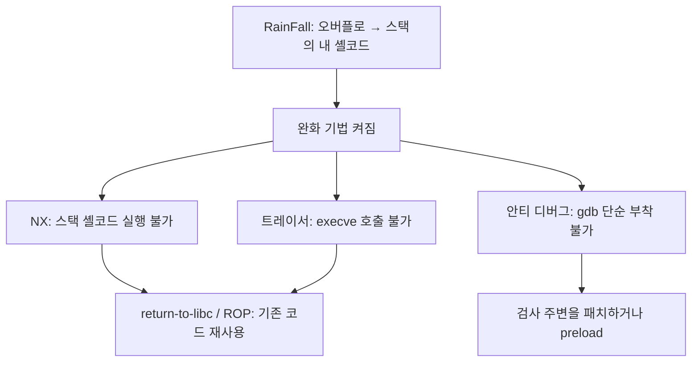

+++
title = "OverRide: 쉬운 완화 기법 너머의 익스플로잇"
description = "RainFall의 속편: 지름길이 막힌 열 단계. ptrace 안티 디버깅, return-to-libc와 ROP로 실행 불가 스택 뚫기, GOT 덮어쓰기, 그리고 트레이서 아래에서의 셸코드."
tags = ["42", "security", "reverse-engineering"]
+++

**OverRide**는 [RainFall](/ko/posts/42/rainfall/)의 후속 과제입니다. 같은 set-uid 사다리인 `level00`부터
`level09`까지지만, 이번엔 바이너리가 맞섭니다. RainFall이 반환 주소를 덮고 셸코드로 바로 점프하게 해 줬다면,
OverRide는 방어 기능을 켜서 현대 타깃에서 실제로 필요한 기법을 쓰게 만듭니다
([소스](https://github.com/PfClaKr/Ecole42Paris_Override)).

앞서와 같은 유의 사항: 이 글은 취약점 *종류*에 대한 회고이지 페이로드 요리책이 아닙니다. 핵심은 각 단계가
공격에 대해, 그리고 거울처럼 방어에 대해 무엇을 가르치는가입니다.

## RainFall과 무엇이 다른가

RainFall은 대개 "버퍼를 넘치게 해서 셸코드에 안착하기"였습니다. OverRide는 이걸 하나씩 걷어 냅니다.

**넘치게만 하는 게 아니라 읽기 (level00–level02).** 여러 단계가 *정보*에 관한 것입니다. 하드코딩된 검사,
사용자 이름 비교, 또는 프로그램이 다음 비밀번호로 채워 둔 버퍼를 오버플로로 되읽기. 익스플로잇의 첫 번째
기술은 정찰이고, 이 단계들이 그걸 훈련시킵니다.

**ptrace 안티 디버깅 (level04, level06).** 프로세스는 `ptrace(PTRACE_TRACEME)`나 그 변형을 불러 디버거를
탐지하거나 막을 수 있습니다. 한 프로세스는 한 번만 추적될 수 있기 때문입니다. level06은 이미 추적 중이면
"TAMPERING DETECTED"를 출력하고 포기합니다. 안티 디버깅은 벽이 아니라 과속방지턱이라는 걸 배웁니다. 가짜
`ptrace`를 `LD_PRELOAD`하거나, 호출을 패치하거나, 검사 뒤에 브레이크포인트를 걸면 됩니다. 멀웨어가 숨고
분석가가 우회하는 방식 그대로입니다.

**return-to-libc (NX 뚫기).** 스택이 실행 불가면 스택에 써 넣은 셸코드를 실행할 수 없습니다. 그래서 덮어쓴
반환 주소를 자기 코드가 아니라 이미 존재하는 함수, libc의 `system()`으로 향하게 하고, 그 인자(`"/bin/sh"`)를
스택에 배치합니다. 프로그램 자신의 라이브러리가 무기가 됩니다. 이 과제가 중심으로 삼는 대표 기법입니다.

**ROP, 그 일반화.** 라이브러리 호출 하나를 엮을 수 있으면 여러 개도 엮을 수 있습니다. 바이너리에 이미 있는,
`ret`으로 끝나는 짧은 명령어 조각("가젯")을 찾아 그 주소들을 스택에 늘어놓으면, 각 조각이 실행되고 다음
조각으로 되돌아갑니다. 반환 지향 프로그래밍(ROP)은 한 번도 쓴 적 없는 코드로 계산하게 해 주고, 그래서 실행
불가 스택만으로는 충분하지 않습니다.

**GOT 덮어쓰기 (또 포맷 스트링).** level05와 level08은 포맷 스트링과 제어된 쓰기로 돌아오지만, 이제 흥미로운
표적은 **Global Offset Table**입니다. 동적 링크된 프로그램이 거쳐 점프하는, 해석된 라이브러리 주소 표입니다.
예를 들어 `fprintf`의 GOT 항목을 `system`의 주소로 덮으면, 다음 "로그" 호출이 셸을 띄웁니다. RainFall의
포맷 스트링 쓰기를 동적 링크의 실제 작동 방식과 묶어 줍니다.

**트레이서 아래에서의 셸코드 (level04).** 한 단계는 fork해서 자식이 자신을 추적하고 `gets`로 입력을 읽고,
부모는 `ptrace`로 감시하며 모든 `execve`를 막습니다. 셸코드는 여전히 주입할 수 있지만, 부모가 거르는 바로
그 시스템 콜 *없이* 일을 해내야 합니다. 시스템 콜 하나를 막는 샌드박스는 샌드박스가 아니라는 깔끔한 교훈입니다.

**구조체 오버플로로 숨은 경로 열기 (level09).** 한 `struct`에 메시지 버퍼, 사용자 이름, 길이 필드가 나란히
들어 있습니다. 한 필드를 넘치게 하면 다음 복사에 쓰이는 길이가 망가지고, 프로그램 안에는 여러분의 입력으로
`system()`을 실행하는 `secret_backdoor()`가 닿기를 기다리고 있습니다. 구조체 안 필드의 인접성은 스택의
인접성만큼 익스플로잇에 쓰일 수 있습니다.

## 방어자의 독법

여기 나오는 모든 기법은 어떤 방어 하나가 나머지 없이 배치되었기 때문에 존재합니다. 그게 진짜 커리큘럼입니다.

- NX가 스택 셸코드를 막으니 공격자는 **ret2libc와 ROP**로 옮겨 갔다 → 답은 **ASLR + PIE**. 필요한 주소를
  예측할 수 없게 합니다.
- ASLR은 **정보 유출**(포맷 스트링, 초기화되지 않은 읽기)로 무력화될 수 있다 → 그래서 `-Wformat-security`,
  초기화된 메모리, 경계 검사로 *유출도 막아야* 합니다.
- GOT 덮어쓰기는 **RELRO**(`-Wl,-z,relro,-z,now`)를 낳았습니다. 시작 후 GOT를 읽기 전용으로 매핑합니다.
- 안티 디버깅과 시스템 콜 거르기는 **난독화**입니다. 분석을 늦추는 데는 쓸모 있지만 결코 보안 경계가 아닙니다.
  진짜 격리는 seccomp, 네임스페이스, 최소 권한입니다.
