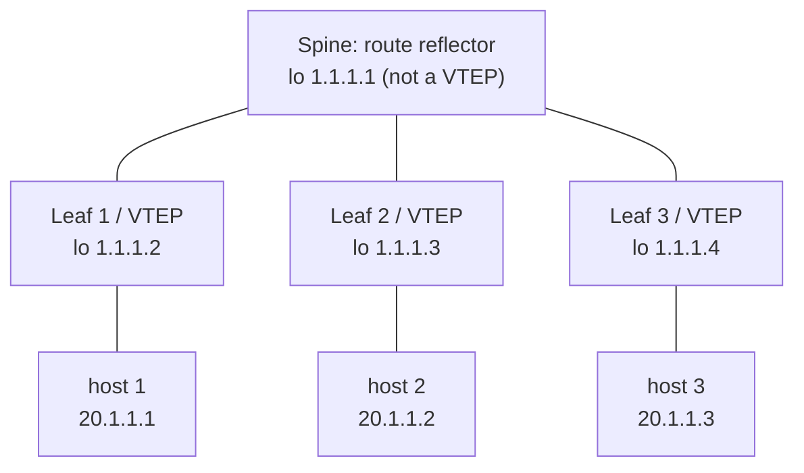
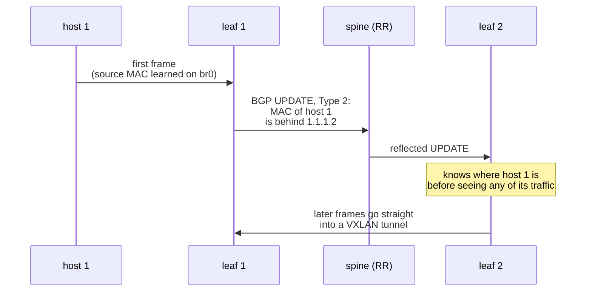

+++
title = "BADASS: putting L2 on top of L3 with VXLAN and BGP-EVPN"
description = "A GNS3 + FRRouting lab in three steps: hand-made VXLAN tunnels, then multicast, then a BGP-EVPN spine-leaf fabric where a route reflector teaches every leaf where each MAC lives."
tags = ["42", "network", "bgp", "vxlan"]
+++

**BADASS** (*BGP At Doors of Autonomous Systems is Simple*) is a 42 networking project built in
[GNS3](https://www.gns3.com/). Every router is a Docker container running
[FRRouting](https://frrouting.org/), and every host is a tiny Alpine container. The goal fits in
one sentence: hosts sitting on different routers, across a routed network, should behave as if
they were plugged into the **same switch**.

The project gets there in three parts. This post follows them using the configs from the
[repository](https://github.com/PfClaKr/Ecole42Paris_BADASS).

## Part 1: the building blocks

**GNS3** emulates rather than simulates: the GUI only draws the topology, while `gns3-server`
starts real containers and `ubridge` wires them together with veth pairs. That means real Linux
kernels forward the packets, and you can right-click any link to capture it in Wireshark.

**FRR** is not one program but a set of daemons. Each protocol (`bgpd`, `ospfd`, `isisd`)
computes its own routes and hands them to **zebra**, which picks the winners by administrative
distance and installs them in the kernel's routing table. The kernel forwards packets; FRR decides
where they should go.

The router image is just the official FRR image with the right daemons enabled:

```dockerfile
FROM frrouting/frr:latest
RUN apk update && apk add busybox-extras vim
ENV DAEMONS="zebra bgpd ospfd isisd"
COPY daemons /etc/frr/daemons
RUN chown frr:frr /etc/frr/daemons   # FRR refuses to start daemons whose config it doesn't own
CMD ["bash", "-c", "/usr/lib/frr/docker-start > /var/log/frr.log 2>&1 & exec bash"]
```

The hosts are `alpine` with `tcpdump` and `iperf`. Alpine's userland is BusyBox, so the image is
only a few megabytes.

## Part 2: VXLAN by hand

**VXLAN** wraps a complete Ethernet frame in UDP (port 4789) and sends it across an IP network.
A 24-bit **VNI** identifies the segment:

| | VLAN | VXLAN |
|---|---|---|
| Identifier | 12 bits, about 4,094 segments | 24 bits, about 16 million segments |
| Works at | L2 (802.1Q tag) | L3 (UDP encapsulation) |
| Reach | one L2 domain | across any routed network |

On each router, a Linux bridge joins the port facing the host (`eth1`) and a VXLAN interface. To
the host, the bridge is the switch, and the VXLAN interface is a cable that happens to cross the
network. In the **static** version, each router names its peer explicitly:

```sh
ip link add br0 type bridge
ip link set dev br0 up
ip link add name vxlan10 type vxlan id 10 dev eth0 remote 10.1.1.2 local 10.1.1.1 dstport 4789
ip link set dev vxlan10 up
ip addr add 10.1.1.1/24 dev eth0
brctl addif br0 eth1
brctl addif br0 vxlan10
```

The **multicast** version replaces `remote … local …` with `group 239.1.1.1`. Every router joins
the same group, and broadcast traffic is sent once to the group instead of once per peer:

| | Static (unicast) | Multicast group |
|---|---|---|
| Peers | listed in each config | not listed, just the group |
| Broadcast/unknown traffic | copied once per peer by the sender | sent once, replicated by the network |
| Adding a router | edit every existing router | configure only the new one |
| Requirement | none | the underlay must route multicast |

Both versions still learn MAC addresses by **flood and learn**: if you don't know where a MAC is,
send the frame everywhere and watch the replies. And public networks rarely carry multicast. Part 3
fixes both problems with a control plane.

## Part 3: BGP-EVPN on a spine-leaf fabric

**EVPN** uses multiprotocol BGP (the `l2vpn evpn` address family) to *advertise* MAC addresses,
the way BGP normally advertises IP prefixes. The data plane is still VXLAN; only the learning moves
into the control plane.



It works in two layers.

- **Underlay (OSPF).** Every router has a loopback (`1.1.1.x/32`), and OSPF makes those loopbacks
  reachable from each other. BGP sessions and VXLAN tunnels use the loopbacks, so they survive the
  loss of any single physical link.
- **Overlay (iBGP + route reflector).** iBGP doesn't forward routes learned from one iBGP peer to
  another, so normally every pair of routers needs its own session. A **route reflector** is
  allowed to reflect them instead, and each leaf only talks to the spine.

The spine's config uses a peer group and a listen range, so a new leaf needs no change on the
spine:

```text
router bgp 1
    neighbor ibgp peer-group
    neighbor ibgp remote-as 1
    neighbor ibgp update-source lo
    bgp listen range 1.1.1.0/29 peer-group ibgp
    address-family l2vpn evpn
        neighbor ibgp activate
        neighbor ibgp route-reflector-client
```

On a leaf, the VXLAN interface has **no peer and no group** anymore. EVPN fills that in:

```text
ip link add vxlan10 type vxlan id 10 dstport 4789

router bgp 1
    neighbor 1.1.1.1 remote-as 1
    neighbor 1.1.1.1 update-source lo
    address-family l2vpn evpn
        neighbor 1.1.1.1 activate
        advertise-all-vni
```

### Two route types do the work

- **Type 3 (inclusive multicast).** "I am a VTEP for VNI 10, and my address is 1.1.1.2." It exists
  as soon as the VNI is up, even with no host attached, and builds the list of peers that receive
  broadcast traffic. No multicast is needed.
- **Type 2 (MAC/IP advertisement).** "MAC `aa:bb:…` (and IP 20.1.1.1) is behind me." It appears once
  a host has sent traffic and its MAC has been learned, and it gains the IP part once the host has
  an address.



That chain is easy to demonstrate. With every host stopped, only Type 3 routes exist, and the
bridge already lists the remote VTEPs:

```sh
vtysh -c "show bgp l2vpn evpn route type multicast"   # [3]:[0]:[32]:[1.1.1.2] …
vtysh -c "show bgp l2vpn evpn route type macip"       # empty
bridge fdb show dev vxlan10 | grep 00:00:00:00:00:00  # dst 1.1.1.3, dst 1.1.1.4
```

Start one host without an IP and a MAC-only Type 2 route (`[2]:[0]:[48]:[mac]`) appears on
**every** leaf. Give the hosts addresses and the route grows an IP (`…:[32]:[20.1.1.1]`). Then
`ping` works across the fabric, and Wireshark shows ICMP inside UDP 4789 between loopbacks.

## Takeaways

- **Underlay and overlay are separate jobs.** OSPF only makes loopbacks reachable; BGP only
  carries reachability information; VXLAN only moves frames.
- **Part 2's problems are control-plane problems.** Flood and learn and multicast underlays go
  away once the network *tells* each VTEP what it would otherwise have to discover.
- **Route reflectors carry control traffic only.** The spine is not a VTEP; data flows leaf to
  leaf.

Configs for all three parts are on [GitHub](https://github.com/PfClaKr/Ecole42Paris_BADASS).
