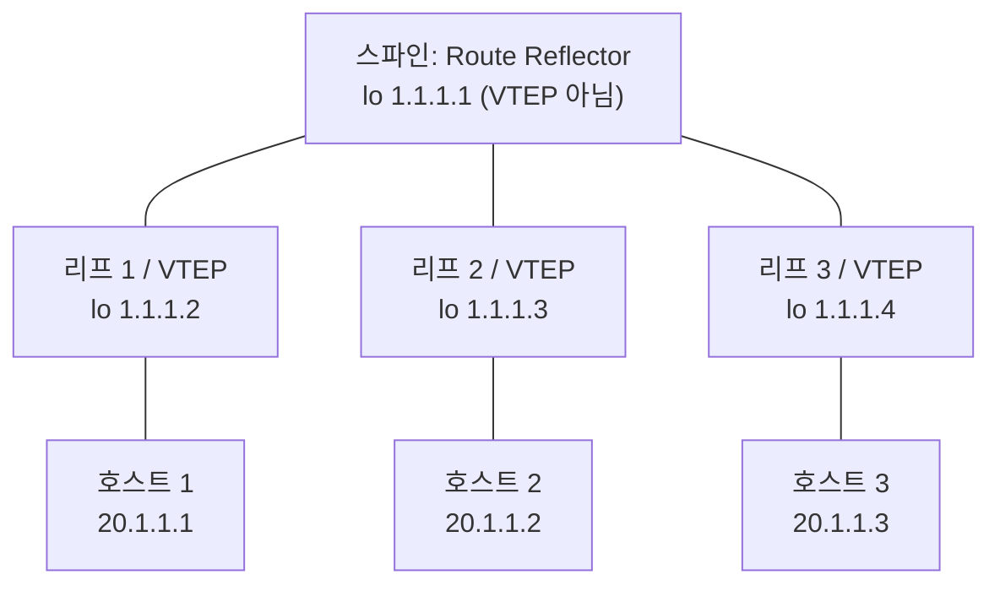
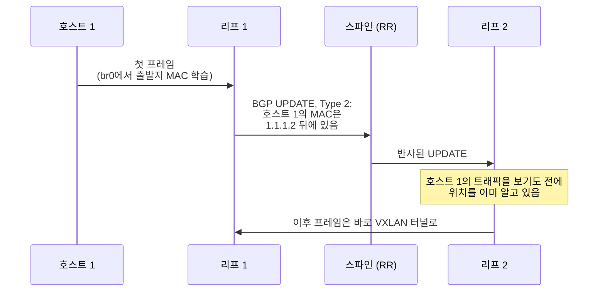

+++
title = "BADASS: VXLAN과 BGP-EVPN으로 L3 위에 L2 얹기"
description = "GNS3 + FRRouting 실습을 세 단계로: 손으로 만든 VXLAN 터널, 멀티캐스트, 그리고 Route Reflector가 모든 리프에게 MAC 위치를 알려 주는 BGP-EVPN 스파인-리프 구조."
tags = ["42", "network", "bgp", "vxlan"]
+++

**BADASS**(*BGP At Doors of Autonomous Systems is Simple*)는 [GNS3](https://www.gns3.com/)에서 진행하는
42 네트워크 프로젝트입니다. 모든 라우터는 [FRRouting](https://frrouting.org/)을 돌리는 Docker 컨테이너이고,
호스트는 작은 Alpine 컨테이너입니다. 목표는 한 문장으로 정리됩니다. 라우팅된 네트워크를 사이에 두고
서로 다른 라우터에 붙어 있는 호스트들이, 마치 **같은 스위치**에 꽂힌 것처럼 동작하게 만드는 것입니다.

프로젝트는 세 파트에 걸쳐 여기에 도달합니다. 이 글에서는
[저장소](https://github.com/PfClaKr/Ecole42Paris_BADASS)의 설정 파일을 따라가 봅니다.

## Part 1: 기본 구성 요소

**GNS3**는 시뮬레이션이 아니라 에뮬레이션입니다. GUI는 토폴로지를 그리기만 하고, 실제로는 `gns3-server`가
진짜 컨테이너를 띄우고 `ubridge`가 veth 페어로 서로 연결합니다. 그래서 패킷은 실제 리눅스 커널이
전달하고, 아무 링크나 우클릭해서 Wireshark로 바로 캡처할 수 있습니다.

**FRR**은 프로그램 하나가 아니라 데몬 묶음입니다. 프로토콜별 데몬(`bgpd`, `ospfd`, `isisd`)이 각자 경로를
계산해서 **zebra**에 넘기면, zebra가 AD(Administrative Distance)로 승자를 골라 커널 라우팅 테이블에
설치합니다. 패킷 전달은 커널이 하고, FRR은 어디로 보낼지를 결정합니다.

라우터 이미지는 공식 FRR 이미지에 필요한 데몬만 켠 것입니다.

```dockerfile
FROM frrouting/frr:latest
RUN apk update && apk add busybox-extras vim
ENV DAEMONS="zebra bgpd ospfd isisd"
COPY daemons /etc/frr/daemons
RUN chown frr:frr /etc/frr/daemons   # 설정 파일 소유자가 frr이 아니면 데몬이 시작되지 않음
CMD ["bash", "-c", "/usr/lib/frr/docker-start > /var/log/frr.log 2>&1 & exec bash"]
```

호스트는 `tcpdump`와 `iperf`를 넣은 `alpine`입니다. Alpine의 유저랜드가 BusyBox라서 이미지가 몇 MB밖에
되지 않습니다.

## Part 2: 손으로 만드는 VXLAN

**VXLAN**은 이더넷 프레임 전체를 UDP(4789번 포트)로 감싸서 IP 네트워크 너머로 보냅니다. 세그먼트는
24비트 **VNI**로 구분합니다.

| | VLAN | VXLAN |
|---|---|---|
| 식별자 | 12비트, 약 4,094개 | 24비트, 약 1,670만 개 |
| 동작 계층 | L2 (802.1Q 태그) | L3 (UDP 캡슐화) |
| 범위 | 하나의 L2 도메인 | 라우팅된 네트워크 어디든 |

각 라우터에서는 리눅스 브리지가 호스트 쪽 포트(`eth1`)와 VXLAN 인터페이스를 하나로 묶습니다. 호스트
입장에서 브리지는 스위치이고, VXLAN 인터페이스는 네트워크를 가로지르는 케이블입니다. **static** 버전에서는
각 라우터가 상대를 직접 지정합니다.

```sh
ip link add br0 type bridge
ip link set dev br0 up
ip link add name vxlan10 type vxlan id 10 dev eth0 remote 10.1.1.2 local 10.1.1.1 dstport 4789
ip link set dev vxlan10 up
ip addr add 10.1.1.1/24 dev eth0
brctl addif br0 eth1
brctl addif br0 vxlan10
```

**멀티캐스트** 버전은 `remote … local …` 대신 `group 239.1.1.1`을 씁니다. 모든 라우터가 같은 그룹에
가입하고, 브로드캐스트 트래픽은 상대마다 한 번씩이 아니라 그룹에 한 번만 보냅니다.

| | static (유니캐스트) | 멀티캐스트 그룹 |
|---|---|---|
| 상대 VTEP | 설정마다 직접 명시 | 명시 안 함, 그룹만 지정 |
| 브로드캐스트/미지 트래픽 | 송신자가 상대 수만큼 복제 | 한 번 보내면 네트워크가 복제 |
| 라우터 추가 | 기존 라우터 전부 수정 | 새 라우터만 설정 |
| 요구 사항 | 없음 | 언더레이가 멀티캐스트를 라우팅해야 함 |

두 방식 모두 MAC 주소는 여전히 **flood and learn**으로 배웁니다. MAC이 어디 있는지 모르면 일단 모든
곳으로 보내고 응답을 보고 배웁니다. 게다가 공용 네트워크는 멀티캐스트를 거의 전달하지 않습니다.
Part 3는 컨트롤 플레인으로 이 두 문제를 해결합니다.

## Part 3: 스파인-리프 위의 BGP-EVPN

**EVPN**은 멀티프로토콜 BGP(`l2vpn evpn` address family)로 MAC 주소를 *광고*합니다. BGP가 평소 IP
프리픽스를 광고하는 것과 같은 방식입니다. 데이터 플레인은 여전히 VXLAN이고, 학습만 컨트롤 플레인으로
옮겨 갑니다.



두 계층으로 동작합니다.

- **언더레이(OSPF).** 모든 라우터에 루프백(`1.1.1.x/32`)이 있고, OSPF가 루프백끼리 서로 도달할 수 있게
  해 줍니다. BGP 세션과 VXLAN 터널이 루프백을 쓰기 때문에, 물리 링크 하나가 끊어져도 살아남습니다.
- **오버레이(iBGP + Route Reflector).** iBGP는 한 iBGP 피어에게 배운 경로를 다른 iBGP 피어에게 전달하지
  않기 때문에, 원래는 라우터 쌍마다 세션이 필요합니다. **Route Reflector**는 이 경로를 반사해 줄 수 있어서,
  각 리프는 스파인하고만 세션을 맺으면 됩니다.

스파인 설정은 peer-group과 listen range를 써서, 리프를 추가해도 스파인을 고칠 필요가 없습니다.

```text
router bgp 1
    neighbor ibgp peer-group
    neighbor ibgp remote-as 1
    neighbor ibgp update-source lo
    bgp listen range 1.1.1.0/29 peer-group ibgp
    address-family l2vpn evpn
        neighbor ibgp activate
        neighbor ibgp route-reflector-client
```

리프의 VXLAN 인터페이스에는 이제 **상대도 그룹도 없습니다**. 그 빈칸은 EVPN이 채웁니다.

```text
ip link add vxlan10 type vxlan id 10 dstport 4789

router bgp 1
    neighbor 1.1.1.1 remote-as 1
    neighbor 1.1.1.1 update-source lo
    address-family l2vpn evpn
        neighbor 1.1.1.1 activate
        advertise-all-vni
```

### 일을 하는 두 가지 경로 타입

- **Type 3 (Inclusive Multicast).** "나는 VNI 10의 VTEP이고 주소는 1.1.1.2다." VNI가 올라오는 순간,
  호스트가 하나도 없어도 생깁니다. 브로드캐스트 트래픽을 받을 상대 목록을 만들어 주므로 멀티캐스트가
  필요 없습니다.
- **Type 2 (MAC/IP Advertisement).** "MAC `aa:bb:…`(와 IP 20.1.1.1)는 내 뒤에 있다." 호스트가 트래픽을
  보내 MAC이 학습되면 생기고, 호스트에 주소가 생기면 IP 부분이 붙습니다.



이 과정은 직접 보여 주기 쉽습니다. 호스트를 전부 끈 상태에서는 Type 3 경로만 있고, 브리지에는 이미 원격
VTEP 목록이 들어 있습니다.

```sh
vtysh -c "show bgp l2vpn evpn route type multicast"   # [3]:[0]:[32]:[1.1.1.2] …
vtysh -c "show bgp l2vpn evpn route type macip"       # 비어 있음
bridge fdb show dev vxlan10 | grep 00:00:00:00:00:00  # dst 1.1.1.3, dst 1.1.1.4
```

IP 없이 호스트 하나를 켜면 MAC만 있는 Type 2 경로(`[2]:[0]:[48]:[mac]`)가 **모든** 리프에 나타납니다.
호스트에 주소를 주면 경로에 IP가 붙습니다(`…:[32]:[20.1.1.1]`). 그러면 `ping`이 구조 전체를 가로질러
통하고, Wireshark에서는 루프백 사이 UDP 4789 안에 들어 있는 ICMP가 보입니다.

세 파트의 설정 파일은 모두 [GitHub](https://github.com/PfClaKr/Ecole42Paris_BADASS)에 있습니다.
