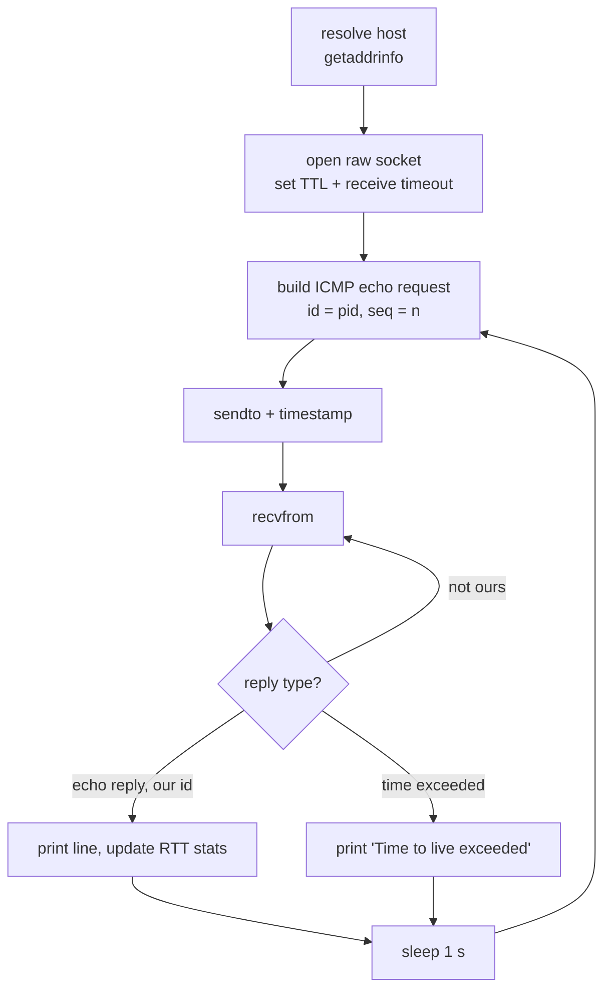

+++
title = "ft_ping: rebuilding ping with raw ICMP sockets"
description = "What happens behind `ping`: building ICMP echo requests by hand, the RFC 1071 checksum, parsing replies under the IP header, and computing RTT statistics with Welford's algorithm."
tags = ["42", "network", "c", "linux"]
+++

`ping` is the first network tool most of us learn, and **ft_ping** asks you to rewrite it in C,
using `inetutils-2.0` as the reference for behavior and output. There is no library doing the work:
you build the packets, send them on a raw socket, and decode whatever comes back.

The whole implementation is about 400 lines in the
[repository](https://github.com/PfClaKr/Ecole42Paris_ft_ping). Here is how it fits together.

## The loop



It runs until `Ctrl+C` (`SIGINT`), until `-c` packets have been handled, or until the `-w` deadline
fires through `alarm()` and `SIGALRM`. Both signal handlers only clear a global flag, and the loop
prints the summary on its way out.

## A raw socket

```c
sockfd = socket(AF_INET, SOCK_RAW, IPPROTO_ICMP);
setsockopt(sockfd, SOL_SOCKET, SO_RCVTIMEO, &timeout, sizeof(timeout)); // -W, wait per reply
setsockopt(sockfd, IPPROTO_IP, IP_TTL, &opts.ttl, sizeof(opts.ttl));     // --ttl
```

A raw socket skips TCP and UDP entirely: we write the ICMP header ourselves, and the kernel only
adds the IP header. That power is why it requires root (or `CAP_NET_RAW`). `SO_RCVTIMEO` turns a
lost reply into an `EAGAIN` instead of a hang.

## Building an echo request

An ICMP echo request is an 8-byte header followed by a payload:

| Field | Size | Value |
|---|---|---|
| type | 1 byte | `8` (echo request) |
| code | 1 byte | `0` |
| checksum | 2 bytes | RFC 1071, computed last |
| identifier | 2 bytes | our PID |
| sequence | 2 bytes | 0, 1, 2… |
| payload | 56 bytes | padding |

The identifier matters more than it looks. A raw ICMP socket receives **every** ICMP packet that
reaches the machine, including replies meant for another `ping` running at the same time. Stamping
our PID into the request is how we recognize our own replies.

## The Internet checksum (RFC 1071)

The checksum is the one's complement of the one's-complement sum of the packet, taken as 16-bit
words:

```c
unsigned short checksum(void *b, int len)
{
    unsigned short *buf = b;
    unsigned int sum = 0;

    for (sum = 0; len > 1; len -= 2)
        sum += *buf++;                 // add 16-bit words
    if (len == 1)
        sum += *(unsigned char *)buf;  // odd trailing byte
    sum = (sum >> 16) + (sum & 0xFFFF); // fold the carries back in
    sum += (sum >> 16);
    return ~sum;                        // one's complement
}
```

It is computed with the checksum field set to zero. The receiver runs the same sum over the whole
packet and expects `0xFFFF`.

## Reading a reply

What comes back from `recvfrom` starts with the **IP header**, not ICMP. Its length is variable
(`ihl` counts 32-bit words), so the ICMP header begins at `ihl * 4`:

```c
struct iphdr   *ip_hdr   = (struct iphdr *)packet;
struct icmphdr *icmp_hdr = (struct icmphdr *)(packet + ip_hdr->ihl * 4);

if (recv_len < ip_hdr->ihl * 4 + sizeof(struct icmphdr))
    return ICMP_ERROR;                    // too short to be real
if (icmp_hdr->type == ICMP_TIME_EXCEEDED)
    return ICMP_TIME_EXCEEDED_ERROR;      // a router dropped it (TTL hit 0)
if (icmp_hdr->un.echo.id != htons(getpid() & 0xFFFF))
    return ICMP_DUPLICATE_ERROR;          // someone else's reply: keep reading
return ICMP_NORMAL;
```

That gives the three cases from the diagram. A normal reply prints
`64 bytes from …: icmp_seq=… ttl=… time=… ms`, with the TTL read from the reply's IP header. A
*time exceeded* message comes from the router where the TTL ran out, which you can provoke on
purpose with `--ttl 1`. With `-v`, the program also dumps the IP header in the same layout as
inetutils, plus our original echo header, which the router quotes back inside its error. Anything that isn't ours is skipped and we read again.

## RTT statistics without storing samples

The summary line ends with `min/avg/max/stddev`. Instead of keeping every round-trip time in an
array, ft_ping updates the mean and variance as it goes, using **Welford's algorithm**:

```c
rtt->count++;
double delta = time_diff - rtt->avg;
rtt->avg += delta / rtt->count;          // running mean
rtt->s   += delta * (time_diff - rtt->avg); // running sum of squared differences
// at the end: stddev = sqrt(s / count)
```

It needs constant memory and avoids the precision loss of the naive "sum of squares minus square
of sum" formula.

## Options

| Option | Effect |
|---|---|
| `-v`, `--verbose` | show the identifier and dump headers of ICMP errors |
| `-c N`, `--count` | stop after N packets |
| `-w N`, `--timeout` | stop after N seconds overall |
| `-W N`, `--linger` | wait up to N seconds for each reply |
| `--ttl N` | set the IP time to live |
| `-q`, `--quiet` | print only the summary |

They are parsed with `getopt_long`, and each numeric value is range-checked before use.

The source is on [GitHub](https://github.com/PfClaKr/Ecole42Paris_ft_ping). Build with `make`,
then run `sudo ./ft_ping -c 4 example.com`.
