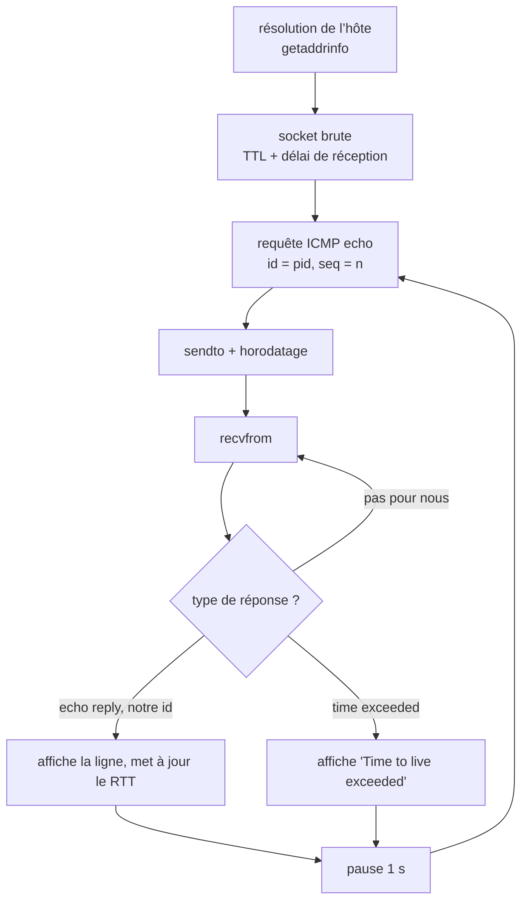

+++
title = "ft_ping : recoder ping avec des sockets ICMP brutes"
description = "Ce qui se passe derrière `ping` : construire des requêtes ICMP echo à la main, le checksum RFC 1071, décoder les réponses sous l’en-tête IP et calculer les statistiques de RTT avec l’algorithme de Welford."
tags = ["42", "network", "c", "linux"]
+++

`ping` est souvent le premier outil réseau qu’on apprend, et **ft_ping** demande de le réécrire en
C, en prenant `inetutils-2.0` comme référence pour le comportement et l’affichage. Aucune
bibliothèque ne fait le travail : on construit les paquets, on les envoie sur une socket brute et
on décode ce qui revient.

L’implémentation complète fait environ 400 lignes dans le
[dépôt](https://github.com/PfClaKr/Ecole42Paris_ft_ping). Voici comment elle s’articule.

## La boucle



Elle tourne jusqu’à `Ctrl+C` (`SIGINT`), jusqu’à ce que `-c` paquets aient été traités, ou
jusqu’à l’échéance de `-w`, déclenchée par `alarm()` et `SIGALRM`. Les deux gestionnaires de
signaux ne font que remettre un drapeau global à zéro, et la boucle affiche le résumé en sortant.

## Une socket brute

```c
sockfd = socket(AF_INET, SOCK_RAW, IPPROTO_ICMP);
setsockopt(sockfd, SOL_SOCKET, SO_RCVTIMEO, &timeout, sizeof(timeout)); // -W, attente par réponse
setsockopt(sockfd, IPPROTO_IP, IP_TTL, &opts.ttl, sizeof(opts.ttl));     // --ttl
```

Une socket brute contourne complètement TCP et UDP : on écrit nous-mêmes l’en-tête ICMP, et le
noyau n’ajoute que l’en-tête IP. C’est ce pouvoir qui exige d’être root (ou d’avoir
`CAP_NET_RAW`). `SO_RCVTIMEO` transforme une réponse perdue en `EAGAIN` au lieu d’un blocage.

## Construire une requête echo

Une requête ICMP echo est un en-tête de 8 octets suivi d’une charge utile :

| Champ | Taille | Valeur |
|---|---|---|
| type | 1 octet | `8` (echo request) |
| code | 1 octet | `0` |
| checksum | 2 octets | RFC 1071, calculé en dernier |
| identifiant | 2 octets | notre PID |
| séquence | 2 octets | 0, 1, 2… |
| charge utile | 56 octets | remplissage |

L’identifiant compte plus qu’il n’y paraît. Une socket ICMP brute reçoit **tous** les paquets ICMP
qui arrivent sur la machine, y compris les réponses destinées à un autre `ping` lancé en même
temps. Inscrire notre PID dans la requête permet de reconnaître nos propres réponses.

## Le checksum Internet (RFC 1071)

Le checksum est le complément à un de la somme en complément à un du paquet, pris par mots de
16 bits :

```c
unsigned short checksum(void *b, int len)
{
    unsigned short *buf = b;
    unsigned int sum = 0;

    for (sum = 0; len > 1; len -= 2)
        sum += *buf++;                 // additionne les mots de 16 bits
    if (len == 1)
        sum += *(unsigned char *)buf;  // octet final impair
    sum = (sum >> 16) + (sum & 0xFFFF); // réinjecte les retenues
    sum += (sum >> 16);
    return ~sum;                        // complément à un
}
```

On le calcule avec le champ checksum à zéro. Le destinataire refait la même somme sur tout le
paquet et attend `0xFFFF`.

## Lire une réponse

Ce que renvoie `recvfrom` commence par l’**en-tête IP**, pas par ICMP. Sa longueur est variable
(`ihl` compte des mots de 32 bits), donc l’en-tête ICMP commence à `ihl * 4` :

```c
struct iphdr   *ip_hdr   = (struct iphdr *)packet;
struct icmphdr *icmp_hdr = (struct icmphdr *)(packet + ip_hdr->ihl * 4);

if (recv_len < ip_hdr->ihl * 4 + sizeof(struct icmphdr))
    return ICMP_ERROR;                    // trop court pour être valide
if (icmp_hdr->type == ICMP_TIME_EXCEEDED)
    return ICMP_TIME_EXCEEDED_ERROR;      // un routeur l’a jeté (TTL à 0)
if (icmp_hdr->un.echo.id != htons(getpid() & 0xFFFF))
    return ICMP_DUPLICATE_ERROR;          // la réponse de quelqu’un d’autre : on relit
return ICMP_NORMAL;
```

On retrouve les trois cas du schéma. Une réponse normale affiche
`64 bytes from …: icmp_seq=… ttl=… time=… ms`, le TTL étant lu dans l’en-tête IP de la réponse. Un
message *time exceeded* vient du routeur où le TTL est tombé à zéro, ce qu’on peut provoquer
volontairement avec `--ttl 1`. Avec `-v`, le programme affiche aussi l’en-tête IP dans la même
présentation qu’inetutils, ainsi que notre en-tête echo d’origine, que le routeur recopie dans son
message d’erreur. Tout ce qui ne nous concerne pas est ignoré, et on relit.

## Des statistiques de RTT sans stocker les mesures

La ligne de résumé se termine par `min/avg/max/stddev`. Au lieu de garder chaque temps
aller-retour dans un tableau, ft_ping met à jour la moyenne et la variance au fil de l’eau avec
l’**algorithme de Welford** :

```c
rtt->count++;
double delta = time_diff - rtt->avg;
rtt->avg += delta / rtt->count;             // moyenne courante
rtt->s   += delta * (time_diff - rtt->avg); // somme courante des écarts au carré
// à la fin : stddev = sqrt(s / count)
```

Il utilise une mémoire constante et évite la perte de précision de la formule naïve « somme des
carrés moins carré de la somme ».

## Options

| Option | Effet |
|---|---|
| `-v`, `--verbose` | affiche l’identifiant et les en-têtes des erreurs ICMP |
| `-c N`, `--count` | s’arrête après N paquets |
| `-w N`, `--timeout` | s’arrête après N secondes au total |
| `-W N`, `--linger` | attend jusqu’à N secondes chaque réponse |
| `--ttl N` | fixe le TTL IP |
| `-q`, `--quiet` | n’affiche que le résumé |

Elles sont analysées avec `getopt_long`, et chaque valeur numérique est vérifiée avant usage.

Le code source est sur [GitHub](https://github.com/PfClaKr/Ecole42Paris_ft_ping). Compilez avec
`make`, puis lancez `sudo ./ft_ping -c 4 example.com`.
