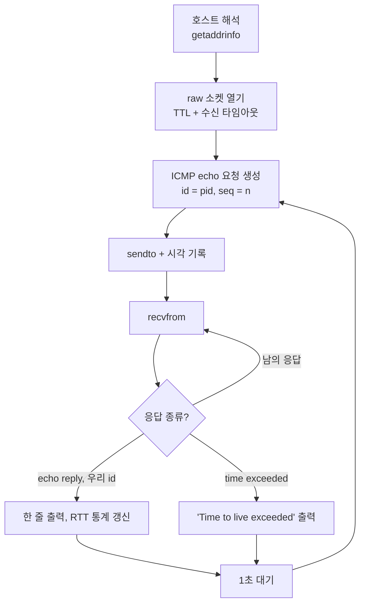

+++
title = "ft_ping: raw ICMP 소켓으로 ping 다시 만들기"
description = "`ping` 뒤에서 일어나는 일: ICMP echo 요청을 직접 만들고, RFC 1071 체크섬을 계산하고, IP 헤더 아래의 응답을 해석하고, Welford 알고리즘으로 RTT 통계를 내는 과정."
tags = ["42", "network", "c", "linux"]
+++

`ping`은 대부분 처음 배우는 네트워크 도구입니다. **ft_ping**은 `inetutils-2.0`의 동작과 출력을 기준으로 이를
C로 다시 작성하는 과제입니다. 대신 일해 주는 라이브러리는 없습니다. 패킷을 직접 만들어 raw 소켓으로
보내고, 돌아오는 것을 직접 해석합니다.

[저장소](https://github.com/PfClaKr/Ecole42Paris_ft_ping)의 전체 구현은 400줄 남짓입니다. 어떻게 맞물려 있는지
살펴보겠습니다.

## 루프



`Ctrl+C`(`SIGINT`)를 누르거나, `-c`로 정한 개수를 처리하거나, `alarm()`과 `SIGALRM`으로 `-w` 시간이 다 될
때까지 돕니다. 두 시그널 핸들러는 전역 플래그만 내리고, 루프가 빠져나오면서 요약을 출력합니다.

## raw 소켓

```c
sockfd = socket(AF_INET, SOCK_RAW, IPPROTO_ICMP);
setsockopt(sockfd, SOL_SOCKET, SO_RCVTIMEO, &timeout, sizeof(timeout)); // -W, 응답당 대기 시간
setsockopt(sockfd, IPPROTO_IP, IP_TTL, &opts.ttl, sizeof(opts.ttl));     // --ttl
```

raw 소켓은 TCP와 UDP를 완전히 건너뜁니다. ICMP 헤더는 우리가 직접 쓰고, 커널은 IP 헤더만 붙입니다. 이런
권한 때문에 root(또는 `CAP_NET_RAW`)가 필요합니다. `SO_RCVTIMEO`를 걸어 두면 응답이 사라졌을 때 멈춰 서는
대신 `EAGAIN`이 돌아옵니다.

## echo 요청 만들기

ICMP echo 요청은 8바이트 헤더 뒤에 페이로드가 붙은 형태입니다.

| 필드 | 크기 | 값 |
|---|---|---|
| type | 1바이트 | `8` (echo request) |
| code | 1바이트 | `0` |
| checksum | 2바이트 | RFC 1071, 마지막에 계산 |
| identifier | 2바이트 | 우리 PID |
| sequence | 2바이트 | 0, 1, 2… |
| payload | 56바이트 | 패딩 |

identifier는 생각보다 중요합니다. raw ICMP 소켓은 기기에 도착하는 **모든** ICMP 패킷을 받습니다. 동시에 돌고
있는 다른 `ping`의 응답까지요. 요청에 PID를 찍어 두는 게 내 응답을 알아보는 방법입니다.

## 인터넷 체크섬 (RFC 1071)

체크섬은 패킷을 16비트 워드로 나눠 1의 보수 합을 구하고, 다시 1의 보수를 취한 값입니다.

```c
unsigned short checksum(void *b, int len)
{
    unsigned short *buf = b;
    unsigned int sum = 0;

    for (sum = 0; len > 1; len -= 2)
        sum += *buf++;                 // 16비트 워드 더하기
    if (len == 1)
        sum += *(unsigned char *)buf;  // 홀수 길이면 마지막 바이트
    sum = (sum >> 16) + (sum & 0xFFFF); // 올림수를 다시 더하기
    sum += (sum >> 16);
    return ~sum;                        // 1의 보수
}
```

계산할 때 checksum 필드는 0으로 둡니다. 받는 쪽은 패킷 전체에 같은 합을 구해서 `0xFFFF`가 나오는지
확인합니다.

## 응답 읽기

`recvfrom`으로 받은 데이터는 ICMP가 아니라 **IP 헤더**로 시작합니다. 길이가 가변(`ihl`은 32비트 워드 단위)이라
ICMP 헤더는 `ihl * 4` 위치에서 시작합니다.

```c
struct iphdr   *ip_hdr   = (struct iphdr *)packet;
struct icmphdr *icmp_hdr = (struct icmphdr *)(packet + ip_hdr->ihl * 4);

if (recv_len < ip_hdr->ihl * 4 + sizeof(struct icmphdr))
    return ICMP_ERROR;                    // 너무 짧아서 유효하지 않음
if (icmp_hdr->type == ICMP_TIME_EXCEEDED)
    return ICMP_TIME_EXCEEDED_ERROR;      // 라우터가 버림 (TTL이 0이 됨)
if (icmp_hdr->un.echo.id != htons(getpid() & 0xFFFF))
    return ICMP_DUPLICATE_ERROR;          // 남의 응답: 다시 읽기
return ICMP_NORMAL;
```

다이어그램의 세 가지 경우가 여기서 나뉩니다. 정상 응답이면 `64 bytes from …: icmp_seq=… ttl=… time=… ms`를
출력하는데, TTL은 응답의 IP 헤더에서 읽습니다. *time exceeded*는 TTL이 다 떨어진 라우터가 보내는 메시지로,
`--ttl 1`을 주면 일부러 일으킬 수 있습니다. `-v`를 주면 IP 헤더를 inetutils와 같은 형식으로 덤프하고, 라우터가
에러 메시지 안에 되돌려 준 원래 echo 헤더도 함께 보여 줍니다. 내 것이 아닌 패킷은 건너뛰고 다시 읽습니다.

## 샘플을 저장하지 않는 RTT 통계

요약 줄은 `min/avg/max/stddev`로 끝납니다. 왕복 시간을 전부 배열에 쌓는 대신, ft_ping은 **Welford 알고리즘**으로
평균과 분산을 그때그때 갱신합니다.

```c
rtt->count++;
double delta = time_diff - rtt->avg;
rtt->avg += delta / rtt->count;             // 이동 평균
rtt->s   += delta * (time_diff - rtt->avg); // 편차 제곱의 누적 합
// 마지막에: stddev = sqrt(s / count)
```

메모리를 일정하게만 쓰고, "제곱의 합 − 합의 제곱" 같은 단순한 공식에서 생기는 정밀도 손실도 피할 수
있습니다.

## 옵션

| 옵션 | 효과 |
|---|---|
| `-v`, `--verbose` | identifier 표시, ICMP 에러 헤더 덤프 |
| `-c N`, `--count` | N개 보낸 뒤 종료 |
| `-w N`, `--timeout` | 전체 N초 뒤 종료 |
| `-W N`, `--linger` | 응답마다 최대 N초 대기 |
| `--ttl N` | IP TTL 설정 |
| `-q`, `--quiet` | 요약만 출력 |

옵션은 `getopt_long`으로 파싱하고, 숫자 값은 쓰기 전에 범위를 검사합니다.

## 정리

- **raw 소켓은 평소 커널이 숨기는 것을 보여 줍니다.** 헤더, 바이트 순서(`htons`), 체크섬이 전부 내 손에
  있습니다.
- **모든 패킷은 믿을 수 없는 입력입니다.** 캐스팅하기 전에 길이를 확인하고, identifier로 걸러야 합니다.
  raw 소켓에는 내 것이 아닌 트래픽도 들어오기 때문입니다.
- **시그널은 가장자리에 둡니다.** 핸들러는 플래그만 바꾸고, 실제 일은 전부 메인 루프에서 합니다.

소스는 [GitHub](https://github.com/PfClaKr/Ecole42Paris_ft_ping)에 있습니다. `make`로 빌드한 뒤
`sudo ./ft_ping -c 4 example.com`으로 실행해 보세요.
