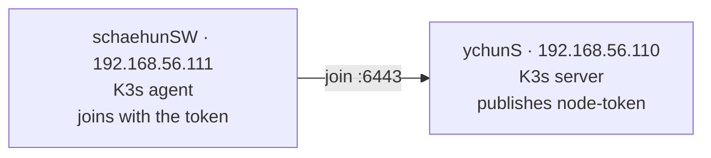
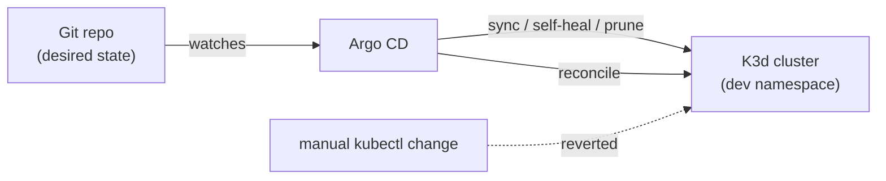

+++
title = "Inception-of-Things: Kubernetes from VMs to GitOps"
description = "A three-part Kubernetes project, built as a team of two: a K3s cluster on Vagrant VMs, host-based Ingress routing to three apps, and GitOps with Argo CD on K3d syncing from a Git repo."
tags = ["42", "kubernetes", "devops"]
+++

**Inception-of-Things** (IoT) is 42's Kubernetes project, the follow-up in spirit to
[Inception](/posts/42/inception/)'s Docker work. It builds up in three parts: a multi-node cluster on
VMs, host-based routing into it, and finally GitOps, where a Git repository is the source of truth for
what runs. We did it as a team of two
([source](https://github.com/PfClaKr/Ecole42Paris_Inception_of_Things)).

Throughout, the distribution is **K3s**, a single-binary Kubernetes from Rancher that's light enough to
run in a 1 GB VM, which is the whole reason the project is approachable on a laptop.

## P1 — a two-node cluster with Vagrant

Part 1 provisions two VirtualBox VMs with Vagrant: a K3s **server** (control plane) and a K3s **agent**
(worker), on a private network.



The one real problem is the join token. An agent needs the server's node-token to join, but both VMs
come up together. My server writes the token to a file and serves it over a throwaway HTTP server; the
agent polls until it's there, then installs K3s pointing at the server:

```ruby
# server: publish the token once K3s has written it
NODE_TOKEN="/var/lib/rancher/k3s/server/node-token"
while [ ! -e ${NODE_TOKEN} ]; do sleep 2; done
cd /tmp/token-share && python3 -m http.server 8080 &

# agent: wait for it, then join
while [ -z "$NODE_TOKEN" ]; do
  NODE_TOKEN=$(curl -sf http://192.168.56.110:8080/node-token); sleep 2
done
curl -sfL https://get.k3s.io | K3S_URL=https://192.168.56.110:6443 K3S_TOKEN=${NODE_TOKEN} sh -
```

Both install with `--flannel-iface eth1` so the cluster network runs over the private interface, not the
NAT interface Vagrant uses for SSH. Getting that wrong means nodes that "join" but can't talk to each
other, the first of several networking lessons.

## P2 — three apps behind one Ingress

Part 2 is a single K3s server running three small web apps, routed by **hostname**. K3s ships Traefik as
its default Ingress controller, so routing is just an `Ingress` object:

```yaml
rules:
- host: app1.com
  http: { paths: [{ path: /, backend: { service: { name: app1, port: { number: 80 }}}}]}
- host: app2.com
  http: { paths: [{ path: /, ... app2 ... }]}
- http:            # no host → default backend
    paths: [{ path: /, ... app3 ... }]
```

Curling the server IP with `Host: app1.com` reaches app1, `app2.com` reaches app2, and anything else
falls through to app3 as the default. It's the same virtual-host idea as the nginx config in Inception,
now expressed declaratively and handled by the cluster instead of a hand-written server block. One app
also runs three replicas, so the Service load-balances across pods.

## P3 — GitOps with Argo CD

Part 3 is the point of the whole project. Instead of running `kubectl apply` by hand, a controller
watches a Git repository and makes the cluster match it. This is **GitOps**: the repo is the desired
state, and the cluster continuously reconciles toward it.

The setup script (idempotent, re-runnable) installs Docker, **K3d** (K3s inside Docker containers, so no
VM this time), and `kubectl`, then:

```bash
k3d cluster create iot --servers 1 --agents 2 --api-port 6550 -p "8080:80@loadbalancer"
kubectl create namespace argocd && kubectl create namespace dev
kubectl apply -n argocd -f https://raw.githubusercontent.com/argoproj/argo-cd/stable/manifests/install.yaml
kubectl apply -f argocd.yaml      # our Application, pointing at the Git repo
```

The `Application` is the whole idea in one object:

```yaml
spec:
  source:
    repoURL: https://github.com/.../ychun_iot_chaehun.git
    path: .
    targetRevision: HEAD
  destination: { namespace: dev }
  syncPolicy:
    automated: { selfHeal: true, prune: true }
```

With `selfHeal` and `prune`, Argo CD doesn't just deploy once. Change the manifest in Git and the cluster
follows; delete something from Git and Argo CD removes it from the cluster; change something **directly**
in the cluster and Argo CD reverts it to match Git. The app's deployed version is whatever the repo says,
and nothing else.



## What it taught me

- **Declarative beats imperative.** The jump from "run these commands in order" (Inception's bash
  entrypoints) to "describe the end state and let a controller converge" is the real content of the
  project. A reconciling controller handles drift, restarts and partial failures that a script can't.
- **The cluster network is a real network.** Picking the wrong interface, forgetting the private network,
  or colliding ports (K3d maps host ports to the load balancer) all cause failures that look like
  Kubernetes bugs but are plain networking.
- **Everything is an object you can read.** `Ingress`, `Service`, `Deployment`, `Application` — the whole
  system is YAML you `kubectl get` and `describe`. That's intimidating at first and then liberating:
  there's no hidden state, just the API.

IoT is where Kubernetes stopped being a buzzword for me and became a set of concrete objects and a
controller loop. GitOps in particular changed how I think about deployment: the question is no longer
"did I run the right command?" but "does the repo say what I want?".
