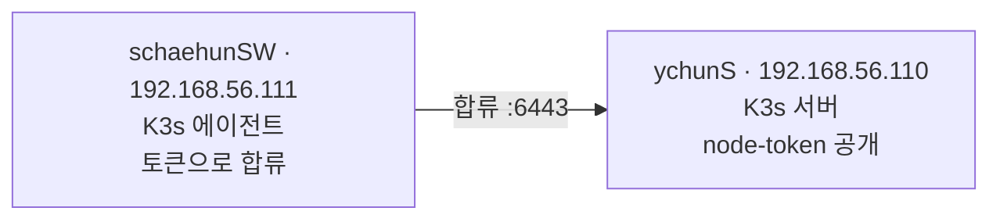
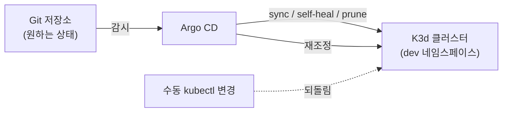

+++
title = "Inception-of-Things: VM 위 Kubernetes에서 GitOps까지"
description = "2인 팀으로 만든 세 파트짜리 Kubernetes 과제: Vagrant VM 위의 K3s 클러스터, 호스트 기반 Ingress로 앱 세 개 라우팅, 그리고 Git 저장소에서 동기화하는 K3d 위 Argo CD GitOps."
tags = ["42", "kubernetes", "devops"]
+++

**Inception-of-Things**(IoT)는 42의 Kubernetes 과제로, [Inception](/ko/posts/42/inception/)의 Docker 작업을
정신적으로 잇는 후속입니다. 세 파트로 쌓아 올립니다. VM 위의 멀티 노드 클러스터, 그 안으로의 라우팅, 그리고
마지막으로 Git 저장소가 실행 상태의 진실의 원천이 되는 GitOps. 2인 팀으로 했습니다
([소스](https://github.com/PfClaKr/Ecole42Paris_Inception_of_Things)).

처음부터 끝까지 배포판은 **K3s**입니다. Rancher가 만든 단일 바이너리 Kubernetes로, 1 GB VM에서 돌 만큼
가벼워서 이 과제를 노트북에서도 할 만하게 만드는 핵심입니다.

## P1 — Vagrant로 두 노드 클러스터

파트 1은 Vagrant로 VirtualBox VM 두 대를 띄웁니다. K3s **서버**(컨트롤 플레인)와 K3s **에이전트**(워커)를
사설 네트워크에 둡니다.



진짜 문제는 합류 토큰 하나입니다. 에이전트는 합류하려면 서버의 node-token이 필요한데, 두 VM이 함께 올라옵니다.
제 서버는 토큰을 파일에 쓰고 일회용 HTTP 서버로 서빙하고, 에이전트는 토큰이 생길 때까지 폴링하다가 서버를
가리키며 K3s를 설치합니다.

```ruby
# 서버: K3s가 토큰을 쓰고 나면 공개
NODE_TOKEN="/var/lib/rancher/k3s/server/node-token"
while [ ! -e ${NODE_TOKEN} ]; do sleep 2; done
cd /tmp/token-share && python3 -m http.server 8080 &

# 에이전트: 토큰을 기다렸다가 합류
while [ -z "$NODE_TOKEN" ]; do
  NODE_TOKEN=$(curl -sf http://192.168.56.110:8080/node-token); sleep 2
done
curl -sfL https://get.k3s.io | K3S_URL=https://192.168.56.110:6443 K3S_TOKEN=${NODE_TOKEN} sh -
```

둘 다 `--flannel-iface eth1`로 설치해서 클러스터 네트워크가 Vagrant가 SSH에 쓰는 NAT 인터페이스가 아니라 사설
인터페이스로 돌게 합니다. 이걸 틀리면 노드가 "합류"는 하지만 서로 통신하지 못합니다. 여러 네트워크 교훈 중
첫 번째입니다.

## P2 — Ingress 하나 뒤의 앱 세 개

파트 2는 K3s 서버 한 대가 작은 웹 앱 세 개를 돌리고 **호스트 이름**으로 라우팅합니다. K3s는 기본 Ingress
컨트롤러로 Traefik을 함께 담고 있어서, 라우팅은 `Ingress` 객체 하나면 됩니다.

```yaml
rules:
- host: app1.com
  http: { paths: [{ path: /, backend: { service: { name: app1, port: { number: 80 }}}}]}
- host: app2.com
  http: { paths: [{ path: /, ... app2 ... }]}
- http:            # 호스트 없음 → 기본 백엔드
    paths: [{ path: /, ... app3 ... }]
```

서버 IP에 `Host: app1.com`으로 curl하면 app1에, `app2.com`이면 app2에 닿고, 나머지는 전부 기본값인 app3으로
떨어집니다. Inception의 nginx 설정에서 본 가상 호스트 아이디어와 같은데, 이번엔 선언적으로 표현하고 손으로 쓴
서버 블록 대신 클러스터가 처리합니다. 한 앱은 레플리카를 세 개 돌려서 Service가 파드들 사이로 부하를 분산합니다.

## P3 — Argo CD로 GitOps

파트 3이 과제 전체의 핵심입니다. `kubectl apply`를 손으로 돌리는 대신, 컨트롤러가 Git 저장소를 지켜보며
클러스터를 그 내용에 맞춥니다. 이게 **GitOps**입니다. 저장소가 원하는 상태이고, 클러스터는 끊임없이 그쪽으로
수렴합니다.

설정 스크립트(멱등하고 다시 돌릴 수 있음)는 Docker, **K3d**(Docker 컨테이너 안의 K3s라 이번엔 VM이 없음),
`kubectl`을 설치한 뒤:

```bash
k3d cluster create iot --servers 1 --agents 2 --api-port 6550 -p "8080:80@loadbalancer"
kubectl create namespace argocd && kubectl create namespace dev
kubectl apply -n argocd -f https://raw.githubusercontent.com/argoproj/argo-cd/stable/manifests/install.yaml
kubectl apply -f argocd.yaml      # Git 저장소를 가리키는 우리의 Application
```

`Application` 객체 하나에 아이디어 전체가 담겨 있습니다.

```yaml
spec:
  source:
    repoURL: https://github.com/.../ychun_iot_chaehun.git
    path: .
    targetRevision: HEAD
  destination: { namespace: dev }
  syncPolicy:
    automated: { selfHeal: true, prune: true }
```

`selfHeal`과 `prune`이 있으면 Argo CD는 한 번만 배포하는 게 아닙니다. Git의 매니페스트를 바꾸면 클러스터가
따라오고, Git에서 무언가를 지우면 Argo CD가 클러스터에서 지우고, 클러스터를 **직접** 바꾸면 Argo CD가 Git에
맞게 되돌립니다. 앱의 배포 버전은 오직 저장소가 말하는 것뿐, 그 외엔 없습니다.



## 배운 것

- **선언적이 명령적을 이긴다.** "이 명령들을 순서대로 돌려라"(Inception의 bash 엔트리포인트)에서 "최종 상태를
  기술하고 컨트롤러가 수렴하게 하라"로의 전환이 이 과제의 진짜 내용입니다. 재조정 컨트롤러는 스크립트가 못 다루는
  드리프트, 재시작, 부분 실패를 다룹니다.
- **클러스터 네트워크는 진짜 네트워크다.** 인터페이스를 잘못 고르거나, 사설 네트워크를 빼먹거나, 포트가 충돌하면
  (K3d는 호스트 포트를 로드 밸런서로 매핑) Kubernetes 버그처럼 보이지만 사실은 그냥 네트워크 문제입니다.
- **모든 게 읽을 수 있는 객체다.** `Ingress`, `Service`, `Deployment`, `Application` — 시스템 전체가
  `kubectl get`과 `describe`로 보는 YAML입니다. 처음엔 겁나지만 곧 해방감을 줍니다. 숨은 상태가 없고 API만
  있으니까요.

IoT는 제게 Kubernetes가 유행어이길 그만두고 구체적인 객체들과 컨트롤러 루프가 된 지점입니다. 특히 GitOps는 배포를
생각하는 방식을 바꿨습니다. 이제 질문은 "내가 맞는 명령을 돌렸나?"가 아니라 "저장소가 내가 원하는 걸 말하고
있나?"입니다.
