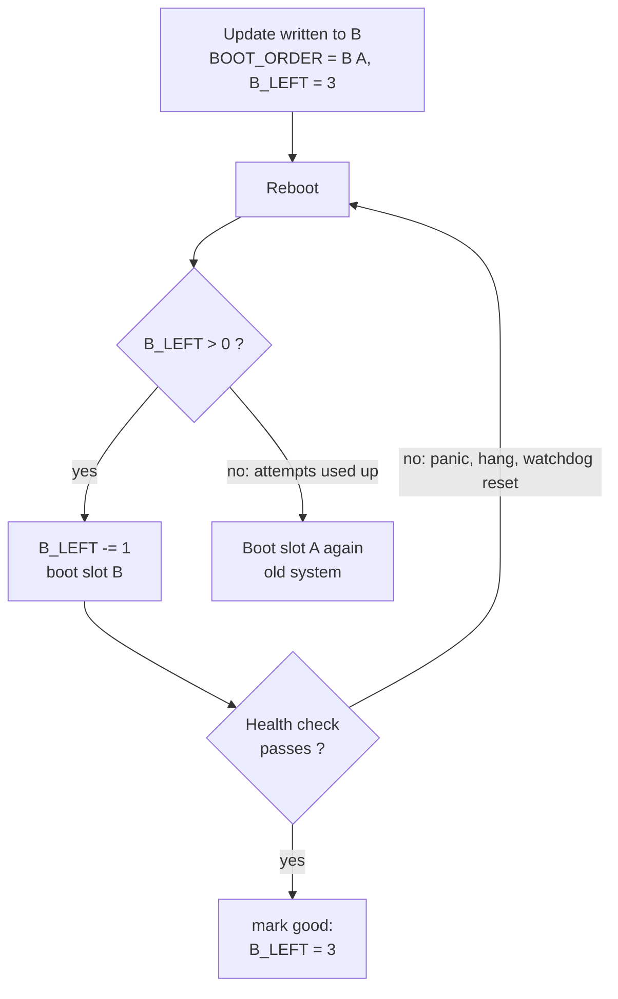

+++
title = "A/B partitions: updating a device without bricking it"
description = "Why field devices keep two copies of their root filesystem, how the bootloader picks one, and how boot counting and a \"mark good\" step turn a bad update into an automatic rollback."
tags = ["linux", "embedded", "ota", "bootloader"]
+++

A laptop that fails to boot after an update is an annoying afternoon. A robot that fails to boot
after an update is a support ticket, a technician on a plane, or a machine that stops a production
line. Field devices cannot rely on someone plugging in a USB stick, and the update has to survive
the worst moments: power cut in the middle of a write, a kernel that panics on new hardware revisions,
a service that hangs.

The most common answer in embedded Linux is the **A/B layout**: keep two complete copies of the
system and never overwrite the one you are running. This post explains the idea and the mechanics
around it; the [next one](/posts/architecture/os/ota-update/rauc/) shows how RAUC implements it.

## What an update must guarantee

Whatever the mechanism, a robust update needs four properties:

1. **Atomic**: after any interruption, the device boots either the old system or the new one, never
   a half-written mix.
2. **Verified**: only images signed by you are installed, and corruption is detected before boot.
3. **Reversible**: if the new system does not come up properly, the device goes back to the old one
   on its own.
4. **Data-preserving**: logs, calibration, maps and configuration survive, in both directions.

Updating in place with a package manager fails the first point: if power drops halfway through
`apt upgrade`, the root filesystem is in a state nobody tested.

## The idea: two root filesystems

The storage is split so that the system exists twice:

```text
eMMC
├── boot      bootloader + its environment
├── rootfs A  ← currently running (read-only)
├── rootfs B  ← the update is written here
└── data      persistent, shared by both slots
```

The update is written to the **inactive** slot while the device keeps working normally on the active
one. Only when the new image is fully written and verified does the bootloader configuration change
to point at it, and the device reboots. If anything goes wrong before that switch, nothing happened:
the old slot was never touched.

The price is storage: two root filesystems instead of one. The write time is the other cost, since a
full image has to be written even for a one-line change. Delta or block-level ("adaptive") updates
reduce the download, but the slot still ends up fully rewritten.

## Who decides what boots: the bootloader

The switch itself is a tiny piece of state in the bootloader's environment: which slot to try first,
and how many attempts each slot has left. With U-Boot, a common convention (the one RAUC uses) is:

```text
BOOT_ORDER=A B      # try A first, then B
BOOT_A_LEFT=3       # remaining boot attempts for A
BOOT_B_LEFT=3
```

On every boot, the boot script walks `BOOT_ORDER`, picks the first slot with attempts left,
**decrements** its counter, saves the environment, and boots it with the matching `root=` on the
kernel command line. GRUB can do the same with variables in `grubenv`, barebox has a built-in
`bootchooser`, and UEFI systems can use `BootOrder`/`BootNext`.

Installing an update therefore means: write slot B, then set `BOOT_ORDER=B A` and reset
`BOOT_B_LEFT=3`.

## Boot counting and "mark good"

The counter is what makes rollback automatic:



1. The new slot boots with a decremented counter.
2. Once userspace decides the system is healthy, it **marks the slot good**, which resets the counter.
3. If the kernel panics, the system hangs, or the health check never passes, the device reboots
   without resetting the counter. After the last attempt, the bootloader skips the slot and boots the
   old one.

Two details make or break this:

- **A hardware watchdog is mandatory.** A system that hangs forever never reboots, so it never falls
  back. The watchdog turns hangs into resets, and resets into attempts.
- **"Healthy" must mean something.** Marking good right after the kernel boots is too early: the
  rootfs mounted, but the application may still crash in a loop. Marking good after hours is too late:
  an unrelated power cut in between would count against the new slot. A good check runs after the
  services that matter are up, and verifies what the product needs (it can talk to the fleet server,
  sensors answer, the main process stays up for a few minutes).

## Keeping data out of the slots

The slots should contain only what the update ships, and be mounted **read-only**. That has several
benefits: every device running version X has bit-identical system files, an integrity layer such as
dm-verity can check them, and an update can replace a slot wholesale without merging anything.

Everything that changes at runtime lives elsewhere:

- a **data partition** for logs, databases, maps, calibration;
- `/etc` handled through an overlay or bind mounts for the few files that must be writable;
- `/var` and `/tmp` on the data partition or in RAM.

The trap is rollback. If version N+1 migrates a database schema on first boot and then fails its
health check, version N boots again and finds data it does not understand. Migrations have to be
backward compatible, versioned, or postponed until after "mark good".

## Variations

- **Symmetric vs asymmetric.** A/B is symmetric: both slots are full systems. An asymmetric layout
  keeps one full system plus a small recovery system that only knows how to download and install. It
  saves space but makes every update a two-step reboot, and the recovery image itself needs updating.
- **What about the bootloader?** The bootloader usually sits outside the A/B scheme, because updating
  it is the one step that can still brick the device. eMMC devices often have two hardware boot
  partitions (`boot0`/`boot1`) that allow a careful A/B update of the bootloader too.
- **Android** uses the same idea for "seamless updates" (`update_engine`), and newer devices use
  **Virtual A/B**: snapshots and copy-on-write instead of a second full partition, to save storage.
- **Image-based vs file-based.** RAUC, SWUpdate and Mender write whole images into slots; OSTree
  keeps a content-addressed store of files and switches deployments with hard links. Both give
  atomic switches; the image-based approach is easier to reason about and to verify.

## Summary

The A/B scheme is simple to describe: never write to what you are running, switch with a single flag,
count the attempts, and let a health check decide whether the switch sticks. Most of the real work is
in the details around it: the bootloader script, the watchdog, a meaningful health check, and data that
survives a rollback. The [next post](/posts/architecture/os/ota-update/rauc/) looks at RAUC, which
handles the install and bootloader part of this on embedded Linux.
