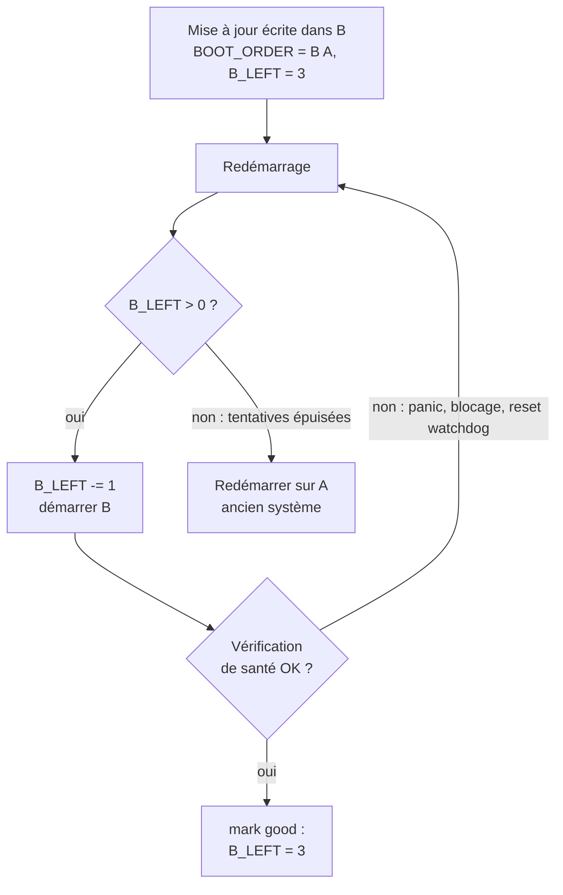

+++
title = "Partitions A/B : mettre à jour un appareil sans le briquer"
description = "Pourquoi les appareils sur le terrain gardent deux copies de leur système de fichiers racine, comment le bootloader choisit, et comment le comptage des démarrages et une étape « mark good » transforment une mauvaise mise à jour en retour arrière automatique."
tags = ["linux", "embedded", "ota", "bootloader"]
+++

Un portable qui ne démarre plus après une mise à jour, c'est un après-midi pénible. Un robot qui ne
démarre plus après une mise à jour, c'est un ticket de support, un technicien dans un avion, ou une
machine qui arrête une ligne de production. Un appareil sur le terrain ne peut pas compter sur
quelqu'un pour brancher une clé USB, et la mise à jour doit survivre aux pires moments : coupure de
courant en pleine écriture, noyau qui panique sur une nouvelle révision matérielle, service qui se bloque.

La réponse la plus courante en Linux embarqué est le **schéma A/B** : garder deux copies complètes du
système et ne jamais écraser celle qui tourne. Cet article explique l'idée et la mécanique autour ;
le [suivant](/fr/posts/architecture/os/ota-update/rauc/) montre comment RAUC l'implémente.

## Ce qu'une mise à jour doit garantir

Quel que soit le mécanisme, une mise à jour robuste a besoin de quatre propriétés :

1. **Atomique** : après n'importe quelle interruption, l'appareil démarre soit l'ancien système, soit
   le nouveau, jamais un mélange à moitié écrit.
2. **Vérifiée** : seules les images signées par vous sont installées, et une corruption est détectée
   avant le démarrage.
3. **Réversible** : si le nouveau système ne démarre pas correctement, l'appareil revient seul à l'ancien.
4. **Préservant les données** : logs, calibration, cartes et configuration survivent, dans les deux sens.

La mise à jour sur place avec un gestionnaire de paquets échoue au premier point : si le courant
coupe au milieu d'un `apt upgrade`, le système de fichiers racine est dans un état que personne n'a testé.

## L'idée : deux systèmes de fichiers racine

Le stockage est découpé pour que le système existe deux fois :

```text
eMMC
├── boot      bootloader + son environnement
├── rootfs A  ← en cours d'exécution (lecture seule)
├── rootfs B  ← la mise à jour est écrite ici
└── data      persistant, partagé par les deux slots
```

La mise à jour est écrite dans le slot **inactif** pendant que l'appareil continue à fonctionner
normalement sur le slot actif. Ce n'est qu'une fois la nouvelle image entièrement écrite et vérifiée
que la configuration du bootloader change pour pointer dessus, et l'appareil redémarre. Si quelque
chose échoue avant ce basculement, rien ne s'est passé : l'ancien slot n'a jamais été touché.

Le prix, c'est le stockage : deux systèmes de fichiers racine au lieu d'un. Le temps d'écriture est
l'autre coût, puisqu'une image complète doit être écrite même pour un changement d'une ligne. Les
mises à jour delta ou par blocs (« adaptatives ») réduisent le téléchargement, mais le slot finit
quand même entièrement réécrit.

## Qui décide de ce qui démarre : le bootloader

Le basculement lui-même est un tout petit état dans l'environnement du bootloader : quel slot essayer
en premier, et combien de tentatives il reste à chaque slot. Avec U-Boot, une convention courante
(celle qu'utilise RAUC) est :

```text
BOOT_ORDER=A B      # essayer A d'abord, puis B
BOOT_A_LEFT=3       # tentatives de démarrage restantes pour A
BOOT_B_LEFT=3
```

À chaque démarrage, le script parcourt `BOOT_ORDER`, prend le premier slot qui a encore des
tentatives, **décrémente** son compteur, sauvegarde l'environnement et le démarre avec le `root=`
correspondant sur la ligne de commande du noyau. GRUB peut faire la même chose avec des variables dans
`grubenv`, barebox a un `bootchooser` intégré, et les systèmes UEFI peuvent utiliser `BootOrder`/`BootNext`.

Installer une mise à jour revient donc à : écrire le slot B, puis définir `BOOT_ORDER=B A` et remettre
`BOOT_B_LEFT=3`.

## Comptage des démarrages et « mark good »

C'est le compteur qui rend le retour arrière automatique :



1. Le nouveau slot démarre avec un compteur décrémenté.
2. Quand l'espace utilisateur estime que le système est sain, il **marque le slot comme bon**, ce qui
   remet le compteur à sa valeur maximale.
3. Si le noyau panique, si le système se bloque ou si la vérification ne passe jamais, l'appareil
   redémarre sans réinitialiser le compteur. Après la dernière tentative, le bootloader saute ce slot
   et démarre l'ancien.

Deux détails font toute la différence :

- **Un watchdog matériel est indispensable.** Un système bloqué pour toujours ne redémarre jamais,
  donc ne revient jamais en arrière. Le watchdog transforme les blocages en redémarrages, et les
  redémarrages en tentatives.
- **« Sain » doit vouloir dire quelque chose.** Marquer bon juste après le démarrage du noyau est trop
  tôt : le rootfs est monté, mais l'application peut encore planter en boucle. Marquer bon après
  plusieurs heures est trop tard : une coupure de courant sans rapport compterait contre le nouveau
  slot. Une bonne vérification s'exécute une fois les services importants lancés et contrôle ce dont
  le produit a besoin (il joint le serveur de flotte, les capteurs répondent, le processus principal
  tient quelques minutes).

## Garder les données hors des slots

Les slots ne doivent contenir que ce que la mise à jour livre, et être montés en **lecture seule**.
Plusieurs avantages : tous les appareils en version X ont des fichiers système identiques au bit près,
une couche d'intégrité comme dm-verity peut les vérifier, et une mise à jour peut remplacer un slot
entier sans rien fusionner.

Tout ce qui change à l'exécution vit ailleurs :

- une **partition de données** pour les logs, bases de données, cartes, calibrations ;
- `/etc` via un overlay ou des montages bind pour les quelques fichiers qui doivent être modifiables
  ([article sur OverlayFS](/fr/posts/architecture/os/ota-update/overlayfs/)) ;
- `/var` et `/tmp` sur la partition de données ou en RAM.

Le piège, c'est le retour arrière. Si la version N+1 migre un schéma de base de données au premier
démarrage puis échoue à sa vérification, la version N redémarre et trouve des données qu'elle ne
comprend pas. Les migrations doivent être rétrocompatibles, versionnées, ou repoussées après le « mark good ».

## Variantes

- **Symétrique ou asymétrique.** A/B est symétrique : les deux slots sont des systèmes complets. Un
  schéma asymétrique garde un système complet et un petit système de secours qui sait seulement
  télécharger et installer. On gagne de la place, mais chaque mise à jour demande deux redémarrages,
  et l'image de secours elle-même doit être mise à jour.
- **Et le bootloader ?** Il reste généralement en dehors du schéma A/B, parce que sa mise à jour est
  la seule étape qui peut encore briquer l'appareil. Les eMMC ont souvent deux partitions de démarrage
  matérielles (`boot0`/`boot1`) qui permettent une mise à jour A/B prudente du bootloader aussi.
- **Android** utilise la même idée pour les « seamless updates » (`update_engine`), et les appareils
  récents utilisent le **Virtual A/B** : des snapshots et du copy-on-write au lieu d'une seconde
  partition complète, pour économiser le stockage.
- **Par image ou par fichiers.** RAUC, SWUpdate et Mender écrivent des images entières dans les slots ;
  OSTree garde un stockage de fichiers adressé par contenu et bascule les déploiements avec des liens
  physiques. Les deux offrent un basculement atomique ; l'approche par image est plus simple à
  raisonner et à vérifier.

## En résumé

Le schéma A/B se décrit simplement : ne jamais écrire sur ce qui tourne, basculer avec un seul
drapeau, compter les tentatives, et laisser une vérification de santé décider si le basculement tient.
L'essentiel du travail réel est dans les détails autour : le script du bootloader, le watchdog, une
vérification qui a du sens, et des données qui survivent à un retour arrière.
L'[article suivant](/fr/posts/architecture/os/ota-update/rauc/) présente RAUC, qui gère la partie
installation et bootloader de tout cela en Linux embarqué.
