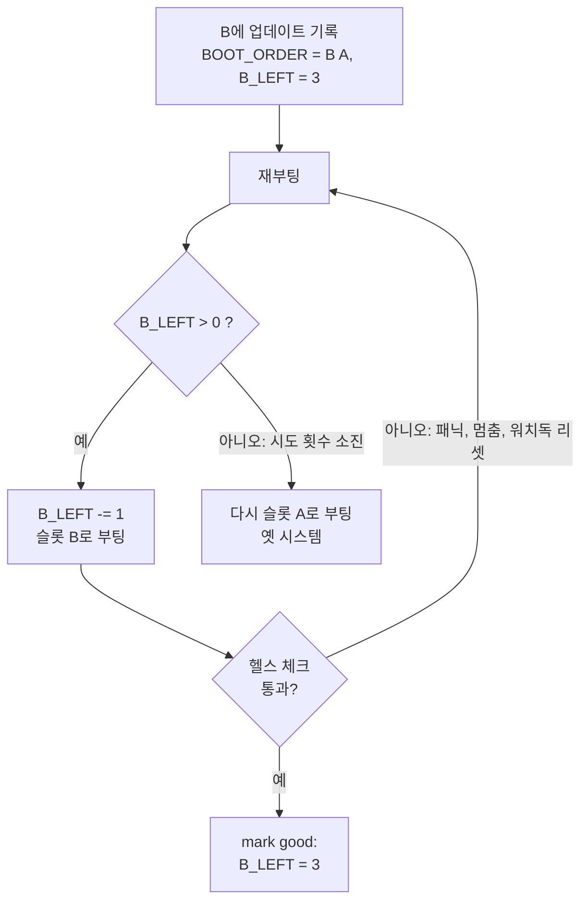

+++
title = "A/B 파티션: 장비를 벽돌로 만들지 않고 업데이트하기"
description = "현장 장비가 루트 파일시스템을 두 벌 갖고 있는 이유, 부트로더가 그중 하나를 고르는 방식, 그리고 부팅 횟수 카운트와 \"mark good\" 단계가 잘못된 업데이트를 자동 롤백으로 바꾸는 원리."
tags = ["linux", "embedded", "ota", "bootloader"]
+++

업데이트 후 부팅이 안 되는 노트북은 귀찮은 오후 한나절이면 끝납니다. 업데이트 후 부팅이 안 되는
로봇은 고객 지원 티켓이고, 비행기를 타는 기술자이고, 생산 라인을 멈춰 세운 기계입니다. 현장에 있는
장비는 누군가 USB를 꽂아 주기를 기대할 수 없고, 업데이트는 최악의 순간도 견뎌야 합니다. 쓰는 도중
전원이 나가거나, 새 하드웨어 리비전에서 커널이 패닉을 일으키거나, 서비스가 멈춰 버리는 순간입니다.

임베디드 리눅스에서 가장 흔한 답은 A/B 구성입니다. 시스템을 통째로 두 벌 두고, 지금 실행 중인
쪽은 절대 덮어쓰지 않는 방식입니다. 이 글은 그 아이디어와 주변 동작 원리를 설명합니다.

## 업데이트가 보장해야 하는 것

방식이 무엇이든, 튼튼한 업데이트에는 네 가지 성질이 필요합니다.

1. 원자성: 어떤 순간에 끊기더라도 장비는 옛 시스템이나 새 시스템 중 하나로 부팅해야 하고, 반쯤
   쓰인 상태로 부팅해서는 안 됩니다.
2. 검증: 내가 서명한 이미지만 설치되고, 손상은 부팅 전에 발견되어야 합니다.
3. 되돌릴 수 있음: 새 시스템이 제대로 올라오지 않으면 장비가 스스로 옛 시스템으로 돌아가야 합니다.
4. 데이터 보존: 로그, 캘리브레이션, 지도, 설정이 양쪽 방향 모두에서 살아남아야 합니다.

패키지 매니저로 제자리 업데이트를 하면 첫 번째에서 실패합니다. `apt upgrade` 도중 전원이 나가면
루트 파일시스템은 아무도 테스트해 본 적 없는 상태가 됩니다.

## 아이디어: 루트 파일시스템 두 벌

저장장치를 나눠서 시스템이 두 번 들어가게 합니다.

```text
eMMC
├── boot      부트로더 + 부트로더 환경 변수
├── rootfs A  ← 현재 실행 중 (읽기 전용)
├── rootfs B  ← 업데이트를 여기에 씀
└── data      영구 데이터, 두 슬롯이 공유
```

장비가 활성 슬롯에서 평소처럼 동작하는 동안 업데이트는 비활성 슬롯에 쓰입니다. 새 이미지를 다 쓰고
검증까지 끝난 다음에야 부트로더 설정을 새 슬롯으로 바꾸고 재부팅합니다. 그 전환 전에 무엇이
잘못되더라도 아무 일도 없었던 것과 같습니다. 옛 슬롯은 건드린 적이 없기 때문입니다.

대가는 저장 공간입니다. 루트 파일시스템이 하나가 아니라 두 개 필요합니다. 쓰기 시간도 비용인데,
한 줄짜리 변경이어도 이미지 전체를 써야 하기 때문입니다. 델타 업데이트나 블록 단위("adaptive")
업데이트로 다운로드 양은 줄일 수 있지만, 슬롯은 결국 전부 다시 쓰입니다.

## 무엇으로 부팅할지 정하는 것: 부트로더

전환 자체는 부트로더 환경에 있는 아주 작은 상태값입니다. 어느 슬롯을 먼저 시도할지, 슬롯마다
부팅 시도가 몇 번 남았는지입니다. U-Boot에서 자주 쓰는 규칙(RAUC가 쓰는 방식)은 이렇습니다.

```text
BOOT_ORDER=A B      # A를 먼저, 그다음 B
BOOT_A_LEFT=3       # A의 남은 부팅 시도 횟수
BOOT_B_LEFT=3
```

부팅할 때마다 부트 스크립트는 `BOOT_ORDER`를 차례로 보면서 시도 횟수가 남은 첫 슬롯을 고르고,
그 카운터를 하나 줄이고, 환경을 저장한 뒤, 커널 명령줄에 해당 `root=`를 넣어 부팅합니다. GRUB은
`grubenv` 변수로 같은 일을 할 수 있고, barebox에는 `bootchooser`가 내장되어 있으며, UEFI 시스템은
`BootOrder`/`BootNext`를 쓸 수 있습니다.

그래서 업데이트 설치란 결국 이것입니다. 슬롯 B에 쓰고, `BOOT_ORDER=B A`로 바꾸고, `BOOT_B_LEFT=3`으로
초기화합니다.

## 부팅 횟수 카운트와 "mark good"

롤백을 자동으로 만들어 주는 건 이 카운터입니다.



1. 새 슬롯은 카운터가 하나 줄어든 상태로 부팅합니다.
2. 사용자 공간에서 시스템이 정상이라고 판단하면 그 슬롯을 "good"으로 표시하고, 카운터가 다시 채워집니다.
3. 커널이 패닉을 내거나, 시스템이 멈추거나, 헬스 체크가 끝내 통과하지 못하면 카운터를 채우지 못한
   채 재부팅합니다. 마지막 시도까지 쓰고 나면 부트로더가 그 슬롯을 건너뛰고 옛 슬롯으로 부팅합니다.

성패를 가르는 건 두 가지입니다.

- 하드웨어 워치독은 필수입니다. 영원히 멈춘 시스템은 재부팅하지 않으니 롤백도 일어나지 않습니다.
  워치독이 멈춤을 리셋으로, 리셋을 시도 횟수로 바꿔 줍니다.
- "정상"이 의미 있는 기준이어야 합니다. 커널이 부팅하자마자 good으로 표시하면 너무 이릅니다.
  rootfs는 마운트됐지만 애플리케이션은 여전히 크래시 루프에 빠져 있을 수 있습니다. 몇 시간 뒤에
  표시하면 너무 늦습니다. 그사이 상관없는 정전이 나도 새 슬롯의 시도 횟수가 깎입니다. 좋은 헬스
  체크는 중요한 서비스들이 올라온 뒤에 실행되고, 제품에 필요한 것을 확인합니다(플릿 서버와 통신이
  되는지, 센서가 응답하는지, 메인 프로세스가 몇 분 동안 버티는지).

## 데이터는 슬롯 밖에

슬롯에는 업데이트가 배포하는 것만 들어 있어야 하고, 읽기 전용으로 마운트해야 합니다. 그러면 좋은
점이 여럿입니다. 버전 X를 돌리는 모든 장비의 시스템 파일이 비트 단위로 같아지고, dm-verity 같은
무결성 계층으로 검증할 수 있고, 업데이트는 아무것도 병합하지 않고 슬롯을 통째로 바꿀 수 있습니다.

실행 중에 바뀌는 것은 모두 다른 곳에 둡니다.

- 로그, 데이터베이스, 지도, 캘리브레이션은 데이터 파티션에.
- 쓰기가 꼭 필요한 몇몇 `/etc` 파일은 overlay나 bind 마운트로([OverlayFS 글](/ko/posts/architecture/os/ota-update/overlayfs/)).
- `/var`와 `/tmp`는 데이터 파티션이나 RAM에.

함정은 롤백입니다. 버전 N+1이 첫 부팅 때 데이터베이스 스키마를 마이그레이션하고 나서 헬스 체크에
실패하면, 다시 올라온 버전 N은 자기가 모르는 데이터를 만나게 됩니다. 마이그레이션은 하위 호환이
되게 하거나, 버전을 관리하거나, "mark good" 이후로 미뤄야 합니다.

## 변형들

- 대칭과 비대칭: A/B는 대칭입니다. 두 슬롯 모두 완전한 시스템입니다. 비대칭 구성은 완전한 시스템
  하나와, 다운로드와 설치만 할 줄 아는 작은 복구 시스템을 둡니다. 공간은 아끼지만 업데이트마다
  재부팅이 두 번 필요하고, 복구 이미지 자체도 업데이트해야 합니다.
- 부트로더는? 보통 A/B 구성 밖에 둡니다. 부트로더 업데이트는 여전히 장비를 벽돌로 만들 수 있는
  유일한 단계이기 때문입니다. eMMC에는 하드웨어 부트 파티션이 두 개(`boot0`/`boot1`) 있는 경우가
  많아서, 부트로더도 조심스럽게 A/B로 업데이트할 수 있습니다.
- Android도 "seamless update"(`update_engine`)에 같은 아이디어를 쓰고, 최근 기기는 Virtual A/B를
  씁니다. 두 번째 파티션을 통째로 두는 대신 스냅샷과 copy-on-write로 저장 공간을 아낍니다.
- 이미지 방식과 파일 방식: RAUC, SWUpdate, Mender는 이미지 전체를 슬롯에 씁니다. OSTree는 콘텐츠
  주소 기반 파일 저장소를 두고 하드 링크로 배포본을 전환합니다. 둘 다 원자적 전환을 제공하지만,
  이미지 방식이 이해하고 검증하기 더 쉽습니다.
