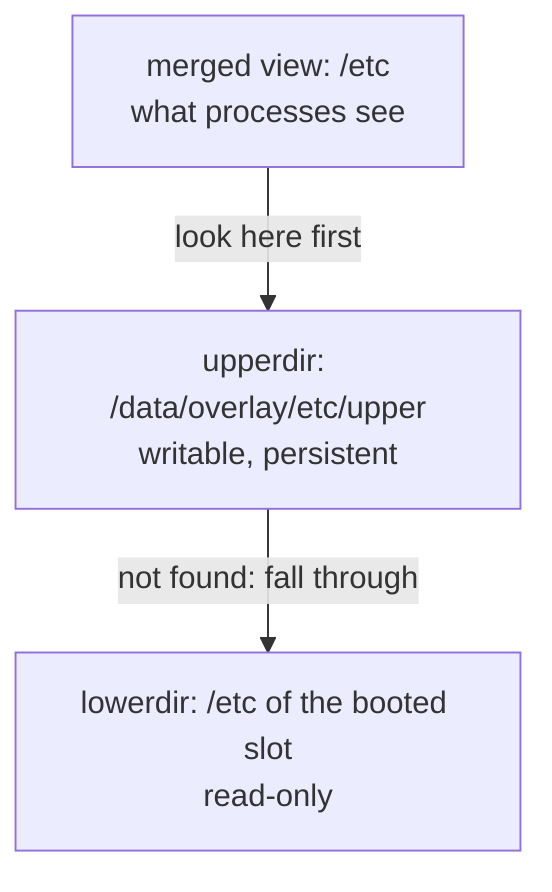

+++
title = "OverlayFS on a read-only root: a writable /etc, and the update trap"
description = "How OverlayFS gives an A/B system a writable /etc on top of a read-only slot, why it must be mounted before systemd starts, and how a persistent upper layer silently hides changes shipped by the next update."
tags = ["linux", "embedded", "ota", "overlayfs", "yocto"]
+++

The [A/B post](/posts/architecture/os/ota-update/ab-partitions/) argued for read-only slots: every
device on version X has bit-identical system files, and an update replaces a slot wholesale. Then
reality shows up. The device needs its own hostname, a `machine-id`, SSH host keys, Wi-Fi or
network profiles, a timezone. All of those live in `/etc` by default, and `/etc` is in the read-only
slot.

The usual answer is **OverlayFS**: a writable layer on the data partition, stacked on top of the
read-only `/etc`. It works well, and it has one trap that only shows up after an update. This post
covers both.

## How OverlayFS works

An overlay mount merges directories into a single view:

- **lowerdir**: the read-only base, here the `/etc` that came with the slot;
- **upperdir**: a writable directory, here on the data partition;
- **workdir**: an empty scratch directory on the *same* filesystem as the upper, used internally for
  atomic operations.



Reads look in the upper first and fall through to the lower. The interesting part is writes:

- **Copy-up**: the first time a lower file is modified, it is copied into the upper, and from then on
  the upper copy is the one everybody sees. The lower file is never touched.
- **Whiteouts**: deleting a lower file creates a *whiteout* in the upper (a character device with
  device number 0/0) that hides it.
- **Opaque directories**: removing a directory and recreating it marks the new one opaque
  (`trusted.overlay.opaque` xattr), so nothing from the lower shows through.

```bash
mkdir -p /data/overlay/etc/upper /data/overlay/etc/work
mount -t overlay overlay \
  -o lowerdir=/etc,upperdir=/data/overlay/etc/upper,workdir=/data/overlay/etc/work /etc
```

Using `/etc` as both lowerdir and mount point works: the path is resolved before the overlay is
mounted on top of it. After a few changes, the upper is a precise list of how this device differs from
the image:

```text
$ ls -la /data/overlay/etc/upper
-rw-r--r-- 1 root root   10 hostname           copied up and edited
c--------- 1 root root 0, 0 motd               whiteout: deleted in /etc
drwxr-xr-x 2 root root 4096 NetworkManager     copied-up directory
```

That listing is also the best debugging tool you will get ("what did we change on this robot?"), and
wiping the upper is a factory reset of `/etc`.

## Mount it before systemd

`/etc` is read by PID 1 itself: systemd reads `machine-id`, unit files, `fstab`. An overlay mounted
by a normal systemd unit or by `fstab` arrives too late; some of `/etc` has already been read from the
lower. The `/etc` overlay has to exist before systemd starts, either in an initramfs or with a tiny
init wrapper that mounts the data partition, sets up the overlay, then `exec`s `/sbin/init`.

Yocto ships that wrapper as an image feature:

```bitbake
IMAGE_FEATURES += "overlayfs-etc"
OVERLAYFS_ETC_MOUNT_POINT = "/data"
OVERLAYFS_ETC_DEVICE = "/dev/mmcblk0p4"
OVERLAYFS_ETC_FSTYPE = "ext4"
```

Other directories (an application's writable data under `/usr/share`, for instance) don't have that
constraint and can use ordinary systemd mount units; the `overlayfs` class generates them from
`OVERLAYFS_MOUNT_POINT` and `OVERLAYFS_WRITABLE_PATHS`.

## The trap: the upper layer survives the update

Here is how it goes wrong. Version 1 ships `/etc/ssh/sshd_config`. At some point, on the device,
something edits it: a technician, a provisioning script, a package post-install. OverlayFS copies it up.
Version 2 hardens `sshd_config` and gets installed into the other slot. The device reboots on version
2, the overlay is mounted again with version 2's `/etc` as lower, and:

- the merged `/etc/ssh/sshd_config` is **still the old copy** from the upper. Version 2's change is
  invisible, and nothing reports it;
- a **whiteout** created under version 1 also hides the file version 2 ships at the same path;
- after a **rollback**, version 1 sees whatever version 2 wrote into the upper, such as a config file
  migrated to a new format.

:::note
None of this is a bug in OverlayFS. Changing the lower while the overlay is not mounted is allowed, and
"the upper wins" is exactly the documented behaviour. It just doesn't match what an image-based update
promises: that version 2 means version 2's files.
:::

## Ways out

**1. Keep the writable set small and explicit.** Overlaying the whole `/etc` invites accidental
copy-ups. If only network profiles, the hostname and SSH host keys need to change, make only those
writable: overlay or bind-mount the few directories that need it (`OVERLAYFS_WRITABLE_PATHS` does this
in Yocto), and keep the rest of `/etc` a pure image artifact.

**2. One upper per slot, rebuilt on update.** Choose the upper from the booted slot, so each slot has
its own:

```sh
slot=$(sed -n 's/.*rauc\.slot=\([^ ]*\).*/\1/p' /proc/cmdline)
up=/data/overlay/etc/$slot
mkdir -p "$up/upper" "$up/work"
mount -t overlay overlay -o "lowerdir=/etc,upperdir=$up/upper,workdir=$up/work" /etc
```

Then, when an update is installed into a slot, start that slot's upper from scratch and copy over an
explicit allow-list from the running one. With RAUC this fits in a slot hook
([RAUC post](/posts/architecture/os/ota-update/rauc/)):

```ini
[hooks]
filename=hook.sh

[image.rootfs]
filename=rootfs.ext4
hooks=post-install
```

```sh
#!/bin/sh
# hook.sh: rebuild the target slot's /etc overlay after its image is written
[ "$1" = "slot-post-install" ] || exit 0
[ "$RAUC_SLOT_CLASS" = "rootfs" ] || exit 0

cur=/data/overlay/etc/$(sed -n 's/.*rauc\.slot=\([^ ]*\).*/\1/p' /proc/cmdline)
new=/data/overlay/etc/$RAUC_SLOT_BOOTNAME
rm -rf "$new" && mkdir -p "$new/upper" "$new/work"

# Carry over only what must survive an update.
for f in machine-id hostname \
         ssh/ssh_host_ed25519_key ssh/ssh_host_ed25519_key.pub \
         NetworkManager/system-connections; do
    [ -e "$cur/upper/$f" ] || continue
    mkdir -p "$new/upper/$(dirname "$f")"
    cp -a "$cur/upper/$f" "$new/upper/$f"
done
```

Everything not on the list is dropped, so version 2 really runs with version 2's `/etc`. And a rollback
boots the old slot with its own, untouched upper.

**3. Move state out of `/etc`.** The best writable file is the one that isn't in `/etc` at all. Many
services can be pointed at `/var` or `/data` for their mutable state, configuration can be split into a
shipped base plus a drop-in directory on the data partition, and runtime-generated files belong in
`/run`. The fewer files the overlay has to carry, the smaller the allow-list and the trap.

## Volatile overlays

Not everything should persist. An overlay whose upper is on `tmpfs` gives a directory that is writable
at runtime and reset on every boot, useful for software that insists on writing next to its files but
whose changes you never want to keep. Same mount, with the upper and work directories under `/run`.

## Small print

- The workdir must be empty and on the same filesystem as the upper, and that filesystem needs
  extended attributes (ext4 is fine, vfat is not).
- Copy-up copies the **whole file** on the first write, so appending one line to a 200 MB file copies
  200 MB. Keep large, frequently written files out of overlays.
- Never modify the lower directory while the overlay is mounted; the result is undefined. In an A/B
  system that is naturally true: the lower is the booted, read-only slot.
- The kernel needs `CONFIG_OVERLAY_FS`, and `findmnt /etc` shows what is actually mounted, which is the
  first thing to check when a setting "doesn't stick".
