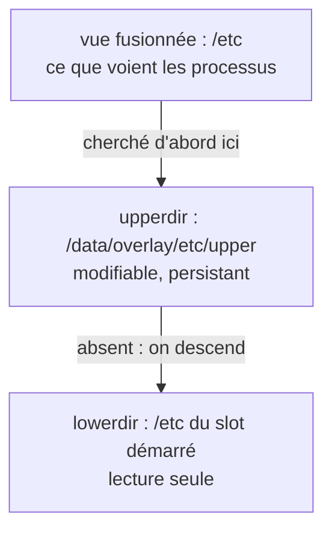

+++
title = "OverlayFS sur une racine en lecture seule : un /etc modifiable, et le piège des mises à jour"
description = "Comment OverlayFS donne à un système A/B un /etc modifiable au-dessus d'un slot en lecture seule, pourquoi il doit être monté avant systemd, et comment une couche supérieure persistante masque en silence les changements livrés par la mise à jour suivante."
tags = ["linux", "embedded", "ota", "overlayfs", "yocto"]
+++

L'[article sur les partitions A/B](/fr/posts/architecture/os/ota-update/ab-partitions/) défendait des
slots en lecture seule : tous les appareils en version X ont des fichiers système identiques au bit
près, et une mise à jour remplace un slot entier. Puis la réalité arrive. L'appareil a besoin de son
propre nom d'hôte, d'un `machine-id`, de clés d'hôte SSH, de profils Wi-Fi ou réseau, d'un fuseau
horaire. Tout cela vit par défaut dans `/etc`, et `/etc` est dans le slot en lecture seule.

La réponse habituelle est **OverlayFS** : une couche modifiable sur la partition de données, empilée
au-dessus du `/etc` en lecture seule. Ça fonctionne bien, avec un piège qui n'apparaît qu'après une
mise à jour. Cet article couvre les deux.

## Comment fonctionne OverlayFS

Un montage overlay fusionne des répertoires en une seule vue :

- **lowerdir** : la base en lecture seule, ici le `/etc` livré avec le slot ;
- **upperdir** : un répertoire modifiable, ici sur la partition de données ;
- **workdir** : un répertoire de travail vide sur le *même* système de fichiers que l'upper, utilisé en
  interne pour les opérations atomiques.



Les lectures cherchent d'abord dans l'upper puis retombent sur le lower. Le plus intéressant, ce sont
les écritures :

- **Copy-up** : la première fois qu'un fichier du lower est modifié, il est copié dans l'upper, et
  c'est désormais cette copie que tout le monde voit. Le fichier du lower n'est jamais touché.
- **Whiteouts** : supprimer un fichier du lower crée un *whiteout* dans l'upper (un périphérique
  caractère de numéro 0/0) qui le masque.
- **Répertoires opaques** : supprimer puis recréer un répertoire marque le nouveau comme opaque
  (xattr `trusted.overlay.opaque`), et plus rien du lower n'apparaît à travers.

```bash
mkdir -p /data/overlay/etc/upper /data/overlay/etc/work
mount -t overlay overlay \
  -o lowerdir=/etc,upperdir=/data/overlay/etc/upper,workdir=/data/overlay/etc/work /etc
```

Utiliser `/etc` à la fois comme lowerdir et comme point de montage fonctionne : le chemin est résolu
avant que l'overlay ne soit monté par-dessus. Après quelques modifications, l'upper est la liste exacte
des différences entre cet appareil et l'image :

```text
$ ls -la /data/overlay/etc/upper
-rw-r--r-- 1 root root   10 hostname           copié puis modifié
c--------- 1 root root 0, 0 motd               whiteout : supprimé dans /etc
drwxr-xr-x 2 root root 4096 NetworkManager     répertoire copié
```

Ce listing est aussi le meilleur outil de diagnostic qui soit (« qu'a-t-on changé sur ce robot ? »),
et vider l'upper revient à une réinitialisation d'usine de `/etc`.

## Le monter avant systemd

`/etc` est lu par le PID 1 lui-même : systemd lit `machine-id`, les fichiers d'unité, `fstab`. Un
overlay monté par une unité systemd classique ou par `fstab` arrive trop tard ; une partie de `/etc` a
déjà été lue depuis le lower. L'overlay de `/etc` doit exister avant le démarrage de systemd, soit dans
un initramfs, soit via un minuscule wrapper d'init qui monte la partition de données, prépare l'overlay,
puis fait `exec /sbin/init`.

Yocto fournit ce wrapper sous forme de fonctionnalité d'image :

```bitbake
IMAGE_FEATURES += "overlayfs-etc"
OVERLAYFS_ETC_MOUNT_POINT = "/data"
OVERLAYFS_ETC_DEVICE = "/dev/mmcblk0p4"
OVERLAYFS_ETC_FSTYPE = "ext4"
```

Les autres répertoires (les données modifiables d'une application sous `/usr/share`, par exemple)
n'ont pas cette contrainte et peuvent utiliser des unités de montage systemd ordinaires ; la classe
`overlayfs` les génère à partir de `OVERLAYFS_MOUNT_POINT` et `OVERLAYFS_WRITABLE_PATHS`.

## Le piège : la couche supérieure survit à la mise à jour

Voici comment ça déraille. La version 1 livre `/etc/ssh/sshd_config`. À un moment, sur l'appareil,
quelque chose le modifie : un technicien, un script de provisioning, le post-install d'un paquet.
OverlayFS le copie dans l'upper. La version 2 durcit `sshd_config` et s'installe dans l'autre slot.
L'appareil redémarre en version 2, l'overlay est remonté avec le `/etc` de la version 2 comme lower, et :

- le `/etc/ssh/sshd_config` fusionné est **toujours l'ancienne copie** de l'upper. Le changement de la
  version 2 est invisible, et rien ne le signale ;
- un **whiteout** créé sous la version 1 masque aussi le fichier que la version 2 livre au même chemin ;
- après un **retour arrière**, la version 1 voit ce que la version 2 a écrit dans l'upper, par exemple
  un fichier de configuration migré vers un nouveau format.

Rien de tout cela n'est un bug d'OverlayFS. Modifier le lower pendant que l'overlay n'est pas monté est
permis, et « l'upper l'emporte » est exactement le comportement documenté. Ça ne correspond simplement
pas à la promesse d'une mise à jour par image : que la version 2 signifie les fichiers de la version 2.

## Les solutions

**1. Garder l'ensemble modifiable petit et explicite.** Superposer tout `/etc` invite les copy-up
accidentels. Si seuls les profils réseau, le nom d'hôte et les clés SSH doivent changer, ne rendez
modifiables que ceux-là : superposez ou montez en bind les quelques répertoires concernés
(`OVERLAYFS_WRITABLE_PATHS` le fait sous Yocto), et gardez le reste de `/etc` comme pur produit de l'image.

**2. Un upper par slot, reconstruit à la mise à jour.** Choisissez l'upper selon le slot démarré, pour
que chaque slot ait le sien :

```sh
slot=$(sed -n 's/.*rauc\.slot=\([^ ]*\).*/\1/p' /proc/cmdline)
up=/data/overlay/etc/$slot
mkdir -p "$up/upper" "$up/work"
mount -t overlay overlay -o "lowerdir=/etc,upperdir=$up/upper,workdir=$up/work" /etc
```

Puis, quand une mise à jour est installée dans un slot, repartez d'un upper vide pour ce slot et
copiez-y une liste explicite depuis celui qui tourne. Avec RAUC, cela tient dans un hook de slot
([article sur RAUC](/fr/posts/architecture/os/ota-update/rauc/)) :

```ini
[hooks]
filename=hook.sh

[image.rootfs]
filename=rootfs.ext4
hooks=post-install
```

```sh
#!/bin/sh
# hook.sh : reconstruire l'overlay /etc du slot cible après l'écriture de son image
[ "$1" = "slot-post-install" ] || exit 0
[ "$RAUC_SLOT_CLASS" = "rootfs" ] || exit 0

cur=/data/overlay/etc/$(sed -n 's/.*rauc\.slot=\([^ ]*\).*/\1/p' /proc/cmdline)
new=/data/overlay/etc/$RAUC_SLOT_BOOTNAME
rm -rf "$new" && mkdir -p "$new/upper" "$new/work"

# Ne reporter que ce qui doit survivre à une mise à jour.
for f in machine-id hostname \
         ssh/ssh_host_ed25519_key ssh/ssh_host_ed25519_key.pub \
         NetworkManager/system-connections; do
    [ -e "$cur/upper/$f" ] || continue
    mkdir -p "$new/upper/$(dirname "$f")"
    cp -a "$cur/upper/$f" "$new/upper/$f"
done
```

Tout ce qui n'est pas dans la liste disparaît : la version 2 tourne vraiment avec le `/etc` de la
version 2. Et un retour arrière démarre l'ancien slot avec son propre upper, intact.

**3. Sortir l'état de `/etc`.** Le meilleur fichier modifiable est celui qui n'est pas dans `/etc`. Beaucoup
de services peuvent placer leur état modifiable dans `/var` ou `/data`, la configuration peut être
séparée en une base livrée plus un répertoire de drop-in sur la partition de données, et les fichiers
générés à l'exécution ont leur place dans `/run`. Moins l'overlay transporte de fichiers, plus la liste
et le piège sont petits.

## Overlays volatils

Tout ne doit pas persister. Un overlay dont l'upper est sur `tmpfs` donne un répertoire modifiable à
l'exécution et réinitialisé à chaque démarrage, pratique pour un logiciel qui tient à écrire à côté de
ses fichiers sans qu'on veuille jamais garder ces changements. Même montage, avec les répertoires upper
et work sous `/run`.

## Petits caractères

- Le workdir doit être vide et sur le même système de fichiers que l'upper, et ce système de fichiers
  doit gérer les attributs étendus (ext4 oui, vfat non).
- Le copy-up copie le **fichier entier** à la première écriture : ajouter une ligne à un fichier de
  200 Mo en copie 200 Mo. Gardez les gros fichiers souvent écrits hors des overlays.
- Ne modifiez jamais le répertoire lower pendant que l'overlay est monté ; le résultat est indéfini.
  Dans un système A/B c'est naturellement le cas : le lower est le slot démarré, en lecture seule.
- Le noyau a besoin de `CONFIG_OVERLAY_FS`, et `findmnt /etc` montre ce qui est réellement monté :
  c'est la première chose à vérifier quand un réglage « ne tient pas ».
