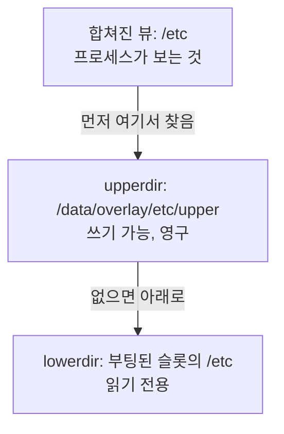

+++
title = "읽기 전용 루트 위의 OverlayFS: 쓸 수 있는 /etc와 업데이트 함정"
description = "OverlayFS로 A/B 시스템의 읽기 전용 슬롯 위에 쓸 수 있는 /etc를 얹는 방법, systemd보다 먼저 마운트해야 하는 이유, 그리고 영구 upper 레이어가 다음 업데이트의 변경을 조용히 가려 버리는 문제."
tags = ["linux", "embedded", "ota", "overlayfs", "yocto"]
+++

[A/B 파티션 글](/ko/posts/architecture/os/ota-update/ab-partitions/)에서는 슬롯을 읽기 전용으로
두자고 했습니다. 버전 X를 돌리는 모든 장비의 시스템 파일이 비트 단위로 같아지고, 업데이트는 슬롯을
통째로 바꾸면 되기 때문입니다. 그런데 현실은 다릅니다. 장비마다 고유한 호스트 이름, `machine-id`,
SSH 호스트 키, Wi-Fi나 네트워크 프로필, 타임존이 필요합니다. 이것들은 기본적으로 전부 `/etc`에 있고,
`/etc`는 읽기 전용 슬롯 안에 있습니다.

흔히 쓰는 해법이 OverlayFS입니다. 데이터 파티션에 있는 쓰기 가능한 레이어를 읽기 전용 `/etc` 위에
겹쳐 올리는 방식입니다. 잘 동작하지만, 업데이트를 하고 나서야 드러나는 함정이 하나 있습니다. 이 글은
둘 다 다룹니다.

## OverlayFS의 동작 방식

overlay 마운트는 여러 디렉터리를 하나의 뷰로 합칩니다.

- lowerdir: 읽기 전용 바탕. 여기서는 슬롯과 함께 배포된 `/etc`입니다.
- upperdir: 쓰기 가능한 디렉터리. 여기서는 데이터 파티션에 있습니다.
- workdir: upper와 같은 파일시스템에 있는 빈 작업 디렉터리로, 원자적 연산에 내부적으로 쓰입니다.



읽기는 upper를 먼저 보고 없으면 lower로 내려갑니다. 흥미로운 건 쓰기입니다.

- copy-up: lower에 있는 파일을 처음 수정하는 순간 그 파일이 upper로 복사되고, 그때부터는 upper의
  사본을 모두가 보게 됩니다. lower 파일은 절대 바뀌지 않습니다.
- whiteout: lower에 있는 파일을 지우면 upper에 whiteout(장치 번호 0/0인 문자 장치)이 생겨서 그
  파일을 가립니다.
- opaque 디렉터리: 디렉터리를 지웠다가 다시 만들면 새 디렉터리가 opaque로 표시되어
  (`trusted.overlay.opaque` xattr) lower의 내용이 더 이상 비쳐 보이지 않습니다.

```bash
mkdir -p /data/overlay/etc/upper /data/overlay/etc/work
mount -t overlay overlay \
  -o lowerdir=/etc,upperdir=/data/overlay/etc/upper,workdir=/data/overlay/etc/work /etc
```

`/etc`를 lowerdir이자 마운트 지점으로 동시에 써도 됩니다. 경로는 overlay가 그 위에 마운트되기 전에
해석되기 때문입니다. 몇 가지를 바꾸고 나면 upper는 이 장비가 이미지와 어떻게 다른지를 정확히 보여
주는 목록이 됩니다.

```text
$ ls -la /data/overlay/etc/upper
-rw-r--r-- 1 root root   10 hostname           copied up, edited
c--------- 1 root root 0, 0 motd               whiteout: deleted in /etc
drwxr-xr-x 2 root root 4096 NetworkManager     copied-up directory
```

이 목록은 최고의 디버깅 도구이기도 합니다("이 로봇에서 우리가 뭘 바꿨지?"). 그리고 upper를 지우면
`/etc`를 공장 초기화하는 셈입니다.

## systemd보다 먼저 마운트하기

`/etc`는 PID 1이 직접 읽습니다. systemd는 `machine-id`, 유닛 파일, `fstab`을 읽습니다. 일반
systemd 유닛이나 `fstab`으로 마운트한 overlay는 너무 늦게 붙습니다. 그 전에 이미 `/etc`의 일부를
lower에서 읽어 버렸기 때문입니다. `/etc` overlay는 systemd가 시작하기 전에 있어야 합니다. initramfs에서
하거나, 데이터 파티션을 마운트하고 overlay를 구성한 뒤 `/sbin/init`을 `exec`하는 작은 init 래퍼를
씁니다.

Yocto는 이 래퍼를 이미지 기능으로 제공합니다.

```bitbake
IMAGE_FEATURES += "overlayfs-etc"
OVERLAYFS_ETC_MOUNT_POINT = "/data"
OVERLAYFS_ETC_DEVICE = "/dev/mmcblk0p4"
OVERLAYFS_ETC_FSTYPE = "ext4"
```

다른 디렉터리(예를 들어 `/usr/share` 아래 애플리케이션의 쓰기 데이터)는 이런 제약이 없어서 평범한
systemd 마운트 유닛으로 충분합니다. `overlayfs` 클래스가 `OVERLAYFS_MOUNT_POINT`와
`OVERLAYFS_WRITABLE_PATHS`로부터 유닛을 만들어 줍니다.

## 함정: upper 레이어는 업데이트를 넘어 살아남는다

문제는 이렇게 일어납니다. 버전 1이 `/etc/ssh/sshd_config`를 배포합니다. 어느 시점에 장비 위에서
무언가가 그 파일을 고칩니다. 기술자일 수도, 프로비저닝 스크립트일 수도, 패키지 post-install일 수도
있습니다. OverlayFS는 그 파일을 upper로 복사합니다. 버전 2는 `sshd_config`를 강화해서 다른 슬롯에
설치됩니다. 장비가 버전 2로 재부팅하면 overlay가 버전 2의 `/etc`를 lower로 해서 다시 마운트되고, 그러면:

- 합쳐진 뷰의 `/etc/ssh/sshd_config`는 여전히 upper에 있는 옛 사본입니다. 버전 2의 변경은 보이지 않고,
  아무도 알려 주지 않습니다.
- 버전 1 시절에 생긴 whiteout은 버전 2가 같은 경로에 배포한 파일까지 가립니다.
- 롤백하면 버전 1이 버전 2가 upper에 써 둔 것(예를 들어 새 형식으로 마이그레이션된 설정 파일)을 보게
  됩니다.

이 중 어느 것도 OverlayFS의 버그가 아닙니다. overlay가 마운트되지 않은 동안 lower를 바꾸는 건 허용되고,
"upper가 이긴다"는 문서에 적힌 그대로의 동작입니다. 다만 이미지 기반 업데이트가 약속하는 것, 즉 버전
2라면 버전 2의 파일이 쓰인다는 약속과 맞지 않을 뿐입니다.

## 해결 방법

1. 쓰기 가능한 범위를 작고 명시적으로 유지하기. `/etc` 전체를 overlay로 덮으면 의도치 않은 copy-up을
   부르게 됩니다. 네트워크 프로필, 호스트 이름, SSH 키만 바뀌면 된다면 그것들만 쓰기 가능하게 하세요.
   필요한 몇몇 디렉터리만 overlay나 bind 마운트로 열고(Yocto에서는 `OVERLAYFS_WRITABLE_PATHS`가 이
   일을 합니다), 나머지 `/etc`는 순수하게 이미지에서 온 그대로 둡니다.

2. 슬롯마다 upper를 따로 두고 업데이트 때 새로 만들기. 부팅된 슬롯에 따라 upper를 골라서 슬롯마다
   자기 upper를 갖게 합니다.

```sh
slot=$(sed -n 's/.*rauc\.slot=\([^ ]*\).*/\1/p' /proc/cmdline)
up=/data/overlay/etc/$slot
mkdir -p "$up/upper" "$up/work"
mount -t overlay overlay -o "lowerdir=/etc,upperdir=$up/upper,workdir=$up/work" /etc
```

그리고 어떤 슬롯에 업데이트를 설치할 때, 그 슬롯의 upper를 비우고 지금 돌고 있는 upper에서 정해진
목록만 복사해 옵니다. RAUC라면 슬롯 훅 하나로 됩니다([RAUC 글](/ko/posts/architecture/os/ota-update/rauc/)).

```ini
[hooks]
filename=hook.sh

[image.rootfs]
filename=rootfs.ext4
hooks=post-install
```

```sh
#!/bin/sh
# hook.sh: rebuild the target slot's /etc overlay after its image is written
[ "$1" = "slot-post-install" ] || exit 0
[ "$RAUC_SLOT_CLASS" = "rootfs" ] || exit 0

cur=/data/overlay/etc/$(sed -n 's/.*rauc\.slot=\([^ ]*\).*/\1/p' /proc/cmdline)
new=/data/overlay/etc/$RAUC_SLOT_BOOTNAME
rm -rf "$new" && mkdir -p "$new/upper" "$new/work"

# Carry over only what must survive an update.
for f in machine-id hostname \
         ssh/ssh_host_ed25519_key ssh/ssh_host_ed25519_key.pub \
         NetworkManager/system-connections; do
    [ -e "$cur/upper/$f" ] || continue
    mkdir -p "$new/upper/$(dirname "$f")"
    cp -a "$cur/upper/$f" "$new/upper/$f"
done
```

목록에 없는 건 모두 버려지므로, 버전 2는 정말로 버전 2의 `/etc`로 돕니다. 롤백하면 옛 슬롯이 손대지
않은 자기 upper와 함께 부팅합니다.

3. 상태를 `/etc` 밖으로 옮기기. 가장 좋은 쓰기 파일은 애초에 `/etc`에 없는 파일입니다. 많은 서비스는
   바뀌는 상태를 `/var`나 `/data`에 두도록 설정할 수 있고, 설정은 배포되는 기본 파일과 데이터
   파티션의 drop-in 디렉터리로 나눌 수 있으며, 실행 중에 생성되는 파일은 `/run`에 두면 됩니다.
   overlay가 실어 나르는 파일이 적을수록 목록도, 함정도 작아집니다.

## 휘발성 overlay

모든 것이 남아야 하는 건 아닙니다. upper를 `tmpfs`에 두면 실행 중에는 쓸 수 있고 부팅할 때마다
초기화되는 디렉터리가 됩니다. 자기 파일 옆에 꼭 뭔가를 쓰려고 하지만 그 변경을 남기고 싶지는 않은
소프트웨어에 유용합니다. 마운트는 같고, upper와 work 디렉터리만 `/run` 아래에 둡니다.

## 알아 둘 점

- workdir은 비어 있어야 하고 upper와 같은 파일시스템에 있어야 하며, 그 파일시스템은 확장 속성(xattr)을
  지원해야 합니다(ext4는 되고 vfat은 안 됩니다).
- copy-up은 첫 쓰기 때 파일 전체를 복사합니다. 200MB 파일에 한 줄을 덧붙이면 200MB가 복사됩니다. 크고
  자주 쓰이는 파일은 overlay 밖에 두세요.
- overlay가 마운트된 동안 lower 디렉터리를 절대 수정하지 마세요. 결과가 정의되어 있지 않습니다. A/B
  시스템에서는 자연스럽게 지켜집니다. lower가 부팅된 읽기 전용 슬롯이기 때문입니다.
- 커널에는 `CONFIG_OVERLAY_FS`가 필요하고, `findmnt /etc`로 실제로 무엇이 마운트되어 있는지 볼 수
  있습니다. 설정이 "적용이 안 될 때" 가장 먼저 확인할 것입니다.

OverlayFS는 읽기 전용 시스템에 쓸 수 있는 구석 몇 군데를 마련해 주는 데 딱 맞는 도구입니다. 미리
설계해 둬야 하는 건, 그 아래의 시스템이 바뀔 때 그 구석들이 어떻게 되느냐입니다. 기본값은 "그 구석들이
이긴다"이기 때문입니다.
